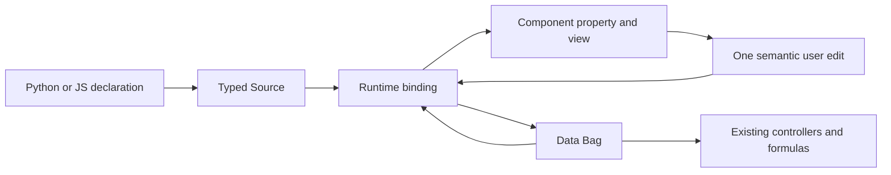

# 205 · General components and provisional replacements

Document ID: **GC-205**. Status: **analysis complete; JS description ownership and shared labelbox contract approved; remaining input decisions open**.

**Current planning:** [GC-245 · Component 0.3 plan](245-components-0-3-plan.md) includes callbackSelect, the random example and legacy-derived radio design. See [§095](#gc-205-095).

[Concise counterpart](../../docs_llm/future/205-components.md).

Read §§020–040 for evidence, §§045–060 for the proposed contract and pilots,
and §065 for decisions. Description ownership is approved in §075; concrete component APIs remain open.

<a id="gc-205-005"></a>
## 005 · Retained direction and next decisions

Block ID: **GC-205-005**.

**Goal:** settle the final definition of Gramlot components, then scope the
input collection (owner item 2.1) and integration of layout components such as
border and tabs (2.2). Provisional inspector replacements are one consumer of
that wider workstream, not its whole scope. The owner distinguished
the dedicated `gramlot-tools-inspector` from the future general component series
and accepted isolated provisional `gramlot-poc-*` components.

**Existing evidence:** [GC-040](../internal/040-js-owned-components.md) records a
JS-owned component/collection experiment, explicitly proposed rather than an
accepted API. [GC-195](../internal/195-tools-inspector.md) and
[PORT-0006](../../ports/PORT-0006-inspector-components/README.md) describe the
bounded inspector work. `webcomponent(code=...)` and that specific port do not
approve a general component registry, object-property binding system or wholesale
PoC transfer. Older port checkpoint statements must be reconciled with current
release evidence before assigning remaining work.

**Before implementation:** choose one component and its consumer, inventory the
legacy/PoC behavior, confirm the public parameters, events, Data integration,
lifecycle and ownership, and determine how the provisional implementation will be
replaced. No component priority, replacement schedule or new release number is
assigned by this backlog. Follow the [port protocol](../../ports/README.md).

**Dependencies and parallelism:** independently bounded components can be reviewed
in parallel after their common contracts are settled. Shared renderer, grammar,
registration or binding work must be coordinated; separate worktrees alone do not
make conflicting contracts independent. The editorial website use case must not
silently require completion of an entire component framework.

**Proposed completion evidence:** one approved port with meaningful interaction,
Data, lifecycle and browser checks, Python authoring where in scope, updated paired
documentation, and explicit disposition of removed provisional responsibilities.
This card adds no runtime implementation or new test suite; reruns of existing
tests are reported in §070.


<a id="gc-205-010"></a>
## 010 · Owner workstream inventory, 2026-10-15

Block ID: **GC-205-010**.

The owner lists final component definition as item 2, the input collection as
2.1, and layout integration (border/tab, etc.) as 2.2. This grouping is retained
without selecting priorities or an implementation phase. Store-based tree/grid
widgets are a separate item 5, to compare with components and stores when deciding
contracts and opportunities for parallel work. The earlier single-port completion
criteria do not establish completion of this entire workstream.

<a id="gc-205-015"></a>
## 015 · Research authorization and evidence snapshot

Owner request, 2026-10-15: “ok procedi con l'analisi di legacy e poc e prepara
il documento sul contratto dei componenti, poi decidiamo le API”. This authorizes
this analysis and proposal, not a runtime port, new public names, a base hierarchy,
Builder changes, a release number or publication. The following sections distinguish
**observed implementation**, **existing accepted constraints**, and **recommendation**.
The earlier sections remain the workstream inventory; this research is now complete
and awaits owner review.

Read-only source snapshots:

| Reference | Repository/revision | Files and entry points inspected |
| --- | --- | --- |
| L1 | GenroPy `fa35e5adfa6ad1b269f3a22a9b12c4c1ee6513ea` | `gnrpy/gnr/web/gnrwebstruct/base.py`: `struct_method`, `GnrDomSrc.__getattr__`, `child`, `formbuilder`; `gnrbaseclasses.py`: `BaseComponent` |
| L2 | Same legacy revision | `gnrjs/gnr_d11/js/genro_wdg.js`: `GnrWdgHandler`, `getHandler`, `create`, `linkSourceNode`, mixin/patch installation |
| L3 | Same legacy revision | `genro_widgets.js`: `baseHtml`, `baseDojo`, `StackContainer`, `TabContainer`; `gnrdomsource.js`: `build`, `registerNodeDynAttr`, `doUpdateAttrBuiltObj`, subscription reset; `genro_src.js`: deletion/cleanup |
| L4 | Same legacy revision | `projects/gnrcore/packages/test/webpages/inputfields/textbox.py` and `layout/tabcontainer.py`: actual Python authoring |
| P1 | PoC `10478b57ce3f22e6445eb6b72eba343520cbebac` | `js/dom/src/components/bases.js`, `registry.js`, `builtin-components.json`; `collections.js`, `builder-base.js` |
| P2 | Same PoC revision | `js/dom/src/collections/inputs.js`, `layout.js`; `contrib/html/html-builder.js`; `application.js`; `forms/field.js`; `renderer/base.js` |
| P3 | Same PoC revision | `scripts/generate_components.py`; `js/dom/tests/component-alpha.test.js`; typed-component architecture assessment dated 2026-09-11 |
| C1 | Core `c3753e25500e8b551a18650567ae612e1fadd1ed` | `src/gramlot/page/builder.py`, `js/src/builder/gramlot-builder.js`, `js/src/renderer/gramlot-html-renderer.js`, `gramlot-renderer.js`, `js/src/view/controls.js`, `js/src/webcomponent.js` |
| C2 | Same core revision | `js/tests/collections.test.js`, `native-controls.test.js`, `webcomponent.test.js`; `tools/poc/README.md`; constitution 11.14, 11.62 and 11.75 |

The inspected legacy and PoC implementation files have no local modifications.
Revision-pinned entry points:
[legacy authoring](https://github.com/genropy/genropy/blob/fa35e5adfa6ad1b269f3a22a9b12c4c1ee6513ea/gnrpy/gnr/web/gnrwebstruct/base.py),
[legacy factory](https://github.com/genropy/genropy/blob/fa35e5adfa6ad1b269f3a22a9b12c4c1ee6513ea/gnrjs/gnr_d11/js/genro_wdg.js),
[legacy adapters](https://github.com/genropy/genropy/blob/fa35e5adfa6ad1b269f3a22a9b12c4c1ee6513ea/gnrjs/gnr_d11/js/genro_widgets.js),
[PoC bases](https://github.com/gramlot-org/gramlot-poc/blob/10478b57ce3f22e6445eb6b72eba343520cbebac/js/dom/src/components/bases.js),
[PoC renderer](https://github.com/gramlot-org/gramlot-poc/blob/10478b57ce3f22e6445eb6b72eba343520cbebac/js/dom/src/contrib/html/html-builder.js),
[core controls](https://github.com/gramlot-org/gramlot/blob/c3753e25500e8b551a18650567ae612e1fadd1ed/js/src/view/controls.js).
Symbols and repository-relative paths above identify the other evidence without
assuming that current upstream line numbers remain stable.

This is a focused analysis of authoring, input, layout, registration and lifecycle,
not an exhaustive audit of every legacy widget or every PoC collection. Store,
form and validation code is inspected to identify boundaries, not to approve ports.

<a id="gc-205-020"></a>
## 020 · Three meanings that must remain distinct

The constitution already distinguishes component, recipe, controller, service and
mixin. The historical vocabulary does not consistently do so.

| Mechanism | Observed responsibility | Implication for the new contract |
| --- | --- | --- |
| Legacy browser widget/handler | A native HTML element, a Dijit object, or an external widget, connected to its Source node | Preserve declarative use and Data interaction; Dojo object shape is not the contract |
| Legacy Python `BaseComponent`, `py_requires`, `struct_method` | Mix page capabilities/resources and expose Python methods that build Source | Reusable authoring/composition is a separate concern from browser control implementation |
| PoC custom element collection | Browser implementation plus description/grammar, selected for a page | Useful component evidence, but activation and metadata policies still need review |
| PoC `_meta.component` expansion | Invoke a page method at rendering, optionally once per Bag row, create temporary Source expansion and row logic | This is a separate composition/recipe mechanism; it is not required to declare a custom element |
| Current `button` versus `html_button` | Distinct Source declarations both rendered as HTML `button`; only the former adds Gramlot command behavior | A behavioral control does not automatically require a Web Component |
| Current `webcomponent(code=...)` | Declare a literal custom-element tag whose module is loaded explicitly | Existing escape hatch; it does not establish a catalogue or generic property binding |

**Recommendation:** define a Gramlot component by its observable contract and its
integration with Source/Data. Decide separately which implementations need Custom
Elements and Shadow DOM. Do not promote PoC recipe expansion or a universal base
hierarchy merely to make the first input available.

<a id="gc-205-025"></a>
## 025 · Legacy: declaration, construction and composition

**Observed (L1–L4).** Python `GnrDomSrc.__getattr__` resolves registered tag names,
registered structure methods, and other legacy conveniences. Its `child` method
creates declarative Source; Python does not instantiate a Dijit widget. For example,
the inspected legacy pages contain:

```python
# Legacy evidence, not a proposed Gramlot API.
fb.textBox(value='^.test', lbl='Type text', validate_regex=' ^[AB]*$')
tc = pane.tabContainer(selectedPage='^.pippo', selected='^.pluto', height='300px')
tc.contentPane(title='Alfio', closable=True, pageName='alfio')
```

`BaseComponent` mixes Python page functionality and accumulates JS/CSS requirements.
`struct_method` associates an authoring name with a page implementation method;
calling it passes the current Source pane. A formbuilder can therefore contribute
labels and layout without being one browser widget. This is why porting every
Python “component” as a custom element would change the architecture.

On the client, the Source node resolves dynamic declarations, registers context and
form participation, and calls the widget factory. The factory chooses an HTML or
Dojo handler, runs creation hooks, creates/links the browser object, inserts it into
the parent's DOM or widget container, and runs post-creation hooks. Source retains
`widget` or `domNode`; the created object receives `sourceNode` and its handler.

The adapter system installs `mixin_`, `patch_`, version patches, node mixins and
validation mixins. They solved integration problems in Dojo, but also couple method
availability and lifecycle to convention-driven runtime modification.

**Recommendation:** retain declarative construction, context and parent/child
ownership; replace patch conventions with explicit, bounded integration contracts.
Do not import legacy tag case aliases, implicit override policies, Dojo startup or
Python page mixin machinery as prerequisites for browser components.

<a id="gc-205-030"></a>
## 030 · Legacy: binding, editing, layout and teardown

**Observed (L2–L4).** The two directions have different responsibilities:

1. **Data → view:** `registerNodeDynAttr` registers `^` dependencies and resolves
   initial attributes. `updateAttrBuiltObj` dispatches changed attributes to browser
   behavior. It handles special properties and external-widget setters; the external
   widget branch rebuilds when its corresponding `gnr_<attribute>` method is absent.
   These permissive conventions are evidence, not an approved Gramlot fallback.
2. **View → Data:** an adapter reads a candidate and calls its change/write pipeline.
   `baseDojo._doChangeInData` guards recursive writes and lost Source nodes, applies
   blank-to-null unless `blankIsNull` is false, handles validation and then writes
   through `setValueInData`. The latter resolves the bound path, can attach display
   metadata, writes the Bag with the Source as reason and publishes `onSetValueInData`.
3. **Controllers:** they observe the same Data or receive Source/topic publications.
   A control need not create another controller runtime. See
   [GC-196](../internal/196-legacy-publish-subscribe.md) for the detailed message path.

Validation is not merely a red border: the legacy pipeline includes transformations,
errors/warnings, form-handler interaction and `rejectInvalid`. Those behaviors need
separate decisions; neither blank-to-null nor error retention should silently replace
the current native-control contract.

For layouts, `StackContainer` connects child addition/removal and show/hide behavior,
indexes children by `pageName`, and exposes selection by position (`selected`) or
name (`selectedPage`). `onShowHideChild` writes the corresponding bound values and
publishes a `selected` payload identifying page and show/hide. The legacy example
binds both at once. Closing a page removes its Source node; deleting the final page
clears selection through the removal path. `TabContainer` builds on this mechanism.
The numeric position, stable page name, visible page and child lifetime are distinct.

Deletion is not just removing an HTML element: `genro_src._trigger_del` calls
Source deletion hooks, informs parent widgets, destroys widget/external/DOM content,
then cleans node and descendant subscriptions and node-ID registration. The lost-node
guard prevents a late widget event from writing into a now-unrelated Data path.

**Recommendation:** preserve these ownership questions and the familiar declaration
model. Specify ordering, disposal and invalid-selection behavior explicitly instead
of copying delayed callbacks, reflective setters and Dojo lifecycle assumptions.

<a id="gc-205-035"></a>
## 035 · PoC: useful mechanisms and limits

**Observed (P1–P3).** There are two metadata directions, not one finished system:

- The checked-in `builtin-components.json` catalogue generates JS descriptions and
  Python declaration classes through `scripts/generate_components.py`. Generated
  Python methods use `**kwargs`; descriptions are not proof of complete runtime
  type checking, signatures or editor support.
- [GC-040](../internal/040-js-owned-components.md) records a later experiment where
  JS-owned descriptions export JSON for a generic Python loader. Its local worktree
  `/private/tmp/gramlot-js-component-manifest` is no longer present at the recorded
  path. The historical test result remains evidence recorded at that time; it was
  **not reproduced in this investigation**, and the experiment is not in the pinned
  PoC commit. Recover or recreate a bounded probe before relying on it for delivery.

The checked-in registry validates component names and custom tags, rejects duplicate
collection names and duplicate entries within a collection, and attaches descriptions
to implementations. The lower-level collection registry and builder resolution have
different policies: the latter merges selected grammar entries in order, with later
entries winning. These checks do not establish a single global collision policy.
Custom-element registration and collection descriptions are also different scopes;
per-page grammar isolation does not imply multiple implementations of the same DOM
tag can coexist within one window.

`getComponentBases` caches bases per `HTMLElement` constructor. `GramlotElement`
guards repeated connection and releases registered connection disposers in reverse
order. `ControlElement` composes decoration and field-state presentation, creates an
inner native input in an open shadow root, exposes a typed `value` property and
bridges `change` to a composed bubbling event. Native `input` crosses the shadow
boundary; blindly re-emitting it would risk duplicate commits. Decoration and field
state are separate helpers, which is valuable evidence for narrow capabilities.

The actual editing path is larger than the base class: delegated `Application`
listeners identify bound hosts and call the form service; `FormField` tracks candidate,
stored value, validation generation, pending work and disposal. The renderer projects
metadata-declared properties, hands stores to special widgets, and contains explicit
branches for grid/chart/select and layout integration. Copying only the custom-element
class would therefore omit required behavior; copying the whole path would import
form/store/application responsibilities outside this task.

**Important qualification about focus:** `ControlElement.attributeChangedCallback`
protects the focused draft from a `value` *attribute* update, and the alpha test proves
that narrow case. The PoC renderer also assigns `el.value` directly for null-aware
controls; its value setter does not have the same focus guard. FormField adds its own
draft policy. There is no basis for claiming that every PoC update universally protects
focus. These paths must be reconciled before choosing a new editing contract.

The PoC tabs use shadow markup and slotted children, a MutationObserver for child
changes, and `gnr-set` events carrying a pointer and value to the runtime. They
support `value`, positional `selected` and named `selectedPage`, including implicit
selection repair. Their coexistence is historical evidence, not approval to add
three interchangeable selection representations to Gramlot.

<a id="gc-205-040"></a>
## 040 · Current Gramlot: reuse and gaps

**Observed and already bounded (C1–C2).** Gramlot has portable grammar collection
loading in Python and JS, SourceBag/SourceBagNode, typed transport, Data path
resolution, live projection, native input adapters, named Logic, controllers,
subscriptions and local Source/DOM references. These are the starting point.

Current examples of supported declarations are:

```python
pane.input(value='^.name', live=True)
pane.webcomponent(code='gramlot-poc-tree')
```

The first has native-control binding. The second renders the declared custom tag
and supports ordinary Source projection/events; it does **not** acquire the native
input adapter just because the custom element exposes `value`. Inspector Logic
currently assigns its Bag to `storeBag` explicitly, under constitution 11.62.

| Concern | Current core | Gap for general components |
| --- | --- | --- |
| Authoring grammar | `load_collection` / `loadCollection`; portable signatures and child rules | Package description/export and activation agreement |
| Browser construction | HTML/SVG rendering and explicit `webcomponent(code=...)` | General component integration lifecycle and readiness |
| Data projection | Source-context pointers, values and attribute projection | Declared typed property channels, including Bag identity and replacement |
| User edits | `ControlAdapter` selected for native input/select/textarea | Component edit reporting and one runtime-owned commit path |
| Lifecycle | Node binding cleanup, references, branch freeze/unfreeze, disposal | Component connect/disconnect versus Source removal, reconnect and late work |
| Commands/events | Named Logic, `connect_on...`, local bus and postMessage frame boundary | Which component events/methods are public and their payload/order |
| Styling | Existing themes; bounded inspector CSS contract | General host/inner-control/layout theme and accessibility contract |
| Forms/stores | No general component form/store contract established here | Keep service ports separate from visual controls |

Current native editing suppresses an equal echo only while committing, lets a
controller's different correction reach the input, and defers projection during
IME composition. Text preserves an empty string. These differ from legacy null
normalization and from parts of PoC draft handling. Preserve native behavior; a new
component policy must be explicit and tested, not inherited accidentally.

**Pre-existing documentation divergence:** constitution 11.14 describes additive
collection composition preserving omitted/null fields and merging named attributes.
The later [GC-210 §090](../internal/210-binding-contract.md#gc-210-090), explicitly
recorded as owner decisions of 2026-09-30, specifies whole replacement of named
elements/abstracts (ASTRA-03), while grammar metadata merges. Current Python/JS
collection tests implement that later rule and pass. Thus this is not an unexplained
runtime change: the later contract record exists, but the earlier constitutional
wording has not been reconciled with it. Preserve the evidence and resolve that
textual lineage when documenting collection extension; do not silently change Builder
or impose the PoC experiment's blanket collision rejection. This analysis changes
neither policy nor constitution.

<a id="gc-205-045"></a>
## 045 · Proposed responsibility contract, before API spelling

The table is a **recommendation for owner review**, not an implemented interface.
Names describe responsibilities; they are not proposed classes or method names.

| Owner | Proposed responsibility | Must not duplicate |
| --- | --- | --- |
| Collection description/export | Declare control names, types, values, events, child constraints, assets and implementation association | The Builder grammar/type engine or a second manually maintained Python catalogue |
| Python/JS authoring | Validate declarations and produce equivalent typed Source | Browser construction or execution on the server |
| Runtime binding integration | Resolve pointers, project typed values, accept one edit, own subscriptions and release them | Component-internal pointer parsers or a second Data root |
| Component implementation | Own inner UI, transient edit draft, focus, accessibility and semantic user events | Page-level controller, RPC, form or store policy |
| Source/renderer | Own declared children, identity, order and removal | Component-managed copies of the application Source tree |
| Shared services | Validation, formatting, storage or requests when separately contracted | Ad hoc service code repeated in each component |
| Themes | Shared visual tokens and documented styling surfaces | Hardcoded density and sizing repeated across controls |

A component may need local transient state (caret, popup, uncommitted draft).
That is not a second application Data model. Define who can commit it and what
happens when Data changes externally, rather than forbidding necessary editor state.

Recommended edit flow:



Projection should not itself emit a user edit. A component reports a value/change;
the integration resolves the declared destination. Whether general components need
additional channels for selection, checked state or commands is a decision, not a
reason to let each component write arbitrary page paths. A genuine Bag-valued input
needs a contract for replacement, mutation observation and ownership; it must not
be implicitly JSON-stringified into an HTML attribute.

<a id="gc-205-050"></a>
## 050 · Questions every component description must answer

The following is a semantic checklist, **not a new JSON schema**:

| Area | Information needed before implementing the first component |
| --- | --- |
| Identity | Authoring name in both languages, DOM tag if any, collection identity, implementation module |
| Parameters | Type, required/default behavior, omission versus null, pointer acceptance, updateable versus construction-only |
| Projection | Attribute versus JS property; boolean presence versus false; typed objects; removal/reset behavior |
| Values | Domain type, empty/null semantics, model value versus display text and draft; no implicit Decimal/Date narrowing |
| Editing | Commit trigger, live behavior, IME, correction/echo handling, disabled/readonly behavior, invalid draft policy |
| Events | Name, payload, bubbling/composition, cancelability, order relative to Data writes and programmatic updates |
| Methods/references | Public operations, invocation context and lifetime; whether existing Source/DOM references suffice |
| Children | Allowed child declarations, ownership, placement/slots, insertion/removal/reordering and nested contexts |
| Lifecycle | Initialization/readiness, projection, connection, reconnect, removal, cancellation and final disposal |
| Presentation | Label/accessibility name, keyboard focus, errors, compact/default density, light/dark and browser differences |
| Packaging | Description and runtime in matching artifacts, trusted JS loading, dependencies, CSS/assets and host delivery |
| Failures | Unknown component, invalid type, missing implementation, unsupported capability and partial initialization cleanup |

Do not invent new validators in Gramlot for capabilities already owned by Builders.
If a required description cannot be expressed there, record the precise missing
capability for owner review in that project. No generic Builder extension is
requested merely to complete this checklist.

Before activation, distinguish importing descriptions without a DOM from registering
implementations in a browser realm. A Python-only server must be able to consume
shipped metadata without executing Node. Browser-only serverless authoring must
consume the same contract, without importing DOM implementation code into its Worker.
The collection description discussed here is **not** the root page's installable-app
web manifest; they have different consumers and responsibilities.

Naming is deferred to [GC-225](../internal/225-naming-and-proxy-conventions.md).
Legacy `textBox`, PoC `gnr-textbox`, `wc_requires`, `gnr-set`, and experiment names
are evidence, not approved final spelling or compatibility aliases.

<a id="gc-205-055"></a>
## 055 · Lifecycle and interaction cases to settle

**Recommendation:** describe lifecycle by behavior before choosing callbacks or
inheritance. These cases are not interchangeable:

- Constructing an instance, receiving typed properties and attaching it to a DOM.
  Decide when the component is ready and when child Source can be mounted.
- Receiving new Data or dynamic Source attributes: update without recreating the
  control where supported; define which shape changes require reconstruction.
- Moving/reconnecting a DOM instance: connection resources must be released and
  restored without duplicating listeners or losing surviving view state.
- Hiding a tab/palette: hidden content is not automatically destroyed. Specify
  focus transfer and whether inactive content is eagerly mounted or deferred.
- Removing Source, including under freeze: existing logical disposal cannot wait
  for physical DOM removal. Late edits, timers and async validation results must
  not write into deleted or rebound paths.
- Final page disposal or failed initialization: subscriptions, observers, external
  listeners and pending tasks must have an owner and a deterministic release path.

Shadow DOM is an implementation choice with observable consequences: event
retargeting, composed events, keyboard focus, labels and CSS penetration. A parent
component must not interpret a nested child's input as its own edit. Native form
submission/reset participation is also a separate choice; a custom element with a
`value` property is not automatically a form-associated element.

Refs and publish/subscribe should reuse existing Gramlot mechanisms where applicable.
The initial Source/DOM reference port does not establish a third “component instance”
reference type. No reference carries a live object into another frame: current frame
messaging remains postMessage-only under its existing data contract.

<a id="gc-205-060"></a>
## 060 · Recommended pilots and acceptance evidence

**Proposed sequence, not implementation authorization:** one text input consumed by
a small Python-authored page with an equivalent JS page, then one tabs container.
Both must run with current Source/Data and ordinary named Logic. Native input and
provisional inspector consumers supply comparison evidence; production inspector
replacement waits until the new layout/control contracts pass their own review.

| Pilot | Required demonstration | Cases that expose a false simplification |
| --- | --- | --- |
| Text input | Two controls and a formula share one Data path; user edit and external controller update both work | Equal echo versus a different correction, empty/null, live/commit, IME, focus/draft, readonly/disabled, context rebinding |
| Tabs | Python declares children; selection follows Data and user changes update Data once | Selection by identity versus position, removal of selected child, no children, hidden/disabled page, reordered children, nested controls |
| Both | Themes, keyboard access, dynamic Source and disposal work | Reconnect, frozen removal, stale async completion, duplicate events, two instances and multiple browser realms |
| Collection | Metadata and JS implementation agree in all three execution environments | Unknown names, collisions/overrides, missing module, import without DOM, metadata/runtime mismatch |

Before an input collection is called complete, later typed pilots must additionally
prove parsing/formatting, precision and calendar/time semantics. A successful text
control does not qualify Decimal or date editing. Before store widgets are ported,
settle the store contract and its observation/lifetime rules independently.

Prefer Chromium and WebKit integration tests for the chosen pilots, plus Python/JS
transport/grammar tests and focused lifecycle tests. Actual Safari qualification must
be reported separately. No such new pilot/browser qualification is claimed here.

<a id="gc-205-065"></a>
## 065 · Decision register for owner review

All rows are **open proposals** unless explicitly described as an existing constraint.
Discuss them in order, one decision at a time; do not ask for a blanket approval of
all unresolved behavior.

| Order | Decision | Recommendation and reason |
| --- | --- | --- |
| D1 | Component versus recipe and browser substrate | Preserve the constitution's separation; use a custom element where encapsulated browser behavior warrants it. Avoid a universal hierarchy |
| D2 | Source of component descriptions — ownership approved | Description and implementation share one JS module; export JSON for Builders, without manually duplicated Python definitions. Owner confirmation and remaining API questions: §075. GC-040 probe still requires reproduction before delivery |
| D3 | Collection composition and registration scope | Reconcile historical 11.14 wording with the later GC-210 §090 replacement contract, then distinguish grammar extension from global custom-tag collisions; do not infer a policy from PoC registration |
| D4 | Value/property and edit contract | Runtime owns binding and commits; component owns view/draft. Select projection/commit semantics explicitly, reusing current native behavior where appropriate |
| D5 | Lifecycle and children | Keep Source authoritative; settle reconnect versus removal, freeze, and whether initial tabs mount all content |
| D6 | Public operations and events | Reuse named Logic, Source/DOM references and messaging; choose event ordering, payload and cancelability with actual input/tabs cases |
| D7 | Styling and accessibility | Reuse shared themes and compact density; choose documented styling surfaces for shadow content and label/focus behavior |
| D8 | Initial delivery scope | Approve one input pilot, then tabs; keep form engines, stores, db selectors, full recipe expansion and inspector migration outside until separately scoped |

The user requested familiar authoring and minimal gratuitous divergence from legacy.
Keep its concepts and meaningful behavior; record deliberate incompatibilities.
Neither legacy casing nor its permissive fallbacks override current naming and
single-path rules. Final API examples, JSON schema, classes, method names and a port
plan should be written after these decisions, not retroactively approved by a test.

<a id="gc-205-070"></a>
## 070 · Verification and handoff

On 2026-10-15, reran existing tests without modifying legacy, PoC, Builder or runtime:

- PoC `node --test js/dom/tests/component-alpha.test.js`: **4/4 passed**. Covers
  described collections in two DOM realms, connection/disposal/decoration of an
  external control, invalid descriptions, and one input event invalidating a field
  once. This is headless DOM evidence, not browser/layout qualification.
- Core `node --test tests/native-controls.test.js tests/webcomponent.test.js
  tests/collections.test.js` from `js/`, with absolute `GRAMLOT_TEST_PYTHON` and
  `PYTHONPATH` pointing at the core environment/source: **35/35 passed**. Includes
  Python-to-JS collection authoring, existing ordered replacement, native editing
  and explicit custom-tag behavior. Initial attempts used the wrong Python import
  environment/relative interpreter path; corrected configuration passed unchanged.
- Legacy behavior is source-traced; no live legacy page or legacy widget suite was
  executed in this investigation. GC-040's separate experiment could not be rerun
  because its recorded worktree path is absent.

Documentation verification passed for both views' anchors and local links; six
pinned source references match local Git objects. Strict Sphinx and public-manual
checks passed (10 pages); the allowlist continues to exclude this planning card.
These checks do not accept the proposed component contract.

**Outcome:** analysis complete; API and implementation decisions pending owner review.
No runtime changes, new public API, version assignment, package release or deployment.
Next discussion starts with D1/D2 and the concrete text-input consumer; D3 includes
a recorded documentation divergence to reconcile before collection override design.


<a id="gc-205-075"></a>
## 075 · Approved description ownership (2026-10-15)

Owner confirmed "si" to: "descrizione e implementazione nello stesso modulo
JavaScript, JSON generato per i Builders e nessuna definizione Python duplicata".
See constitution 11.76. One JS module owns the implementation and description;
collection preparation exports metadata that Python reads to author Source without
executing JavaScript or requiring Node on the Python server. Any future editor
stubs derive from that same description.

The illustrative factory, base class, export names and declaration names are not
approved APIs. JSON schema, public signatures, collection selection, asset delivery,
registration and lifecycle remain to be decided. This confirmation does not authorize
implementation, dependency edits or publication. GC-040's missing historical probe
is still a verification gap, not restored evidence.

Owner clarification: the **application** declares the collections it uses, not
individual pages as previously proposed. The owner explicitly defers how to declare,
select and load them (constitution 11.76 follow-up). No application API or automatic
loading rule is approved. Continue the individual component contract without opening
this deferred mechanism; next discuss its public parameters and value/edit boundary.


<a id="gc-205-080"></a>
## 080 · Modern platform and Softwell migration evidence (2026-10-16)

Owner direction, constitution 11.77: maximize suitable modern HTML/CSS/JavaScript
capabilities, preserving compatibility where feasible and explaining discrepancies
to the Softwell team. Evaluate legacy behavior and contemporary browser facilities
together; do not treat a legacy implementation technique as the desired contract.

For each component capability, record:

| Review field | Required evidence |
| --- | --- |
| Legacy contract | Actual declaration and observable behavior, with source reference |
| Platform candidate | Relevant HTML/CSS/JS facility, checked against current official documentation and browser support |
| Benefit | Concrete reduction in custom code, improved behavior, accessibility or maintainability |
| Semantic differences | User edits, programmatic values, events, typing, validation, styling and lifecycle as applicable |
| Compatibility disposition | Behavior retained, intentionally changed or deferred; owner approval for the changed contract |
| Softwell migration | Before/after declaration, affected cases, required application changes and reason |
| Qualification | Browser/keyboard/accessibility and lifecycle evidence for the claimed behavior; unsupported cases explicit |

Do not declare an entire family modern/portable based only on syntax or one browser.
Use native facilities where they match the agreed semantics; framework services still
own the responsibilities that the platform does not provide. General compatibility
layers or multiple alternate paths still need explicit approval under constitution §13.

The input validation direction is now clarified in §085: Gramlot validation has
priority and may configure native constraints automatically where their semantics
match. Specific mappings remain open: compare length metrics, programmatic values,
error presentation and preventing extra input versus accepting an invalid draft.
No validation engine or concrete attribute mapping is implemented by this note.

<a id="gc-205-085"></a>
## 085 · Gramlot validation and browser constraints (2026-10-16)

Owner direction: "darei la priorita alla validazione gramlot che semmai guida in
automatico quella nativa laddove sia usabile". This clarifies the overlap discussed
in §080; see constitution 11.77 follow-up.

**Gramlot defines the validation rules; browser constraints help enforce them.**
There is some overlap between Gramlot validation and checks supplied by HTML.
Application authors should not need to declare the same rule twice. A component
may derive native constraints from the Gramlot rule when they preserve its meaning.
Native validation supports the Gramlot contract rather than defining a second,
independent validation policy.

For example, an agreed required-value rule could configure HTML `required`, and an
agreed length rule could configure `minlength`/`maxlength`. These are candidate
mappings, not approved equivalences: whitespace handling, length metrics and editing
restrictions must match the intended Gramlot behavior. Browser capabilities do not
silently redefine a Gramlot rule. Where native checks are insufficient, Gramlot
remains responsible for the agreed validation behavior, including values supplied
through Data rather than user editing.

Document this overlap and each supported mapping for application authors. Explain
any legacy differences and migration implications for Softwell. Exact validator
syntax, native mappings, messages, validation timing and invalid-value commit policy
remain part of the component design; this decision does not implement them.


Localization is being examined before the input contract is finalized, at the
owner's request. [GC-235](235-localization.md) traces the Python/JS legacy mechanism,
validation-message interaction and modern alternatives. Engine, message identity
and API decisions remain open; this investigation does not implement localization.

The subsequent [localization decisions (GC-240)](240-localization-decisions.md)
identify `intl_str` parameters and shared page metadata. They refine the authoring
direction without yet selecting an engine or implementing component localization.

Owner follow-up, 2026-10-16: [GC-240 §§050–060](240-localization-decisions.md#gc-240-050)
includes JS component descriptions/generated Python signatures, existing `lbl`/`label`,
visible/accessibility text and validation messages in the localization scope.
Keep business values, technical codes and message arguments distinct. Localization
is explicitly non-priority and non-blocking: this supersedes interpreting the earlier
analysis-before-input discussion as an implementation prerequisite. Continue component
work; retain the deferred classification plan without implementing provisional APIs.

<a id="gc-205-090"></a>
## 090 · Approved shared labelbox contract (2026-10-16)

Owner evidence: "si includiamo labelbox con lbl_ e box_ nel contratto condiviso";
"per position prevedevo TL TC TR per il top poi L e R e poi BL BC e BR per iol
bottom"; "e puo essere ^position"; finally "si TL come default. aggiorna il
contratto con labelbox, lbl_ e box_ e lbl_position anche reattivo".
This accepts the bounded presentation contract below, not the entire proposed
text-input API, validation policy or implementation. Names are recorded in GC-225 §050.

Labelbox is a shared composition responsibility for inputs: it owns label placement,
label/control containers and accessible label association. The control retains its
editing/value responsibility. Do not reproduce labelbox independently in each input.
The concrete composition mechanism and public standalone declaration remain open.

| Declaration | Destination / meaning |
| --- | --- |
| `lbl` | Label text, qualified as `intl_str` |
| `lbl_position` | Explicit labelbox layout parameter; not a label CSS attribute |
| Other `lbl_*` | Attributes of the label |
| `box_*` | Attributes of the outer composition container |
| `box_l_*` | Attributes of the label container |
| `box_c_*` | Attributes of the control container |
| Control parameters | Remain on the control, e.g. its value and editing behavior |

Recognize explicit `lbl_position` before generic `lbl_`, and `box_l_`/`box_c_` before
`box_`; strip the destination prefix when forwarding. Reuse the destination's
supported attribute contract rather than treating groups as arbitrary untyped keys.
The complete allowed attribute inventory and export schema still need definition.
The legacy label/control subdivisions are `box_l_`/`box_c_`, not `lbl_c_`.

| Resolved `lbl_position` | Placement and alignment |
| --- | --- |
| `TL`, `TC`, `TR` | Above the control, aligned left / center / right |
| `L`, `R` | Beside the control, on its left / right |
| `BL`, `BC`, `BR` | Below the control, aligned left / center / right |

Omitting `lbl_position` defaults to **`TL`**. A literal or reactive pointer is allowed;
the resolved value belongs to the eight-code domain. Default on omission does not
establish fallback/coercion for null, missing pointer values or unknown codes; error
handling must be settled before implementation. Vertical alignment for side labels
and wrapping/overflow behavior remain open.

Illustrative future authoring (the `textbox` method name is not finalized):

```python
pane.textbox(
    value="^.customer.name",
    lbl="Customer",
    lbl_position="^position",
    lbl_color="var(--text-muted)",
    box_width="100%",
    box_l_padding_bottom="4px",
    box_c_min_width="0",
)
```

Gramlot resolves/subscribes to the pointer through its binding machinery; labelbox
receives the resolved position. A change updates presentation without recreating
the input: preserve its value, focused control and caret/selection. Labelbox does
not parse pointers or introduce an independent Data model.

Localization remains deferred: `lbl` is `intl_str`, while position codes, dimensions
and colors are not translatable. Other prefixed attributes inherit the semantic type
of their destination; a prefix does not make every string localizable. Text is
shown as supplied until the separate localization work is implemented.

Legacy migration: the source's `labledbox` / `buildLblWrapper` mechanisms are evidence,
not classes to copy. Replace legacy `lbl_side` authoring with `lbl_position` and the
explicit position codes; no compatibility alias is approved. The previous proposed
`top/bottom/left/right` domain and `top` default are superseded by this decision.
The earlier JS descriptor example remains illustrative, not an approved export API.

Future acceptance checks (not executed implementation tests): correct routing with
no prefix overlap; all eight placements; omitted position yields TL; live Data changes
preserve input identity/value/focus/selection; accessible association survives layout
changes; label text remains literal without localization. Define unresolved errors
and side-label layout before testing their behavior. No runtime work is authorized
by this documentation update; invalid-value commit policy remains undecided.


<a id="gc-205-095"></a>
## 095 · Component 0.3 planning follow-up — 2026-10-16

The owner includes callbackSelect and the random-data lesson, asks to start from
textbox/labelbox while designing multiple controls together, and requests radio
buttons/groups with legacy-inspired syntax. [GC-245](245-components-0-3-plan.md)
contains the updated plan, including inherited metadata, automatic activation of
selected collections, explicit capability mixins and stateful collaborators.
The earlier textbox-then-tabs sequence in §060/D8 is superseded as a proposal by
this multi-control input plan; layout remains a separate workstream.

Confirmed scope and proposed architecture are kept distinct (constitution 11.84).
Legacy radioButton and radioButtonText are the relevant authoring evidence; the
old radiogroup helper is deprecated, and existing native boolean radio semantics
remain unchanged. The subsequent definition sketch was accepted and its first
implementation is recorded in [GC-245 §060](245-components-0-3-plan.md#gc-245-060).
No new release is claimed.
