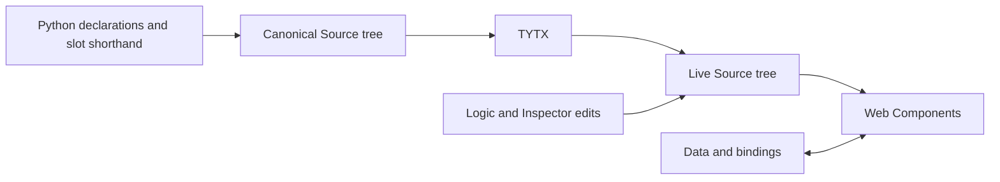

# 320 · Frames, slot bars and windows

> **Menu follow-up, 2026-10-22:** [GC-330](330-menus-and-commands.md) records
> the legacy/core inventory and proposed command sharing between bars and menus.
> The owner reaffirmed flex bars with ordinary Source children. A shared registry
> and unnamed slotButton spacers remain proposals; unknown-name behavior is open.

> **Authoring update, 2026-10-22:** [GC-325](325-how-to-extend-gramlot.md)
> records the owner's subsequent choice: fixed `slotButton("namespace:name")`
> and `slotSpacer(...)` elements, JS-owned registrations and page `gramlots`
> with an implicit base. Compact strings, their expansion/parser rules and
> generated per-button grammar methods below are superseded proposals, retained
> as design history rather than additional implementation paths. Related dynamic
> helper/named-slot syntax remains proposed. Unknown-name behavior is deferred;
> the free-content slot API is not settled. Window/frame requirements remain.

Document ID: **GC-320**. Date: **2026-10-22**.
Status: **window first increment implemented and verified; see §075. Earlier slot DSL sections remain historical proposals.**
[Concise view](../../docs_llm/future/320-frames-bars-and-windows.md).
Related: [GC-070 §1620](../internal/070-work-status.md#gc-070-1620),
[GC-070 §1625](../internal/070-work-status.md#gc-070-1625),
[GC-225](../internal/225-naming-and-proxy-conventions.md),
[GC-310](310-buttons-and-button-bars.md).

All examples below are proposed Python authoring, not executable examples of the
published release. Existing API names retain their current contracts unless a
specific change is identified. No release, dependency-source edit or implementation
of this proposal is authorized merely by this document.

<a id="gc-320-005"></a>
## 005 · Confirmed requirements and evidence

The owner requests a complete design and Python syntax, preserving useful legacy
expressiveness while moving layout and interaction into Web Components. The
latest explicit instruction confirms nested slotBars and multiple bars within
one region. Earlier confirmations establish:

- Python authoring first; shared browser runtime, server independence.
- Dialog and floating window: title bar, close control, optional collapse and
  resizing, with an internal framePane containing application bars/content.
- Dialog is modal, including when collapsed. Its movement, resizing and collapse
  default off. Floating is nonmodal, with those three capabilities default on.
- Closing via X/Escape is interceptable; an application may refuse or ask for
  confirmation; with no interceptor, normal closing proceeds.
- framePane exposes five regions; horizontal sides normally have one row and
  vertical sides one column, but support multiple rows/columns.
- slotButton publishes a command; designated frame content executes it. The
  message explicitly identifies the originating button. The center-region node
  itself is not mandated as recipient.
- Slot syntax is to be decided. Desired capabilities include named content,
  dynamic creation, configurable spacers and beginning/end placement. The precise
  meaning of positions 1/-1 was not confirmed; §030 gives a concrete proposal.
- groupBox already satisfies the requested labelgroup. Standalone copyButton and
  Catalog persistence are separate work. No maturity level follows from release.

Read-only provenance: GenroPy@fa35e5adfa6ad1b269f3a22a9b12c4c1ee6513ea,
gnrwebstruct/base.py and dojo11.py; genro_components.js FramePane, SlotBar,
SlotButton; genro_widgets.js Dialog/FloatingPane; Dojo 1.1 Dialog/FloatingPane.
Nested bar: resources/common/th/th_form.py:338–345. Multiple bars:
projects/gnrcore/packages/test15/webpages/gnrwdg/slotbar.py:75.
PoC@10478b57ce3f22e6445eb6b72eba343520cbebac supplies palette/clipboard evidence,
but no framePane/slotBar implementation was found. Core baseline is 0.3.10.

<a id="gc-320-010"></a>
## 010 · One Source structure; browser-owned behavior

**Recommendation:** preserve the compact legacy declaration as an authoring
shorthand that creates ordinary, ordered Source nodes. The browser renders that
one structure; it never reparses a second slots string or reconstructs children.

| Layer | Owns | Does not own |
| --- | --- | --- |
| JavaScript component descriptors | Parameters, types/defaults, DOM tags and export of portable grammar | Python-specific widget catalogs |
| Thin authoring helpers | Region access, expansion of the slot string, insertion coordinates and named-slot lookup | DOM, layout, focus, modal state, command execution |
| SourceBag/SourceBagNode | Ordered component tree, identity, attributes, runtime structural edits | A parallel private toolbar tree |
| Data and existing bindings | Bound values and writeback | Automatic saving of editor drafts |
| Web Components | Flex/border layout, window chrome, geometry gestures, accessibility | Application save/copy/undo algorithms |
| Existing command/subscription infrastructure | One click path and delivery to the target Source node | A new toolbar event bus |
| Application Logic | Command handling and close decisions | Manual DOM wiring for these components |

The Python portion cannot disappear: Python must describe Source. It becomes
small, deterministic authoring code, rather than half of a widget runtime.
Equivalent JS authoring helpers may perform the same pure expansion; a shared
fixture corpus must prove identical canonical Source. This is language authoring
parity, not two browser implementations. Python-first delivery does not remove
shared JS grammar/runtime requirements.

The canonical serialized representation has explicit frame/content regions,
slotBar, slot and spacer nodes. The initial DSL is consumed during authoring and
is **not retained as an authoritative runtime slots attribute**. Runtime editing,
remote fragments and the Inspector all operate on these same nodes.



For example, `slotBar("save,12,*,close")` creates these ordered children:
```text
slotBar
  slot name=save
  spacer size=12
  spacer flex=1
  slot name=close
```
The two unnamed spacers still have distinct stable Source node identities.
Naming a slot and naming a child component are separate scopes.

A Web Component creates internal styles, native controls and shadow slots once.
Application children stay in light DOM under renderer ownership. Structural
changes use Source APIs; components must not rewrite/reparent those children
to invent visual order. Positioning follows canonical Source order.

<a id="gc-320-015"></a>
## 015 · Component boundaries and naming proposal

These names derive from existing camelCase authoring / PascalCase descriptor /
gramlot-kebab-case DOM conventions. They are proposals to review in GC-225 before
implementation, not approved additions to the convention register.

| Authoring | Browser tag | Responsibility |
| --- | --- | --- |
| framePane | gramlot-frame-pane | Border-layout specialization with five region accessors and one designated command recipient |
| slotBar | gramlot-slot-bar | Ordered flex strip, arbitrary named content and spacers; may be nested |
| slot | gramlot-slot | Stable named container within a bar; not the native shadow-DOM slot |
| spacer | gramlot-spacer | Fixed space, elastic space or separator; never a button |
| slotButton | gramlot-slot-button | Existing button presentation with one scoped-publish mechanism |
| dialog | gramlot-dialog | Modal window chrome around a Source framePane |
| floatingPane | gramlot-floating-pane | Nonmodal window chrome around a Source framePane |

Reuse contentPane for frame regions and existing borderContainer layout
implementation for framePane. Extract/reuse its layout implementation at that
boundary if necessary; do not compose a second independently sizing border engine.
The internal framePane remains a real Source node, not an invisible DOM-only
copy, so authoring, Inspector and dynamic edits see it.

Reuse Container, parameter projection, theme tokens, Labelbox/command presentation
where applicable. Share window geometry/chrome behavior between dialog and
floatingPane; modality is an explicit difference. Share existing ButtonBinding
and SubscriptionsHandler, adding a narrowly defined slotButton publish mechanism,
mutually exclusive with action/fire/nested command providers.

Important namespace impacts:
- dialog currently denotes native HTML. The proposed component spelling would
  reserve html_dialog for native use, as html_button already does. Internal ask
  and Inspector native-dialog declarations must be migrated and tested first.
  This change needs explicit acceptance; no silent API shadowing.
- slot is already an HTML element. Native use must remain accessible as html_slot;
  the new component is only valid under slotBar.
- floatingPane follows legacy naming. Do not also add floating/palette aliases.
- icon uses the existing text/emoji icon parameter. An icon-name library or
  automatic save/undo/copy preset registry is not included without a separate
  decision.

<a id="gc-320-020"></a>
## 020 · Frame regions, rows and columns

Proposed syntax:

```python
frame = pane.framePane(nodeId="customerFrame", height="100%")

tools = frame.top.slotBar("new,10,save,*,close", node_label="tools")
filters = frame.top.slotBar("search,*,status", node_label="filters")

frame.center.textbox(value="^.customer.name", lbl="Name")
frame.bottom.slotBar("message,*,cancel,confirm", node_label="footer")
```

Region accessors top/bottom/left/right/center are narrowly scoped authoring
accessors on framePane Source nodes. Access creates a missing region once during
authoring; unused regions occupy no space. No arbitrary missing attribute is
treated as a new region or slot. The accessors expose actual Source nodes.
At runtime an absent region is created through an explicit structural operation,
not as an accidental side effect of inspection.

Default region arrangement:
- top/bottom: bars/rows stack vertically; each row lays items horizontally;
- left/right: bars/columns sit side by side; each column lays items vertically;
- center: ordinary content fills the available area; no implicit toolbar policy.

Direct widget insertion into a side uses one explicit, framework-authored default
track in Source. Further tracks can be declared explicitly:

```python
frame.top.button("Refresh")               # first implicit horizontal track
row = frame.top.row("filters")           # another explicit horizontal track
row.textbox(value="^.query", placeholder="Search")
row.checkbox(value="^.active", lbl="Active")

column = frame.left.column("tools")       # another vertical track
column.button("Inspect")
column.button("Settings")
```

row/column are proposed region-authoring operations creating ordinary named
Source containers with flex styles, not new rendering engines or Web Components.
A slotBar directly added to a side is itself a track; it is not wrapped in the
implicit track. Distinct tracks have explicit unique names; the implicit track
has a reserved internal identity recorded in GC-225 before implementation.
Cross-axis arrangements use an explicitly nested container; no automatic wrap
creates new semantic rows or changes slot identity.

Sizing, splitter, drawer and design parameters belong to the existing border
region contract. framePane does not become a record, form store or page singleton.
FramePage remains the current page-level abstraction, independently useful.

<a id="gc-320-025"></a>
## 025 · Slot syntax, nesting and spacing

Retain the compact form:

```python
bar = frame.top.slotBar("new,12,save,|,undo,*,close")
bar.slots["new"].slotButton("New", publish="new", icon="＋")
bar.slots["save"].slotButton("Save", publish="save", icon="💾")
bar.slots["undo"].slotButton("Undo", publish="undo", icon="↶")
bar.slots["close"].slotButton("Close", publish="close", icon="×")
```

Proposed primary lookup is bar.slots["name"], not unrestricted bar.name lookup.
Names such as copy, title, button and data therefore cannot collide with Source
methods, attributes or widget names. The string remains as compact as legacy;
slot content can be any ordinary Gramlot component or nested layout.

| DSL token | Canonical Source |
| --- | --- |
| name | Named slot, unique among this bar's direct slots |
| positive integer or 0 | Fixed spacer of that many pixels along the main axis |
| * | Elastic spacer, flex growth weight 1 |
| pipe character | Separator; theme determines thickness/presentation |

Trim surrounding token whitespace; reject empty tokens, repeated names and
unsupported punctuation/negative numeric tokens. Proposed slot names use
letters/underscores followed by letters/digits/underscores. Preserve case for
identity. Numeric names and reserved structural names are rejected. No embedded
JavaScript or dotted-path interpretation. Named ready-made content and
slot@parameter require the additional design review in §070; their usefulness
must not be dismissed with the legacy implementation's implicit lookup chains.

Fixed spacers may later be configured through their Source attributes with a
nonnegative number of pixels or an explicit supported CSS length; invalid lengths
are rejected, never coerced. Elastic spacers have positive numeric weight.
They are aria-hidden and never receive keyboard focus. Separators are represented
with appropriate separator semantics; they are not disabled fake buttons.

For ten regularly spaced commands, gap is simpler than nine separate spacers:

```python
bar = frame.top.slotBar(node_label="actions", gap="8px")
for name, caption, icon in actions:
    slot = bar.addSlot(name)
    slot.slotButton(caption, publish=name, icon=icon)
```

Use an explicit spacer when a particular gap differs. gap applies between direct
items; its effect around explicit spacers is additive and documented. The default
gap comes from a theme token; exact visual value needs the first visual review.

Nesting stays ordinary composition:

```python
bar = frame.top.slotBar("title,*,actions", node_label="tools")
bar.slots["title"].div("Customers")

actions = bar.slots["actions"].slotBar("save,8,undo", orientation="horizontal")
actions.slots["save"].slotButton("Save", publish="save", icon="💾")
actions.slots["undo"].slotButton("Undo", publish="undo", icon="↶")
```

Orientation defaults from the containing side for top-level bars, from the
containing bar for nested bars, and horizontal elsewhere. Explicit orientation
wins. A nested frame establishes a new command scope; a nested bar does not.

Multiple bars use distinct Source node_label values in the same region as in
§020. They are not encoded using brackets or nested substrings in the DSL.

<a id="gc-320-030"></a>
## 030 · Dynamic insertion, ordering and identity

Proposed source-level operations, available during Python construction and as
equivalent framework operations in client Logic:

```python
help_slot = bar.addSlot("help", position=-1)
help_slot.slotButton("Help", publish="help", icon="?")

bar.addSlot("refresh", before="save").slotButton(
    "Refresh", publish="refresh", icon="↻"
)
bar.addSpacer(size=16, before="save")
bar.addSpacer(flex=1, before="help")
bar.moveSlot("help", position=-1)
bar.removeSlot("refresh")
```

addSlot rejects duplicate names; slots[name] only retrieves an existing slot.
removeSlot removes the Source subtree and disposes its bindings. moveSlot changes
the order of the existing node and retains content/DOM identity. No implicit
upsert, get-or-create or DOM-only reorder. An unknown slot is an explicit error.

Recommendation for positions: signed one-based **insertion gaps** in the ordered
direct-child sequence, including spacers. For n children: 1 inserts before the
first, n+1 appends; -1 appends and -(n+1) prepends. Zero and out-of-range positions
are rejected. A move computes gaps after removing the moving item. Omission
appends. Exactly one of position/before/after may be specified. before/after
refer to named sibling slots. This is an explicit proposal for the user's 1/-1
request; it is not a previously confirmed legacy convention.

Positions are applied at the time of insertion/movement, not permanent edge
anchors. For permanent visual separation, place an elastic spacer:

```python
bar = frame.top.slotBar("primary,*,secondary")
bar.slots["primary"].slotButton("New", publish="new", icon="＋")
bar.slots["secondary"].slotButton("Close", publish="close", icon="×")
```

Later insertion into either named group preserves the two visual groups. Repeated
position=1 prepends and reverses the order of successive insertions; callers
needing a stable group use a named slot containing ordered children.

No runtime replaceSlots string is maintained: changing the initial DSL after
construction cannot silently discard live state. Existing callers of legacy
replaceSlots require explicit conversion to these structural operations;
a compatibility parser is not included.

"Dynamic Python" means Python can build a newly requested Source fragment through
the existing source/remote protocol. Python is not running in the browser. Client
Logic uses Source operations on the already live tree. The insertion helpers
must participate in the existing Source edit lifecycle, including Inspector undo
where it owns the edit; this design does not introduce an application transaction
system or promise rollback of application effects.

<a id="gc-320-035"></a>
## 035 · Commands, sender and designated recipient

```python
editor = frame.center.contentPane(
    frameTarget=True,
    nodeId="customerEditor",
    selfsubscribe_save="customer.save",
    selfsubscribe_undo="customer.undo",
)
editor.textbox(value="^.customer.name", lbl="Name")
```

The handlers are named browser Logic methods; declaring their names in Python
does not execute Python callbacks on browser clicks. Server work uses existing
dataRpc/endpoints. The exact subscription-handler invocation shape retains the
existing contract.

Each frame has at most one active designated descendant with frameTarget=True,
excluding descendants owned by a nested frame. Missing target: command buttons
cannot dispatch and expose a diagnostic; never fall back to a global topic.
Duplicate target: invalid structure, refuse dispatch. A replacement target is
resolved from the current Source at activation; disposed targets are never cached.
A disabled button stays disabled even if a target is available.

The button publishes through the existing Source node publish path, which already
supports node-scoped subscriptions. Do not copy legacy topic concatenation into
slotButton or create another target registry/bus.

Historical payload proposal, superseded by the confirmed five-field contract in
[GC-335 §080](335-common-menu-system.md#gc-335-080). In that contract command is
the full registered key and frame is not a message field. Retained here as design
history, not the implementation contract:

| Field | Meaning |
| --- | --- |
| command | The published command name, e.g. save |
| sender | Actual originating button Source node |
| target | Actual recipient Source node |
| frame | Owning framePane Source node |
| parameters | Explicit optional command data, default empty object |
| modifiers | Keyboard modifier snapshot, using the existing event convention |

Node references are for same-page delivery; this is not a new wire envelope and
does not grant cross-frame messaging privileges. No DOM event object is required
for the application command contract. Avoid inventing independent sender IDs
when existing Source identity suffices.

slotButton's publish mechanism is exclusive: action, fire or an executable nested
provider on the same button is an authoring error. The recipient decides save,
copy, undo, etc. This is distinct from a value-copying copyButton.
Use ordinary button when the application needs the existing action/provider path.

Window chrome's close/collapse controls operate on the window itself. A footer
slotButton publishing close targets the application content, which may ask the
window to close through the same approved close-request boundary; these routes
are not silently equated.

<a id="gc-320-040"></a>
## 040 · Dialog and floating Python proposal

```python
dlg = root.dialog(
    title="Customer",
    open="^.customerDialogOpen",
    width="640px",
    height="420px",
    movable=True,
    resizable=True,
    collapsible=True,
    beforeClose="customer.beforeClose",
)
frame = dlg.frame
bar = frame.top.slotBar("title,*,save", node_label="tools")
bar.slots["title"].div("Customer details")
bar.slots["save"].slotButton("Save", publish="save", icon="💾")

content = frame.center.contentPane(
    frameTarget=True, selfsubscribe_save="customer.save"
)
content.textbox(value="^.customer.name", lbl="Name")

footer = frame.bottom.slotBar("message,*,cancel,confirm", node_label="footer")
footer.slots["cancel"].slotButton("Cancel", publish="cancel", icon="×")
footer.slots["confirm"].slotButton("Confirm", publish="confirm", icon="✓")
```

```python
floating = root.floatingPane(
    title="Tools", open="^.toolsOpen", width="320px", height="440px"
)
floating.frame.top.slotBar("search,*", node_label="tools")
floating.frame.center.div("Nonmodal content")
```

The first declaration creates one window Source node with exactly one framePane
child; .frame exposes that child. Application content is authored through it.
Window title and accessible caption are plain/localized text, never unsanitized
innerHTML. Use the existing label qualification conventions.

| Parameter | Dialog default | Floating default | Proposal |
| --- | --- | --- | --- |
| open | false | false | Boolean; read/write Data binding |
| movable | false | true | Boolean, reactive |
| resizable | false | true | Boolean, reactive |
| collapsible | false | true | Boolean, reactive |
| collapsed | false | false | Boolean; read/write binding |
| closable | true | true | Exposes/enables user closing, reactive |
| width / height | theme size | theme size | CSS size, clamped to available viewport |
| minWidth / minHeight | theme minimum | theme minimum | Explicit supported lengths |
| beforeClose | absent | absent | Named Logic guard only in this proposal |

Exact initial theme sizes are a visual review item, not arbitrary constants in
components. Geometry uses left/top offsets in pixels when authored; absent
offsets center the dialog and place a floating window within viewport bounds.
No geometry persistence across page reload in the first slice. During the same
mounted window lifetime, close/reopen retains children, drafts and last geometry.
Destroying Source disposes it. These retention choices are proposed, not yet
owner-confirmed.

On collapse save expanded height and show only chrome. Restore preserves width,
position and expanded content. A modal stays in its native modal session;
do not close/reopen it on collapse, movement or resize. A disabled collapse
capability restores an already collapsed window. Disabling movement/resize
cancels any current gesture and releases capture. External geometry changes
cancel the current conflicting gesture; the external value wins.

The modal backend is a native HTML dialog shown with showModal; the component
owns drag/resize. Its title/resize controls and slotted frame content must all
remain inside the modal interaction boundary. Mount only opens after binding
and child installation; no arbitrary timeout substitutes for lifecycle hooks.
Floating uses nonmodal chrome and page-local stacking; no permanent maximum
z-index, and it cannot appear above an active modal. Native popovers used by
fields must continue to work.

Background interaction blocking is document-local. A modal inside an iframe
does not block its containing page; no cross-document application-modal contract
is included. See the [HTML dialog standard](https://html.spec.whatwg.org/multipage/interactive-elements.html#the-dialog-element).

Maximize/restore remains a deliberate second decision. Recommendation: omit
the capability/control from the first slice; do not silently interpret the owner's
"all active" as including maximize. Fullscreen and maximize are also distinct.

<a id="gc-320-045"></a>
## 045 · Closing, async confirmation and accessibility

Recommendation: one close-request path for X, Escape and application-requested
closing. Proposed Source operation requestClose(reason) delegates to it; it never
removes the window Source node.

A beforeClose named Logic guard receives the window Source node and
{reason}; it must return a boolean or a Promise of a boolean. true permits,
false vetoes; absent guard permits. Invalid result or exception keeps the window
open and reports a diagnostic. Existing tab onClose stays synchronous and unchanged.
This async window hook is a proposed bounded extension, not permission to make
every existing hook asynchronous.

While a guard is pending, suppress duplicate requests, expose busy state, and
preserve modality/focus. Application confirmation may open a nested modal using
existing ask services; only the uppermost modal is interactive. Removal/disposal
invalidates outstanding completion so it cannot reopen or mutate a destroyed node.

Recommendation for Data: setting bound open false is an explicit application
state update and bypasses the user-close guard; application commands needing
confirmation call requestClose. Document this distinction; no loop that writes
false then true to imitate a veto. Accepted closing writes false once and emits
one close notification; a veto writes nothing. Source deletion is teardown, not
an interceptable user close. Hidden/show attribute tricks must not leave a
native dialog document blocked.

Recommend no click-outside dismissal for modal dialog. Escape/X respect closable;
the application can still explicitly close/remove it. A collapsed modal keeps
restore and permitted close controls reachable. Title and handles have accessible
names; close/collapse use native buttons. Movement/resizing must have keyboard
equivalents when enabled, with bounded steps defined by theme/configuration.
Track focus on open and restore it to a connected previous element on close.
Use reduced-motion preferences; avoid forcing focus during geometry changes.

<a id="gc-320-050"></a>
## 050 · Live lifecycle and ownership details

- Parameter projection and binding use the current ComponentCollection metadata,
  ControlAdapter/sourceContext facilities where appropriate; containers do not
  create a second Data writer. Extending read/write state beyond control value
  requires a bounded reviewed adapter, not application SET workarounds.
- Stable slot nodes and their canonical order allow pointer insertion, undo and
  dynamic replacement through ordinary Source. Preserve active inputs, selection,
  invalid drafts, nested runtime state and iframe browsing contexts.
- Scope discovery observes Source lifecycle, excludes nested frames and releases
  listeners on removal. No window/document global frame maps.
- Geometry is transient component state, except explicitly bound properties.
  Store the expanded rectangle while collapsed; do not publish every pointermove
  onto unrelated Data. Propose one writeback per completed gesture for bound
  geometry, with final value in pixels; external binding updates stay authoritative.
- ResizeObserver/viewport listeners, pointer capture, queued animation work,
  subscriptions and async close completions all have explicit teardown.
- Reattachment reconciles current Source/Data; it does not replay a stale gesture.
  Reparenting across frames changes the current recipient scope.
- The renderer owns light-DOM order. Browser flex layout must not use CSS order
  to create a visual/keyboard order different from Source.
- Empty slots have no invented placeholder button; normal gap behavior remains.
  Removing a recipient leaves its commands nondispatchable until a valid one
  appears. It never broadens routing.

<a id="gc-320-055"></a>
## 055 · Feasibility gaps and required bounded extensions

The reviewed registry can export typed parameters and child metadata to Python.
Container/BorderContainer and node-scoped publishing already exist.
The inspected Gramlot Source classes do not currently provide frame region,
window frame, named-slot or dynamic-slot helpers. Current ButtonBinding does not
provide slotButton scoped publish, and windows do not exist.

Required Gramlot-owned additions:
1. Bounded component-aware Source authoring helpers and slot DSL expansion,
   with canonical grammar support for the new structural elements.
2. Reuse/extraction of border layout implementation for FramePane and small
   context-specific region/track authoring rules.
3. SlotBar/Slot/spacer Web Components, reactive orientation and spacing.
4. SlotButton's single publish mechanism and frame recipient discovery.
5. Shared window chrome/geometry plus modal/nonmodal specializations and
   state writeback, close guard and teardown.

The upstream Builder provides schema dispatch and container hooks, but that alone
does not prove equivalent named-context routing in both languages. Before coding
helpers, use a small fixture to establish supported extension points in the
installed public Builder API. If a necessary primitive is missing, report the
gap to Builders; do not monkeypatch it, change installed source, substitute
ordinary Bags or introduce a private parallel proxy tree. This feasibility gate
does not invalidate the proposed syntax, but it can block its implementation.

Public helper names, parameter defaults, grammar changes and inline/named hook
classification must be reviewed in GC-225 and the contract before coding.
The project proposal is not that approval.

<a id="gc-320-060"></a>
## 060 · Delivery slices and meaningful verification

This is a proposed delivery sequence for this scope, not a replacement for GC-110.

| Slice | Outcome | Focused acceptance checks |
| --- | --- | --- |
| 1 · Source and frame | Canonical grammar, helper feasibility, frame regions/tracks | Python-to-TYTX-to-browser parity; lazy regions; multiple tracks; existing border tests; no hidden source tree |
| 2 · Bars and slots | Compact authoring, named access, nesting, dynamic edits | Spacer/order rules; ten-button construction; duplicate rejection; both orientations; focus/draft/iframe retention; narrow viewport |
| 3 · Commands | Icon buttons and designated recipient | Sender/target identity; nested-frame isolation; target removal/replacement; no broadcast fallback; one click engine |
| 4 · Window shell | Dialog/floating with internal frame, defaults | Modal/nonmodal mouse/keyboard behavior; drag/resize; bounds; collapsed modality; nested popovers/dialogs |
| 5 · Closing and lifecycle | Guard, Data updates and disposal | Async veto/accept/reject, duplicate close, source removal while pending, focus restoration, listener cleanup |
| 6 · Python gallery and review | Small Python-authored lessons and parameter documentation | Shared runtime in wheel/npm; actual browser interactions; owner visual acceptance; Catalog metadata readiness |

Core tests use core fixtures. Examples belong to gramlot-examples, with connected
edits scoped separately; no server/serverless release alignment is required here.
Routine work runs focused affected tests; full qualification belongs before a new
release. No release is implied by completing a slice.

Regression matrix must include two independent windows/frames, side changes,
nested bars, multiple horizontal rows/vertical columns, reactive capability toggles,
touch and keyboard gestures, reduced motion, errors and teardown.
Use DOM tests for structure/state, real browsers for geometry, focus, native
modality and clipboard only when the latter is actually in scope.
Shared naming/parameter metadata prepares future Catalog forms but does not
implement Catalog persistence or declare components Stable.

<a id="gc-320-065"></a>
## 065 · Decisions to review and completion evidence

Recommended choices are concrete but not silently accepted:

| Decision | Recommendation | Consequence |
| --- | --- | --- |
| Canonical model | Explicit ordered slot/spacer Source; DSL expands once | One runtime tree; no retained slots string or automatic legacy replaceSlots |
| Slot access | bar.slots["name"] | No collisions with node methods or tag names; differs from legacy bar.name |
| Positions | Signed one-based insertion gaps | 1/prepend and -1/append are operations, not pinned visual anchors |
| Native names | dialog/slot components; html_dialog/html_slot for native | Requires migration and explicit compatibility acceptance |
| Windows | floatingPane; open false; retain on close; no persisted geometry | Predictable lifecycle; no alias set |
| Close guard | Named beforeClose; boolean/Promise; Data false bypasses guard | Async confirmation is possible; application owns explicit state updates |
| Maximization | Defer initial capability | No misleading maximize button or incomplete restore geometry |
| Authoring extras | Review named ready-made content in §070; no automatic legacy lookup-chain or replaceSlots port | Preserve reusable composition without two competing runtime resolvers |

Ask the owner one decision at a time, starting with the canonical model. Confirmed
requirements remain fixed unless the owner explicitly changes them. Implementation
approval and publication are distinct.

Document verification: proposed Python snippets are syntax-checked only, not
executed against nonexistent APIs. Paired sections, anchors and relative links
are checked. Source inspection and earlier existing-component tests are evidence
for reuse; they do not prove this new design's runtime behavior.

<a id="gc-320-070"></a>
## 070 · Named ready-made content: legacy capability to preserve in the review

Owner recalls that recognized names produced ready-made content. Source inspection
confirms two mechanisms, not just empty named slots:

1. Python _addSlot resolves a handler in this order: <prefix>_<slot> (prefix is
   slotbarCode or frameCode), slotbar_<namespace>_<slot>, then slotbar_<slot>.
   Available struct methods depend on the page's loaded components. The slot's
   value, prefixed options and frameCode are passed to the selected handler.
   slot@parameter supplies a parameter; it is more than a plain slot name.
2. JavaScript SlotBar supplies slot_<name> built-ins such as searchOn,
   stackButtons, count and messageBox, producing widgets/content in the bar.

For example, loaded FormHandler methods provide slotbar_form_save and
slotbar_form_revert, implemented by fh_slotbar_form_save/revert; FrameGrid
provides slotbar_addrow/delrow. These definitions supply icons, command routing,
disabled conditions and sometimes form/database behavior. They are not all
generic icon presets and cannot be promoted as dependency-free commands.

The original proposal excluded method lookup too broadly and therefore omitted
a useful authoring capability. Keep the feature under design review:
recognizable names can select reusable content definitions, with explicit
registration/scope and one deterministic resolution rule. Ordinary named slots
must remain available for custom content. Do not silently equate every name with
a command or introduce a new fallback chain.

Recommended design direction, not yet approved: declared named compositions
expand into the same canonical Source during authoring. Browser-only reusable
behavior is a component in the existing registry. Do not run one resolver in
Python and another unrelated one in SlotBar to decide what the same name means.
Review how declarations identify named content versus an empty slot, how
parameters are passed, conflict handling, scoping and runtime insertion before
finalizing syntax. Parameterized definitions and Catalog integration are
candidates, not implemented capabilities or permission to import form services.

Evidence: GenroPy gnrpy/gnr/web/gnrwebstruct/dojo11.py:690–709;
resources/common/gnrcomponents/formhandler.py:317–329; framegrid.py:53;
gnrjs/gnr_d11/js/genro_components.js:6296–6312 and 6384 onward.
This follow-up revises the proposed exclusion, not the already confirmed
requirements. The project still requires an owner-reviewed preset contract.


<a id="gc-320-075"></a>
## 075 · First window increment (2026-10-23)

Owner, 2026-10-23: “Sì, confermo dialog per il componente, html_dialog per il tag nativo e floatingPane per il floating. Procedi con gli adeguamenti interni e la prima versione da provare nella gallery.”

Implemented in the layout collection: dialog and floatingPane share WindowShell;
html_dialog is a distinct native grammar declaration in both languages. Ask and
the three Inspector dialogs use it explicitly. The native showModal session owns
modal blocking, including collapse; floating uses nonmodal native dialog chrome.
The existing framePane owns layout and command targets. The .frame accessor creates
or returns exactly one Source framePane; there is no shadow-only content replica.
Historical slotBar/slotButton syntax in earlier sections is superseded by menu,
menuline and spacer. New helpers do not modify Builder or Bag dependencies.

```python
from gramlot import Page as BasePage
from gramlot.collections.layout import mygramlot as layout

class Page(BasePage):
    gramlots = [layout]

    def main(self, root):
        window = root.dialog(title="Editor", open="^editor.open",
                             movable=True, resizable=True, collapsible=True,
                             width="440px", height="360px",
                             beforeClose="beforeClose")
        frame = window.frame
        frame.top.menu(presentation="bar").menuline(caption="Action", action="handle")
        frame.center.contentPane(frameTarget=True).input(value="^editor.draft")
```

Dialog movement, resize and collapse default false; floating defaults true. open
and collapsed default false; closable defaults true. Title is text. open/collapsed
and width/height/left/top support ordinary Data bindings and writeback; geometry
lengths use CSS strings. minWidth/minHeight constrain geometry. Completed pointer
or arrow-key gestures commit once; cancellation restores the starting rectangle.
Arrow keys on title/resize handle use 10 px steps, Shift uses 1 px. Geometry fits
the document client viewport, excluding scrollbars. Pointer capture, viewport
listener, child observer and pending close completions are released on teardown.

A close/reopen retains mounted Source, controls, draft values and geometry within
the page session. Collapse hides the frame and retains expanded height. Disabling
collapse restores the frame. X/Escape use requestClose; Source requestClose(reason)
uses the same named beforeClose guard with (windowNode, {reason}). Boolean or
Promise<boolean> is required: true accepts, false vetoes; invalid/rejected results
report a diagnostic and retain the window. Pending requests coalesce. Data open=False
and Source deletion bypass the user guard; stale completion cannot close a reopened
or disposed window. The native modal restores focus; Gramlot also restores the
connected previous focus target for nonmodal windows. No maximize or reload storage.

The Python chapter now includes 09_windows, comparing defaults, an explicitly
movable modal, and a floating window. Each frame has top/bottom bars, an Actions
popup, shared draft and central save recipient. The guard can be exercised through
an internal checkbox. The standalone frame lesson remains available as 05_frame_pane.

Verification: 87 focused JavaScript tests cover windows, menus, layout, ask,
buttons and Inspector; seven core Python authoring tests; two chapter tests with
nine page subtests. All pass. Real Uvicorn/browser checks cover default modality,
collapsed modal/float distinction, close veto, focus restoration, popup commands
inside a modal, pointer move/resize, keyboard resize, background editing and retained
geometry/text after reopening. Browser-found corrections include allowing Escape
past a permanent toolbar with no open popup, scrollbar-aware viewport bounds and
using value (not checked) for the native checkbox's two-way binding. Earlier failed
checks exposed the native-prefix collision and an incorrect test helper; both were
corrected and rerun. This is implemented and verified, awaiting owner usability
acceptance. No extended release qualification, package publication or deployment.


<a id="gc-320-080"></a>
## 080. Maximize and restore trial (2026-10-23)

Owner requests maximize/restore on both windows and confirms the proposed contract
with “ok”. This supersedes the maximize exclusion in §075, not its other limits.
`maximizable` defaults false on both dialog and floatingPane; `maximized` defaults
false and uses two-way Data binding. Enable the control explicitly:

```python
window = root.dialog(title="Editor", open="^editor.open",
                     maximizable=True, maximized="^editor.maximized",
                     movable=True, resizable=True, collapsible=True)
window.frame.center.contentPane().input(value="^editor.draft")
```

The same parameters apply to floatingPane. Maximize fills the document client
viewport without a normal-window margin. Restore recovers the normal expanded
rectangle, clamped if the viewport has shrunk. Normal geometry and bound lengths
are not overwritten by maximize or collapse. Bound geometry changes while maximized
update the normal rectangle used on restore. Movement and resize are suspended
while maximized; their authored settings resume on restore. Collapsing retains
maximized state and expanding returns to the viewport size. The maximize control
can change state while collapsed without expanding the frame. Disable maximizable
to restore normal size and write maximized=False. Close/reopen retains content and
state within the page session; reload persistence remains out of scope.

All transitions reuse the same native dialog and mounted frame. A dialog stays
modal, including when collapsed; floating remains nonmodal. Distinct accessible
labels identify Maximize window / Restore size and Collapse window / Expand window.
The existing close guard and source requestClose contract are unchanged.

Verification: 90 focused JS tests pass (including 11 window tests), seven core Python
tests, two gallery tests with nine page subtests. Regressions cover both window types,
Data writeback, normal geometry retention, viewport resize, capability disabling,
collapse/reopen, pointer/keyboard suspension and externally changed geometry.
Uvicorn/browser checks confirm full viewport geometry, exact restoration, retained
input, modal continuity and editable background behind a collapsed maximized
floating. No browser console errors. The gallery lesson 09_windows explains each
operation above the examples. Implemented and verified; owner usability acceptance
and stable maturity remain pending. No release qualification or publication.


Appearance refinement (2026-10-23, owner feedback): the shared resize affordance
is a small two-stroke SVG grip with a 20px hit area, replacing the solid triangle.
Keyboard access and pointer capture remain unchanged. Window regressions and a
real browser drag pass; this does not change the window contract.
