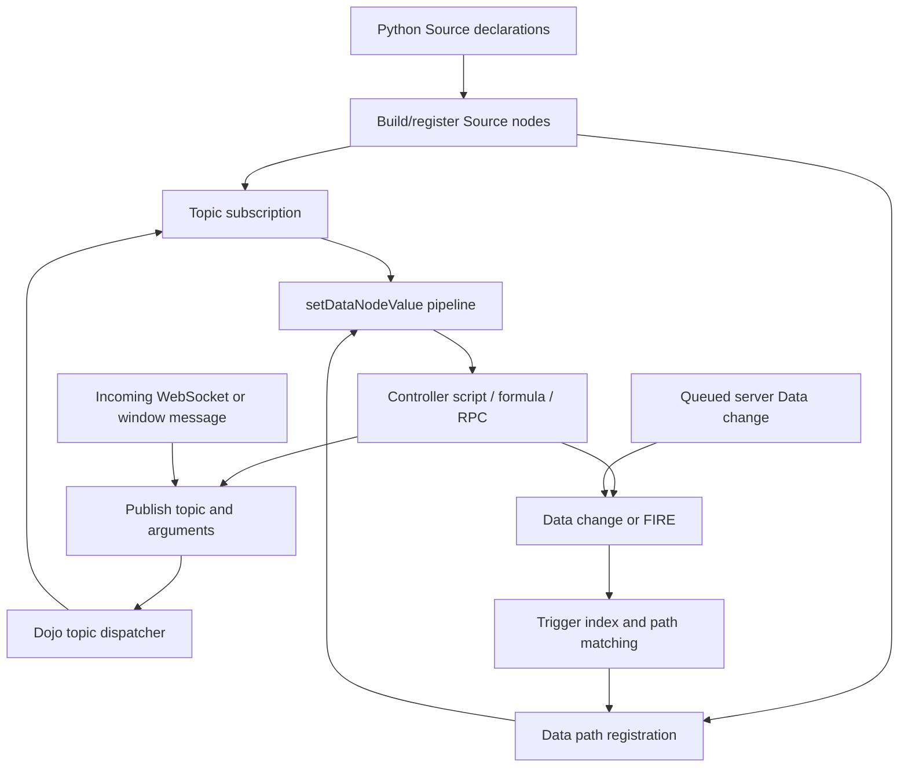

# 196 · Legacy publish/subscribe and controller execution

Document ID: **GC-196**.

[Concise counterpart](../../docs_llm/internal/196-legacy-publish-subscribe.md).
[Future-work inventory](../future/README.md).

**Research snapshot — 2026-10-15.** This document describes observed GenroPy
behavior. It is not a Gramlot API contract, an approved port, or a porting plan.
The owner requested a detailed investigation first and will decide the plan after
reviewing it. The release direction is 0.2.18; its feature boundary remains open.

<a id="gc-196-005"></a>
## 005 · Scope, authority and evidence

The owner's request was: “fai un analisi estrememente dettagliata del meccanismo
legacy e do come anche interagiva con i data contrller e quedno hai quel documento
decidiamo il piano per il porting”. Earlier discussion explicitly included local
messages, communication between frames, and pages belonging to different users.

The inspected repository is `genropy/genropy`, local checkout
`/Users/gporcari/Sviluppo/Genropy/genropy`, revision
**`fa35e5adfa6ad1b269f3a22a9b12c4c1ee6513ea`**. Source links below are pinned to that
revision so subsequent legacy development does not silently change the evidence.
The analyzed runtime files had no local modifications during this investigation.

“Legacy” here means that repository's living implementation, not a reconstructed
2007 release. In particular:

- The page bus is still the Dojo topic mechanism.
- Data-path dispatch now uses `GnrTriggerIndex`, with a trie and floating
  registrations, rather than sending every binding through one Dojo subscriber.
- The inspected async server uses aiohttp/asyncio and explicitly replaces earlier
  Tornado handlers while preserving much of their command vocabulary.
- Bag implementation is selectable. `dojo_base.py:15–24` defaults to `legacy`
  (`gnrbag.js`), with experimental `genro-bag-js` and `genro-bag-js-mixin` modes.
  Runtime probes here use the default legacy Bag. `gnrbag_genro.js:555–560`
  independently retains fire/reset, but this report does not qualify every Bag mode.
- The newer neutral `gnrasync_session.py` exposes notify/request/events. Its own
  tests are not evidence that old `PUBLISH` uses that protocol. The traced path is
  `genro.publish` → Dojo, optionally reached through the legacy WebSocket commands.

Evidence labels used below:

- **Observed source:** the named implementation contains the behavior.
- **Probed:** exact legacy JavaScript or extracted Python methods were executed
  with controlled surrounding objects. Browser rendering and real network transport
  were not involved.
- **Existing test, rerun:** an upstream test was executed as identified in §100.
- **Inference / unresolved:** a consequence or limit requiring broader verification.

This analysis makes no source changes to GenroPy or Gramlot, and does not approve
any of the legacy quirks as future behavior. Constitution §§2, 4, 5 and 11.43 remain
applicable. No implementation, version bump or publication is part of this work.

<a id="gc-196-010"></a>
## 010 · The mechanisms that must not be conflated

The central distinction is between **a message addressed by topic** and **a
mutation/event addressed by Data path**. They can activate the same controller,
but neither is an alias of the other.

| Mechanism | Address | Carrier | Receiver | Retained state |
| --- | --- | --- | --- | --- |
| `genro.publish('topic', ...)` | Exact topic string in the current window | JavaScript arguments | Dojo subscribers, including Source handlers/controllers | No message history |
| `sourceNode.publish('command', kw)` | `nodeId_command` or generated-ID prefix | One payload argument | Node-scoped subscriptions | No message history |
| `form.publish('command', kw)` | `form_<formId>_<command>` | One payload argument | Form subscriptions and handlers | No message history |
| `^path` | Data path, resolved in Source context | Bag event plus current Data | Binding/provider | Data value persists unless fired/reset |
| `=path` | Data path | Read at execution | Controller/formula argument | No subscription from this pointer |
| `FIRE path = value` | Data path | Triggering write, then silent null | Data subscribers/controllers | Normally null after delivery |
| `Bag.subscribe(id, callbacks)` | Bag instance and event kind | Bag mutation event | Callbacks | Bag owns state, not a topic broker |
| `genro.dom.windowMessage` | Window reference | `postMessage` data | Listener republishes a local topic | No application history |
| WebSocket `publish` command | Target page ID, then local topic | Serialized envelope | Client command handler → page bus | No topic replay contract |
| Register/user-store datachanges | Page/user registry and path | Queued Data changes | Client Data update → controllers | Queue/offset semantics differ from page bus |
| Shared object | Shared object ID and inner path | Snapshot and subsequent Bag changes | Participating pages' Data | Shared server state |

A server-side Python lifecycle mechanism also has `_subscribe_event` and
`_publish_event` (`gnrwebpage.py:1080–1087`). Those invoke Python hooks such as
`onCollectDatachanges`; they are not browser topic subscriptions.



A controller is the convergence point. A topic may wake it, and it may then read
Data, write Data, publish another topic, or start an RPC. There is no requirement
that messages first become Data values. Sources: [bus][bus], [controller][controller],
[trigger index][trigger-index], [server bridge][server-bridge].

<a id="gc-196-015"></a>
## 015 · The page-local topic bus

`genro.publish(topic, kw)` has two substantially different forms. For a string
first argument it collects **every argument after the topic** and calls
`dojo.publish(topic, args)`. Thus these are different payload shapes:

```javascript
genro.publish('order_changed', {order_id: 42}); // one object argument
genro.publish('order_changed', 42, 'saved');   // two positional arguments
genro.publish('order_changed', [42, 'saved']); // one array argument
```

The low-level registration is `dojo.subscribe(topic, scope, callback)`; it returns
a handle consumed by `dojo.unsubscribe(handle)`. The inspected `GenroClient` does
not define a corresponding general `genro.subscribe` wrapper. Source registration
adds lifecycle bookkeeping around Dojo instead.

Dojo stores dispatchers in `dojo._topics`. Each dispatcher has an array of
listeners; publication calls the dispatcher directly. Consequences:

1. **Synchronous delivery.** Ordinary callbacks finish before `publish` returns.
   A callback may separately schedule a timeout or RPC; the bus does not await it.
2. **Exact topic matching.** No topic hierarchy, wildcard topic matching, bubbling
   or implicit prefix matching is implemented. `iframe:'*'` is a routing option,
   not a wildcard topic subscription.
3. **No retained message.** A subscriber created after a publication does not
   receive it. A missing topic dispatcher simply does nothing.
4. **No equality filtering.** Two publications with the same content deliver twice.
   They do not use Data's changed-value logic.
5. **Shared local references.** The arguments are passed through `apply`, not cloned.
   One subscriber can mutate an object before the next subscriber reads it.
6. **Reentrancy.** A subscriber can publish another topic immediately. The nested
   delivery completes before the outer dispatcher reaches its next listener.
7. **Exception propagation.** There is no per-subscriber `try/catch` in the Dojo
   dispatcher. A thrown error escapes and prevents remaining listeners from being
   called in that publication.
8. **No aggregation.** Subscriber return values are not collected. `genro.publish`
   does not return a result, promise, acknowledgement or cancellation token.
9. **Registration order is an implementation observation.** Listeners occupy
   ascending array slots, traversed with `for...in`; removal deletes a slot.
   There is no priority API or listener snapshot. Mutation of subscriptions during
   dispatch is not a documented portable scheduling contract.
10. **Window scope.** Each page/window has its own Dojo topic registry. The same
    topic string in two windows is not automatically shared.

The synchronous, shared-reference, nested-call, unsubscribe and exception behaviors
were probed. Sources: [Genro wrapper][bus], [Dojo dispatcher][dojo].

<a id="gc-196-020"></a>
## 020 · What Python declarations actually contribute

Python authoring describes Source; it does not execute the controller's JavaScript
on the server. `GnrDomSrc_dojo_11` implements:

```python
# Legacy declarations, not current Gramlot syntax.
pane.dataController(script, **kwargs)
pane.dataFormula(path, formula, **kwargs)
pane.dataRpc(pathOrMethod, method=None, **kwargs)
```

The first two are essentially `child('dataController', script=..., **kwargs)` and
`child('dataFormula', path=..., formula=..., **kwargs)`. `dataRpc` resolves its
path/method arguments, then creates a Source child. The `subscribe_*` attributes
travel with that node. Python does not maintain a browser topic registry.

A minimal legacy use case is:

```python
pane.data('order.id', 42)
pane.button('Notify',
            action='PUBLISH order_changed = {order_id: current_id};',
            current_id='=order.id')
pane.dataController('SET order.last_seen = order_id;',
                    subscribe_order_changed=True)
```

The button reads the current ID when its action runs. The message wakes the
controller; `order_id` comes from the payload. The controller writes Data, so
ordinary bindings can react. This is explanatory legacy code, not an executable
Gramlot example or a proposed authoring API.

### Button and toolbar conveniences

Legacy buttons can publish without an action string:

```python
pane.button('Recalculate', publish='recalculate')
pane.dataController('console.log(recalculate[0]);',
                    subscribe_recalculate=True)
```

The ordinary `_ButtonLogic` handler calls `genro.publish(topic, true)` for that
attribute, so the subscriber receives one boolean argument, not an automatic map of
all button attributes. Its action choice is `action`, then `fire`, then `publish`,
then the `fire_*` family. A single nested dataController/dataRpc is activated before
that choice; legacy can therefore run a nested provider and a separately declared
action in the same click. This differs from assuming every button has exactly one
mutually exclusive mechanism.

The button's own delayed-click/count handling precedes publication and is separate
from the receiving controller's `_delay`. Slot/toolbar component code has another
convenience: it constructs a contextual prefix and generates an action publishing
an object with `command`, modifiers, options, the event and a click counter. The
basic button and the contextual slot button therefore do not have identical payloads.
A browser event in that local payload is also not automatically suitable for network
serialization. These are inspected authoring conveniences, not new Gramlot proposals.
Sources: [button behavior][button-publish], [slot publication][slot-publish].

The legacy's own `datastore/publish.py` contains direct examples of positional
messages, the `PUBLISH` macro, a controller subscribed to two topics, and an `_ask`
controller activated either by `PUBLISH` or `FIRE`. [Python builders][python-builders],
[legacy teaching page][publish-example].

<a id="gc-196-025"></a>
## 025 · Three declaration families, two execution paths

`subscribe_`, `selfsubscribe_` and `formsubscribe_` are processed for both rendered
Source nodes and nonvisual data providers. Their values do **not** mean the same
thing in those two contexts.

| Declaration | Rendered node | Controller/formula/RPC provider |
| --- | --- | --- |
| `subscribe_refresh=...` | Value is callback code/function for topic `refresh` | Presence subscribes; body remains the provider's script/formula/RPC |
| `selfsubscribe_refresh=...` | `sourceNode.subscribe('refresh', handler)` | Expanded to `<own node ID>_refresh` and activates provider |
| `formsubscribe_onLoaded=...` | Expanded using associated form ID | Resolved after build, then activates provider on `form_<id>_onLoaded` |

For a rendered node, `_doBuildNode` extracts `connect_*` separately, creates the
widget/element, registers self/form handlers, and registers ordinary subscriptions
using `funcCreate` and `registerSubscription`. A DOM event connection is not itself
a named topic subscription, although its callback can publish.

For a data provider, `GnrSrcHandler.moveData` extracts the same prefixes and calls
`node._dataControllerSubscription(subscriptions)`. That function loops over the
**keys**, ignores their values, and registers this callback for each topic:

```javascript
node.setDataNodeValue(null, {}, topicName, arguments);
```

Therefore `subscribe_refresh=True` is an authoring convention, not a boolean
enablement check in that function. **`subscribe_refresh=False` still subscribes**
in the inspected provider path; this was probed. A string value there does not
replace the controller body either.

For form subscriptions, provider registration is postponed through
`afterBuildCalls` so the form can be found. A provider with no corresponding form
cannot receive a fabricated form subscription. Self-scoped names use the provider's
own `nodeId` or generated Source ID, not automatically its parent's ID.

These subscription names are established during build. This code does not implement
a reactive topic selector, topic-pattern matcher or automatic enable/disable based
on the subscription attribute's current Data value. A rebuild/explicit registration
is a different operation.

Sources: [rendered nodes and registration][node-registration],
[provider setup][provider-setup], [provider topic callback][provider-topic].

<a id="gc-196-030"></a>
## 030 · Exactly what a subscribed controller receives

The topic callback passes the callback's **`arguments` object**, not a newly created
array, as `subscription_args`. The controller pipeline constructs a JavaScript
function signature dynamically.

For `genro.publish('refresh', {amount: 7})`, before considering declared attributes:

| Name inside the controller | Meaning |
| --- | --- |
| `this` | The receiving Source node |
| `_reason` | `'refresh'`, the complete subscribed topic string |
| `_node` | `undefined` for this topic activation; no changed Data node was passed |
| `_triggerpars` | `{kw: {}, trigger_reason: 'refresh'}` |
| `refresh` | The received arguments object; `refresh.length === 1` |
| `refresh[0]` | The original payload object |
| `amount` | `7`, promoted from the single object argument |
| `_subscription_kwargs` | The original payload object |
| `_kwargs.amount` | Merged effective argument value, subject to later overrides |

When there is **exactly one argument** and `typeof(argument) === 'object'`, the
pipeline enumerates its keys into named parameters and adds `_subscription_kwargs`.
For two arguments, or one primitive, this promotion is not performed. Positional
messages remain available through the topic-named arguments object:

```python
pane.dataController('console.log(refresh[0], refresh[1], _reason);',
                    subscribe_refresh=True)
# Activated by: genro.publish('refresh', 42, 'saved')
```

A multi-topic controller gets only the active topic's arguments object on that
execution. `_reason` tells it which branch is safe to read:

```python
pane.dataController('''
    if (_reason === 'saved') {
        SET .last_id = saved[0];
    } else if (_reason === 'cancelled') {
        SET .last_id = null;
    }
''', subscribe_saved=True, subscribe_cancelled=True)
```

### Argument precedence

The actual construction order is:

1. `_node`, `_triggerpars`, `_reason`;
2. null placeholders named by `_strippedKwargs` if absent from the declaration;
3. the active topic name and its arguments object;
4. promoted payload fields and `_subscription_kwargs`;
5. resolved remaining Source attributes;
6. explicit `runKwargs`, followed by `_runKwargs`.

Declared attributes are appended **after** payload fields. A declared `amount=9`
therefore shadows payload `amount=7` in the generated non-strict function; a run
argument `amount=11` shadows both. The merged `_kwargs` follows the same overwrite
order. `_subscription_kwargs.amount` still reads the original payload's 7. This
precedence was probed; it is not a proposed Gramlot merge rule.

`_kwargs` is passed as the first formal argument of the script/formula body, but it
is not an automatically available formal parameter in the separate `_if` function.
Its map contains payload/author/run values rather than automatically containing all
of `_node`, `_reason`, `_triggerpars` or the topic-named arguments object.

### Generated-signature limits

The pipeline does not sanitize topic names or payload keys before using them as
parameter names. A Dojo topic such as `order.changed` or `bad-topic` can exist on the
bus but cannot be inserted directly as a JavaScript formal parameter. Both failures
were reproduced in subscribed-controller compilation. A single nonempty array is
also an object: numeric keys `0`, `1` become invalid formal parameters. A valid object
payload is therefore substantially safer than treating “any object” as equivalent.

Inherited enumerable keys are included by `for...in`. Collisions with reserved
argument names are not prevented. `null` and objects without enumerable fields do
not have ordinary keyword-field semantics, despite passing the `typeof` test.
This is observed implementation behavior, not a robust public schema.

The `$1` shorthand belongs to `funcCreate`'s argument rewriting. It refers to the
function's actual positional arguments; the controller body has internal arguments
in front of application arguments. It must not be confused with `refresh[0]`, or
with `$1` in an ordinary rendered-node subscriber.

Source: [controller execution][controller], [function compilation][compilation].

<a id="gc-196-035"></a>
## 035 · Controller execution from message to side effects

The message enters the same `setDataNodeValue` / `setDataNodeValueDo` pipeline used
by Data triggers. There is no separate miniature controller implementation in the
bus.

1. Resolve `currentAttributes` to inspect `_delay` and `_ask` behavior.
2. If `_delay` is truthy, clear the Source node's previous `pendingFire`, and
   schedule `setDataNodeValueDo`. The literal `'auto'` currently becomes no delay;
   the older RPC-load-dependent calculation is commented out.
3. Otherwise handle `_ask` if present, or execute immediately.
4. In `setDataNodeValueDo`, distinguish a triggering Bag node from explicit run
   kwargs. A topic callback starts with an empty run-kwargs object because the
   incoming `null` is normalized to `{}`.
5. Ignore `autocreate` events. If `_userChanges` is set, only reason `'node'`
   passes; a normal topic name is rejected. This was probed.
6. Strip control fields, resolve the optional destination, choose script/formula
   or RPC method, and construct the arguments described in §030.
7. Evaluate `_if` with those arguments. If false, stop unless `_else` is present.
8. Execute the body with `this` bound to the Source node; a result-bearing provider
   writes its result, or the RPC branch starts its request.

### Delay is per receiving node, not per topic

A single controller subscribed to `save` and `reload`, with `_delay=100`, has one
pending timer. Publishing `save` then `reload` inside that interval leaves only the
second invocation. A Data trigger entering the same method can replace a pending
topic invocation too. This is debounce/coalescing, not a guaranteed queue of every
message. The two-topic case was probed.

Declared pointer values are resolved when the delayed execution runs. Payloads are
retained by reference, not copied at scheduling time. For example, a delayed handler
can see the latest form state alongside an older message's fields; if that object is
mutated meanwhile, its fields can change too.

### Ask and conditions

The `_ask` path accepts direct `'node'` triggers or topics present in the extracted
`subscribe_*` set. String ask configurations can use `_ask_if` and cancellation;
parameter forms merge current attributes, run kwargs and object payload into the
ask context, then run after confirmation. Because `_delay` is the first branch,
a delayed invocation calls `setDataNodeValueDo` directly and does not subsequently
pass through `_ask`. The literal topic check also does not automatically recognize
prefixed self/form topics in the same way as ordinary `subscribe_*` keys.

These are source observations. Browser dialog behavior was not exercised.

### Initialization and timers

`moveData` performs `_init` before installing its topic subscriptions; `_onStart`
registers a `^gnr.onStart` trigger, with numeric values becoming a delay if no delay
was supplied. `_onBuilt` schedules an execution after build. `_timing` uses a
periodic timer, and a reactive `_timing` attribute updates that timer through the
Data-trigger branch. Publishing `onPageStart` as a topic and firing `gnr.onStart`
as Data are distinct mechanisms even though their purposes are related.

At page startup, `genro.js:815–825` calls `genro.fireEvent('gnr.onStart')` and
then `genro.publish('onPageStart')` inside a scheduled startup callback. This is
concrete evidence of Data startup followed by topic startup, rather than aliases.

Messages sent before a controller is registered are lost to that controller. A
message sent synchronously by an earlier `_init` cannot be assumed to reach a later
Source node. No bus-level build barrier or replay solves this automatically.

Sources: [controller pipeline][controller], [provider setup][provider-setup],
[timer setup][provider-topic].

<a id="gc-196-040"></a>
## 040 · Formulas, RPCs and DataRemote

The provider subscription setup is shared by dataFormula, dataController, dataScript
and dataRpc in the ordinary provider branch. A message can therefore request a
calculation without putting a synthetic trigger value in Data:

```python
pane.dataFormula('.total', 'price * quantity',
                 price='=.price', quantity='=.quantity',
                 subscribe_recalculate=True)
```

In this explanatory legacy example the `=` arguments do not subscribe to edits.
The topic activates the formula, it reads current values, and writes the result to
its `path`. Adding `^` arguments would add Data-driven activations as well. This
follows the common provider pipeline; this exact page was not launched.

A controller can likewise use `path` and return a value, because the result-write
branch checks destinationPath rather than only the formula tag. With no expression,
the legacy pipeline builds a Bag of kwargs; it should not be assumed identical to
Gramlot's deliberately defined empty-body behavior.

A subscribed `dataRpc` uses the same payload/author-argument construction, then:

- resolves the method and HTTP method (normally POST unless overridden);
- prepares `_onCalling`, `_onResult`, `_onError` and UI execution/lock hooks;
- allows `_onCalling` to alter kwargs or return false to cancel the request;
- removes underscore-prefixed kwargs before making the remote call;
- tracks the returned Deferred in `_deferredRegister`;
- writes a successful result to the Data destination, then invokes `_onResult`;
- invokes `_onError` on the handled error path and removes a settled Deferred from
  the tracking dictionary.

The topic's positional argument list is not automatically an RPC parameter map.
A single object payload is useful because its fields become kwargs. Tracking the
Deferred is not the same as awaiting it in the publisher or enforcing “latest request
wins”. The inspected legacy branch can keep multiple requests outstanding; no
automatic cancellation of an older call appears in that branch.

`dataRemote` takes a **separate early branch** in `moveData`, installs/resolves its
resolver, and does not run the ordinary `subscribe_*` installation block. Its
presence among data tags must not be taken as proof of identical topic support.
Do not infer that all providers accept all trigger sources.

Sources: [provider setup][provider-setup], [RPC execution][controller-rpc].
A real subscriber-to-RPC example is the [chat component][chat], discussed in §085.

<a id="gc-196-045"></a>
## 045 · Data pointers, Bag events and FIRE

`^` and `=` participate in argument resolution differently. `registerNodeDynAttr`
registers attributes whose pointer begins with `^`; both kinds can be resolved by
`getAttributeFromDatasource` when the controller actually runs.

The Data route at this revision is:

1. The root Data Bag reports a mutation to `genro.dataTrigger`.
2. The handler performs relevant server-store/shared-object propagation.
3. `publishDataTrigger` calls `genro.src.triggerIndex.publish(kw)`.
4. The index chooses stable-path ancestors/descendants and floating registrations.
5. `sourceNode.trigger_data` computes the actual matching reason.
6. A data provider calls `setDataNodeValue(kw.node, kw, trigger_reason)`.
7. A rendered-node binding instead updates its built object when appropriate.
8. `_trigger_data` is still published on Dojo for remaining direct subscribers.

Matching distinguishes exact path **`node`**, changed ancestor **`container`**, and
changed descendant **`child`**. Attribute paths and value-only changes have additional
filters. `autocreate` is ignored. An `evt:'fired'` child event is deliberately skipped
in `trigger_data`; do not flatten every fired/changed event into one unspecified
“notify” operation. The index snapshots targets and skips registrations removed
before their turn, unlike the old Dojo listener loop.

A controller activated by Data receives the changed Bag node as `_node`, the Bag
change as `_triggerpars.kw`, and a path-match reason as `_reason`. A controller
activated by a topic receives the topic arguments and topic-name reason described
in §030. This is the crucial interaction: **one executor, different trigger context**.

### The owner's fire/reset recollection is confirmed

`macroExpand_FIRE` turns `FIRE .run = payload` into a call to
`this.setRelativeData('.run', payload, null, true)`. Source `setRelativeData` resolves
the path and calls `Bag.fireItem`. The default legacy implementation does:

```javascript
value = value == null ? true : value;
this.setItem(path, value, attributes, {doTrigger: ..., fired: true});
this.setItem(path, null, attributes, {doTrigger: false});
```

The value is visible during synchronous notification, then reset silently. Two
successive fires of the same payload produce two notifications. Both facts were
probed. A delayed controller reading `=pulse` or `^pulse` later may see null; a topic
payload does not automatically disappear in this way. The live Bag node reference
also does not freeze the fired value for later reads.

There are related but nonidentical helpers: Source `fireEvent` uses `value || true`
(and therefore converts false/zero/empty string); Bag `fireItem` uses a null check;
`FIRE` with an explicit expression passes it directly; `FIRE_AFTER` schedules via a
small delay. `fireDataTrigger` synthesizes an event without the same write/reset
sequence. Their signatures cannot be collapsed into one guarantee by name alone.

No `try/finally` protects the reset in `fireItem`. If a subscriber throws during the
first write, the reset is not reached; the non-null value remaining was reproduced.
That is an edge-case observation, not the intended normal fire semantics.

`genro.dataSubscribe` and `dataNodeSubscribe` subscribe directly to Bag/BagNode
objects. Their IDs and callbacks are not topic strings, and ownership/cleanup is
not automatically supplied by a controller's `subscribe_*` declaration.

Sources: [trigger dispatch][data-trigger], [trigger matching][trigger-match],
[Source writes][source-write], [Bag fire and events][bag-fire], [macros][macros].

<a id="gc-196-050"></a>
## 050 · Ownership, teardown, rebuild and outstanding work

Source nodes wrap Dojo subscription handles in
`genro.src._subscribedNodes[node.getStringId()]`. `registerSubscription` normally
stores a list under the topic name; `unregisterSubscription(reason)` removes its
handles. `_resetDynAttributes` tears down stored subscriptions before rebuilding
registrations. `unsubscribeHandle` distinguishes a trigger-index registration from
a Dojo handle and disposes it in the owning system.

Deletion and replacement go through `cleanupNodeSubscriptions` and
`cleanupContentSubscriptions`. At this revision there are explicit precautions for
frozen Source content and same-Bag rebuilds: discarded children lose subscriptions,
whereas retained already-stripped data nodes must keep theirs because they will not
be registered again by an ordinary strip pass. The upstream focused suite covering
these cases was rerun: **8/8 passed**.

Rendered widgets, data-only nodes, forms and application callbacks do not all have
the same lifecycle. A raw `dojo.subscribe` call outside Source bookkeeping requires
its own unsubscribe. A form or node subscription can nominate a separate
`subscriberNode` to own the handle even when callback scope belongs elsewhere.

Two concrete edge cases were reproduced:

- **Custom reason bookkeeping:** `registerSubscription(topic, scope, handler,
  reason)` tests `topic in subDict` but creates `subDict[reason]`. Repeated
  registration with `reason !== topic` can overwrite the remembered list while
  leaving an older Dojo subscription active. Unregistering the reason then leaves
  that old listener receiving messages.
- **Pending controller delay:** `_onDeleting` clears `_timing`, shortcuts and
  watches, but not `pendingFire`. Calling it after scheduling `_delay` leaves the
  callback able to run in the isolated probe. The inspected cleanup routines do
  not add that cancellation. This is not a browser-wide proof about every widget's
  destruction hooks, but it is a specific gap in the reviewed controller path.

The same caution applies to in-flight RPCs: recording Deferreds is visible; a
universal cancellation contract on every Source deletion is not established here.
Subscriptions, delay timers, periodic timers and pending RPCs are four distinct
resources to reason about.

Sources: [node subscription bookkeeping][node-registration],
[cleanup and rebuild][cleanup], [deletion hook][delete-hook],
[existing teardown tests][teardown-tests].

<a id="gc-196-055"></a>
## 055 · Node-scoped and form-scoped messaging

`sourceNode.publish(command, kw, recursive)` prefixes the topic with its stable
explicit `nodeId` or its generated Source string ID. It always passes `[kw]` to
Dojo, even when `kw` is undefined. It is not the same variadic interface as string
`genro.publish`.

`sourceNode.subscribe(command, handler, subscriberNode)` subscribes to that same
prefix. Its wrapper supplies positional names `p_0`, `p_1`, etc. to `funcApply`, adds
`currentAttributes()`, and executes in the target Source node's scope. The optional
subscriberNode owns removal. Therefore **callback scope and lifecycle owner can be
different objects**. That behavior was probed.

With `recursive=true`, publication starts at the node itself, then walks Source
children and publishes their individually prefixed topics. It is not DOM bubbling
or one shared descendant topic. The callback returns `true` on an unbuilt node;
`GnrBag.walk` treats a non-null result other than `'__continue__'` as termination.
Consequently an unbuilt child can stop the entire remaining traversal, not merely
skip its own subtree. A built/unbuilt/built sibling probe delivered only to the
first child.

`form.publish(command, kw, topic_kw)` constructs
`{topic: 'form_'+formId+'_'+command, parent: publishToParent}`, merges topic_kw,
then calls `genro.publish`. Form handlers can subscribe by command, defaulting
scope to the form and callback to `form[command]`, with the form Source node owning
cleanup. `formsubscribe_*` declarations use the same topic convention.

The comma-separated `form.subscribe` convenience recursively subscribes each command
without forwarding the original callback/scope arguments. That is a concrete
implementation detail, not evidence for a general multi-topic callback interface.
Node IDs and form IDs are string prefixes, not transport-level identities or
security boundaries; prefix collisions must not be assumed impossible by the bus.

Sources: [node methods][node-topics], [Bag walk][bag-walk], [form methods][form-topics].

<a id="gc-196-060"></a>
## 060 · Object-form publish and iframe routing

The second `genro.publish` form receives a routing descriptor, for example:

```javascript
genro.publish({topic: 'refresh', iframe: '*', parent: true}, {reason: 'save'});
```

The active implementation reads `parent`, `iframe`, `extWin`, and uses
`topic.kw || suppliedPayload` for the payload. It first delivers in the current
page, choosing one of these branches:

1. If the descriptor **contains the key** `nodeId`, find that Source node and call
   its node-scoped publish. A missing node produces no local delivery.
2. Otherwise, if it **contains the key** `form`, find that form and publish there.
3. Otherwise, publish the descriptor's topic on the page's global bus.

The `in` checks matter: `{nodeId: null}` is not equivalent to omitting nodeId. The
missing-target/global-suppression behavior was probed. The wrapper does not
implement a “fall back to global if target lookup fails” behavior.

After local delivery:

| Option | Actual behavior |
| --- | --- |
| `iframe: '<id>'` | Resolve iframe through `genro.domById`, access `contentWindow.genro`, call its publish |
| `iframe: '*'` | Visit `window.frames` and publish to each accessible Genro frame |
| `parent: true` | Obtain parent Genro and republish after removing `iframe` and `parent` |
| `extWin: '<key>'` | Send to the registered external window through windowMessage, then return |

For iframe forwarding, a shallow copy of the descriptor is made and `parent` is
removed, but **iframe is retained**. Thus wildcard propagation continues down the
accessible descendant frame tree. A named iframe may also forward again if a
recipient contains a matching iframe ID. Parent propagation strips both routing
flags, so it does not automatically continue to every ancestor or fan out to the
parent's children. To reach siblings, application code must explicitly arrange that
routing; it is not an intrinsic side effect of `parent:true`.

The ordering is local delivery, iframe delivery, parent delivery; extWin is checked
before iframe/parent and returns early. A local subscriber exception can stop the
forwarding before it begins. Calls into child frames are inside `try/catch` blocks,
so access errors and subscriber errors in a child can be swallowed at that boundary.

The child calls are direct JavaScript calls. They depend on browser access rules,
an initialized `f.genro`, and live frame references. A cross-origin frame or a frame
not ready yet is not queued for eventual delivery. File-URL/serverless behavior is
not established merely by this implementation.

`getParentGenro` means `window.parent.genro` when the page has a parent iframe Source
node; for an external page associated with a root page it can mean
`mainGenroWindow.genro`. Initialization also records root/parent page IDs. These IDs
are not what `iframe:'some-id'` searches for: that option uses an element ID.

There is an `_publish_new` function with comments about a comma-separated `target`
syntax (`self`, `parent`, `iframe:...`, `extwin:...`). Its object branch is incomplete
and the call to it inside `publish` is commented out. **That proposed syntax is not
the active legacy API.**

Sources: [active bus and routing][bus], [parent and window listener][windows],
[frame Data bridge][frame-data].

<a id="gc-196-065"></a>
## 065 · External windows, postMessage and cross-frame Data access

For `extWin`, `genro.publish` first performs its local dispatch, obtains the named
entry from `externalWindowsObjects`, adds `topic` to the payload object, then calls
`genro.dom.windowMessage`. This mutates the caller's object; the mutation occurs
after local subscribers were initially invoked. The local-plus-external behavior,
mutation and early return were probed.

`windowMessage(w, message)` translates the literal `'parent'` to `window.parent`
and calls `w.postMessage(message, '*')`. The receiver's `windowMessageListener`
shallow-copies `e.data`, removes the `topic` field (defaulting to `windowMessage`),
then republishes the rest on the local page bus.

Unlike direct iframe calls, `postMessage` is asynchronous and uses the browser's
message serialization semantics. Arbitrary functions, Source objects and Bag
instances cannot be assumed to preserve their runtime identity/prototypes. This
report does not claim a cross-origin Bag serialization protocol from that helper.

The inspected sender uses wildcard target origin and the receiver does not check
`e.origin` or `e.source`. This is a bounded source finding, not a security audit of
every deployment. It is especially relevant before interpreting the helper as an
approved future cross-origin messaging contract.

Separately, `_connectToParentIframe` installs Data resolvers at
`_frames._parent` and, for a named frame, `_frames.<frameName>` on the parent. They
return live Data Bags from the other window. It stores the child Genro instance on
the parent iframe Source node and publishes the node-scoped `pageStarted` message.
This is **cross-frame Data access**, not replication of all topics or proof that
subscriptions automatically cross Bag/window boundaries in every configuration.

Sources: [window receiver][windows], [window sender][window-send],
[frame Data access][frame-data].

<a id="gc-196-070"></a>
## 070 · Server-to-client publishing without WebSocket

Python `page.clientPublish(topic, nodeId=None, iframe=None, parent=None,
page_id=None, **kwargs)` is a bridge into the browser's message system.
It first converts Bag-valued kwargs to typed text. Without WebSocket, it constructs
an object containing `topic`, `kw`, and any requested target options, then calls:

```python
self.setInClientData('gnr.publisher', value=value,
                     page_id=page_id, fired=True)
```

The standard page Source includes this controller:

```python
page.dataController('if(kw){genro.publish(kw);}', kw='^gnr.publisher')
```

That is the concrete system-Data mechanism discussed by the owner: an incoming
Data action is interpreted by an automatically supplied controller.

The longer path is:

1. The server creates a ClientDataChange for the destination page/register.
2. Page/user-store changes are collected for client delivery by
   `collectClientDatachanges` and associated RPC/poll response handling.
3. The browser's `setDatachangesInData` interprets `change_path`, `change_fired`,
   reason, value and attributes.
4. It updates `gnr.publisher`, activating its `^` controller.
5. That controller calls object-form `genro.publish`, which selects local/node/
   form/frame routing as applicable.
6. For a fired datachange the browser silently resets the path to null.

Unlike local topic publication, this path has transport latency and server-side
queuing. Page changes are drained with `get_datachanges(..., reset=True)`;
user-store subscriptions have offsets. Those mechanisms are not equivalent to a
persistent or replayable topic broker.

`setDatachangesInData` uses a value-comparison guard before applying a normal
incoming value; fired changes then reset the slot. It does not invoke `Bag.fireItem`
for this path. Therefore reset-without-second-trigger is shared with FIRE, but all
low-level event flags and edge cases must not be declared identical.

`setInClientData` can choose WebSocket first and fall back to the register path on
an exception. That legacy fallback is an observation, not a proposed Gramlot
compatibility layer. Current constitution §13 requires an agreed primary path.

Sources: [clientPublish][server-bridge], [system controllers][system-controller],
[collection][collect-changes], [incoming Data changes][incoming-changes],
[register queues][register-queues].

<a id="gc-196-075"></a>
## 075 · WebSocket publishing and page-to-page routing

The WebSocket layer carries commands; one of those commands is `publish`.
It does not replace the page-local topic bus or register local `subscribe_*`
subscriptions on the server.

### Browser → server → another browser

```javascript
genro.wsk.publishToClient(targetPageId, 'refresh', {order_id: 42});
```

This creates a Bag with `topic` and `data`, wraps it as
`Bag(command='publish', data=...)`, serializes the envelope to XML, and sends the
`route` command with `target_page_id`. The outer browser-to-server command uses
serialized parameters in JSON. The server's `do_route` looks up exactly that page
in `channels` and forwards the envelope if found.

On the destination, `onmessage` recognizes XML, parses it as a Bag, and separates
response-token messages from commands. `receivedCommand` selects `do_<command>`;
`do_publish` extracts topic/payload/routing fields, converts a Bag payload with
`asDict()`, then calls `genro.publish`. A subscribed controller subsequently follows
the ordinary local path. No automatic echo to the sender is visible in `do_route`.

### Python → browser

`WebSocketHandler.publishToClient` builds the same `publish` command envelope.
The WSGI implementation sends it through a local HTTP/Unix-socket proxy;
`wsproxy_handler` resolves destinations and writes to their WebSocket sessions.
The async in-process facade overrides `sendCommandToPage` to schedule a send on the
server's running loop, including calls from worker threads.

The HTTP proxy accepts a comma-separated page-ID string or `'*'` for all channels.
The inspected in-process facade uses `channels.get(page_id)` for one destination.
The browser `route` handler also selects one page. **Those three entry points do
not establish one uniform broadcast API.**

### Connection identity and delivery limits

The client sends `connected` with `genro.page_id` on open and starts a ping interval.
The server binds a session to a channel/page ID; close removes it and unregisters
the page. Delivery to an absent channel returns without delivering the message.

The bundled ReconnectingWebSocket does queue **outgoing** messages while the socket
is not OPEN and flushes them after the open event. This is important: “no queue”
would be incorrect for the transport. It does not imply server persistence,
replay of already-sent messages, exactly-once delivery, or restoration of all
shared-object/topic state after reconnect. The wrapper's `waitingCalls` tokens
belong to RPC request/response correlation, not a local publish acknowledgement.

Browser `call` returns a Deferred and correlates token replies; `send` and routed
publication do not wait for topic subscribers. A remote subscriber's exception
cannot synchronously propagate to the original publisher across this network hop.
There is no end-to-end delivery acknowledgement in the traced publish route.

### Concrete asymmetries found

1. `clientPublish` accepts `parent` but omits it when calling the WebSocket
   `publishToClient`; the queued-Data branch includes it. Extracted-method probes
   confirm this difference.
2. `WebSocketHandler.setInClientData` accepts `fired` but omits it from the outgoing
   Bag. The separate `fireInClientData` helper instead sends a `set` command with
   `fired=True`. The omission was probed; the APIs must not be declared equivalent.
3. `do_publish` builds a descriptor with **all** of `nodeId`, `iframe`, `parent`
   when any routing field is truthy. If only parent/iframe is selected, the
   descriptor still contains null/undefined nodeId. Object-form `genro.publish`
   tests key presence and selects node routing, suppressing the ordinary local
   global-topic dispatch. A parent-only envelope reproduced this effect; the
   descriptor also carries that key onward. Full browser outcomes depend on the
   eventual target lookups, but the dispatch mismatch is concrete.

Sources: [browser WebSocket handler][ws-client], [Python proxy][ws-proxy],
[session routing][ws-session], [HTTP fan-out][ws-http],
[in-process sender][ws-async-sender].

<a id="gc-196-080"></a>
## 080 · Different users, user stores and shared objects

A topic is not intrinsically associated with a user. Cross-user communication is
achieved by server knowledge of pages/connections/users, or shared-object membership,
then eventual client delivery. There is no automatic server registry of every
browser's `subscribe_refresh` declaration in the inspected path.

### Targeting pages and users

The page register can enumerate pages by connection or user and filter them.
`setInClientData(..., filters='user:...')` targets selected pages. The inspected
filter syntax splits clauses at ` AND ` and `:`, and uses `re.match` for string
values. A user filter is therefore not simply an equality comparison; matching
semantics and escaping matter.

The chat component is a concrete cross-user example:

1. A local `ct_typed_message` subscriber prepares a message.
2. It publishes `ct_send_message` with `{roomId, msg}`.
3. A `dataRpc` subscribed to that topic validates the message and adds the room's
   users in `_onCalling`.
4. The server's `ct_send_message` loops over recipients and adds a fired datachange
   to each recipient's **user store** at `gnr.chat.msg.<roomId>`.
5. It additionally sends `gnr.chat.room_alert` to pages matching a user filter.
6. Client controllers react to the incoming Data paths, open the chat UI if needed,
   update unread counts and play a notification sound.

The chat plugin separately activates/deactivates its user-store subscription through
RPC and switches polling frequency. This is not a pure network topic subscription:
it composes local topics, RPC, user-store queues, Data triggers and controllers.
User-store offsets are tracked per page subscription; global offsets mark whether a
change is new across the user's participating pages. This can avoid treating every
page's receipt as an entirely new user notification, while still delivering changes
to subscribing pages.

### Shared objects are another distinct service

`data(..., shared_id=...)` arranges delayed shared-object registration. The browser
sends `som.subscribe`, receives initial data/privilege, installs the mapping between
shared ID and local Data path, and publishes local `shared_<id>` readiness.
Subsequent local Data changes under that path become `som.datachange` messages.

The server owns a SharedObject with a Bag and `subscribed_pages`. It broadcasts
changes to those pages, excluding the originating page. The receiving browser writes
Data with reason `serverChange`; the outgoing Data hook excludes that reason, which
prevents simple echo loops. The fired branch broadcasts a transient change without persisting its value in the
shared server Bag, and the browser shared-object handler calls `fireItem` when it
receives that flag. The synchronous server `datachange` method returns a broadcast
coroutine; its `lockedCoroutine` decorator detects and awaits that coroutine. A
probe of the exact method and decorator confirmed the broadcast is awaited. This
is method-level evidence, not an end-to-end multi-browser delivery test.

Shared objects also have read/write tag checks on subscription, expiry after the last
unsubscribe, save/load facilities and path-focus notifications. These are state-sharing
responsibilities beyond a page-local pub/sub primitive. The server subscription check
returns `readwrite`, `readonly` or denial; the inspected mutation entry point does
not itself repeat that privilege check. Client-side write filtering is visible, but
is not proof of complete server authorization enforcement.

### What was and was not established about authorization

The inspected generic `do_route` forwards by target page ID without an explicit
sender/recipient authorization check in that method. The WebSocket request handler
shown here does not validate origin itself. Separate page/RPC authentication and
method-tag checks exist, but they cannot be assumed to authorize arbitrary routed
messages by transitivity. Reverse-proxy rules and deployed authentication were not
audited. These are boundaries to examine before selecting any cross-user scope,
not a claim that the entire deployed system has no protection.

Sources: [page/user registry][registry], [store offsets][store-offsets],
[chat][chat], [shared-object client][shared-client], [shared-object server][shared-server],
[session route][ws-session], [method tags][ws-methods].

<a id="gc-196-085"></a>
## 085 · Worked interaction traces

### A. A message requests a calculation using current Data

A form stores price and quantity in Data. A formula has `=price`, `=quantity`, and
`subscribe_recalculate=True`. A button publishes `recalculate`.

The topic has no Data-path semantics. It selects the formula's subscription; the
formula reads both current values at execution time and writes its output. Ordinary
output bindings update from the resulting Data event. There is no need for a
synthetic `recalculate` Data value. With `_delay`, several requests can coalesce.

### B. A change and a message activate the same controller

```python
pane.dataController('''
    if (_reason === 'refresh') {
        console.log('Requested by', _subscription_kwargs.sender);
    }
    SET .display = current_value;
''', current_value='^.value', subscribe_refresh=True)
```

An edit to `.value` gives a Data reason such as `node` and a changed `_node`.
`genro.publish('refresh', {sender:'toolbar'})` gives `_reason='refresh'`, the topic
arguments, and no changed Data node. Both read current_value and execute the same
body. Declaring `_userChanges=True` blocks the topic case in this legacy pipeline.
The code must only read `_subscription_kwargs` when that activation supplied it.

### C. A fired Data action differs from a delayed message

At time A, `FIRE .action = {id:42}` exposes the payload during synchronous delivery,
then sets `.action` to null silently. At time B, a delayed controller rereading the
path sees null. By contrast, `publish('action', {id:42})` retains that payload object
in the delayed invocation's arguments, unless a newer activation replaced the timer.
Neither mechanism is a durable queue. Copying versus retaining a reference is a
separate issue from storing versus resetting a Data slot.

### D. A child frame informs its parent

The child calls `genro.publish({topic:'saved', parent:true}, {id:42})`. Its local
subscribers run first. Then the parent receives a descriptor with `parent` and
`iframe` removed and publishes locally. Other child frames do not automatically
receive it. A controller in the parent can explicitly publish to its frames, but
must avoid creating application-level feedback loops.

### E. A server notification arrives as a controller action

Without WebSocket, `page.clientPublish('saved', id=42)` becomes fired
`gnr.publisher` Data, then the system controller republishes. With WebSocket, it
normally arrives as a `publish` command and enters the bus directly. A receiving
`subscribe_saved=True` controller sees local topic arguments in either route;
the upstream transport and the routing-option asymmetries in §075 remain different.

### F. Chat between two users

User A's local topic wakes a dataRpc, the server selects user B's store/pages, and
B's Data controllers react to the delivered message/alert. No direct access to B's
window or Dojo registry is required. This is the real application composition that
shows why “inter-user pub/sub” is broader than forwarding local topics to iframes.

The snippets are explanatory reconstructions from the cited implementations.
The original publish teaching page and chat component were inspected, not launched
in a complete deployed application during this analysis.

<a id="gc-196-090"></a>
## 090 · Observed limits and quirks to retain in the evidence

These are not an implementation backlog automatically approved by the owner.
“Probed” refers to the controlled harness in §100/§110, not a complete browser run.

| Finding | Evidence strength | Consequence for interpreting legacy |
| --- | --- | --- |
| Same message delivers repeatedly | Probed | Pub/sub is event delivery, not changed-value storage |
| Callback error stops subsequent local listeners | Probed | No per-listener fault isolation |
| Payload reference shared between listeners | Probed | Ordering can affect observed content |
| Topic name becomes a function parameter | Probed | Dots/hyphens valid as bus keys can fail in controllers |
| Single array payload promotes numeric keys | Probed | Not interchangeable with positional arguments |
| Declared/run arguments shadow payload fields | Probed | Payload does not always determine the effective value |
| `subscribe_topic=False` still registers a provider | Probed | Presence, not truthiness, controls that path |
| `_userChanges` filters out topic reasons | Probed | Not an abstract “only user-originated events” filter |
| `_delay` is shared by all activations of one node | Probed | Different topics can cancel each other's pending execution |
| `_delay` bypasses the `_ask` branch | Observed source | Combinations need explicit interpretation |
| `_init` runs before that provider's subscriptions | Observed source | Startup messages can be missed |
| Custom subscription reason loses remembered handles | Probed | Selective cleanup can leave a listener attached |
| `_onDeleting` leaves pendingFire runnable | Probed hook; source review | Delay lifecycle is incomplete in the reviewed path |
| Exception during fire prevents silent reset | Probed | Normal fire/reset is not protected by finally |
| Recursive Source publication stops at an unbuilt node | Probed | Not a guaranteed broadcast to all remaining descendants |
| Frame descriptor sends locally before forwarding | Probed | “Target frame” does not mean “only that frame” |
| Wildcard iframe forwarding retains iframe option | Probed first hop; source recursion | Descendant traversal, not just immediate-child broadcast |
| `nodeId` key presence differs from truthy target ID | Probed | Null target can suppress global delivery |
| External-window forwarding mutates payload and returns early | Probed | Route combinations are not orthogonal |
| Window message lacks origin/source validation in this helper | Observed source | No approved cross-origin trust contract follows from it |
| clientPublish loses parent on WebSocket branch | Extracted Python method probe | Transport-dependent routing |
| WebSocket Data setter drops fired | Extracted Python method probe | Separate fire helper and setter are not equivalent |
| WebSocket routing descriptor inserts empty nodeId | Probed exact receiver | Global local dispatch can be suppressed |
| Outgoing WebSocket messages queue while disconnected | Observed source | Transport queue exists; it is not broker durability |
| Proxy broadcast differs from in-process single-page send | Observed source | Entry points do not share all addressing options |
| Missing network target is silently skipped | Observed source | No recipient acknowledgement |
| User filter uses regular expressions | Observed source | User targeting is not automatic exact equality |
| Shared-object mutation path does not repeat subscription privilege check | Observed source, bounded | Authentication/authorization requires separate verification |

The unfinished `_publish_new` comments, alternative Bag implementation tests and
neutral AsyncSession tests must not be used to fill gaps in the active behavior
with assumptions. A port may deliberately improve a quirk, but that is a later
owner decision rather than a factual description of legacy.

<a id="gc-196-095"></a>
## 095 · Current Gramlot boundary, without a porting plan

Read-only comparison confirms that current Gramlot explicitly excludes
`subscribe_`, `selfsubscribe_` and `formsubscribe_` in both
`src/gramlot/page/builder.py` and `js/src/builder/gramlot-builder.js`.
Its Provider pipeline already has owned Data-trigger registration, lifecycle
cleanup, initialization/built/start/timing/click contexts and named/inline logic.
`Provider.readArguments` constructs `_node`, `_triggerpars` and `_reason` from a
Gramlot trigger object. Those facts are relevant comparison points, not proof that
adding a legacy attribute would already implement messaging.

Current Gramlot RPC behavior also differs deliberately: providers track an
AbortController and describe latest-wins behavior, while the reviewed legacy
subscription/RPC branch can retain several Deferreds. The local inspector's frame
bridge, previously approved for that tool, does not automatically become a general
application message bus.

The core's server/database independence remains binding. Studying the legacy user
register, chat and shared objects establishes the responsibilities involved; it does
not select a host, install GenroPy into core, approve store APIs or define a generic
cross-user protocol. No Builder/Bag dependency changes follow from this report.
No new names/proxies are being introduced under GC-225.

<a id="gc-196-100"></a>
## 100 · Verification performed and coverage limits

On 2026-10-15:

- Read the implementation paths and real authoring examples linked in §115.
- Ran **21 focused JavaScript probes**, using Node **v23.11.0**, loading exact legacy
  Dojo/Genro files into a VM. Environment objects, timers, frame references and Data
  access on synthetic receiving nodes were controlled. The final WebSocket receiver
  probe evaluates its exact method text, not a rewritten implementation.
- Ran **4 extracted Python-method probes** with fake Bag/sender objects, checking
  actual clientPublish forwarding, WebSocket setter-envelope construction, and
  the decorated async shared-object fired branch.
- Reran upstream `gnrjs/tests/trigger_index_frozen_discard.test.js`: **8 tests passed**.
  Those are Source/Data lifecycle tests, not network or cross-user acceptance tests.
- Reviewed `gnrpy/tests/web/gnrasync_test.py` (ping, token reply, proxy push, shared
  object subscription/datachange) and the distinct `gnrasync_session_test.py`.
  **They were not executed for this research** and are not claimed as passing here.

The research programs are reproduced in §110 so temporary local log files are not
the sole evidence. They can be copied to files outside the core test suite and run
against the pinned legacy checkout. They do not add a runtime/CI dependency from
Gramlot to GenroPy and do not modify the checkout they inspect.

The focused probes verify dispatch semantics, parameter construction, precedence,
flag behavior, debounce, ownership cleanup, fire/reset, routing branches and the
identified wrapper mismatches. Browser DOM, actual iframe origin restrictions,
postMessage structured-clone behavior, real socket reconnection, authentication,
multiple deployed users, startup timing under real rendering and every experimental
Bag mode remain **not end-to-end verified**.

A broad clean test claim would be misleading: this is a detailed source analysis
supported by bounded reproductions, not qualification of the whole legacy product
or of a future Gramlot implementation.

<a id="gc-196-105"></a>
## 105 · Questions left for the owner after reading

These are the decisions the evidence makes visible. They are not ordered phases,
proposed defaults or acceptance criteria already adopted:

1. Which message scopes belong in the target release: current page, Source node,
   form, related frames/windows, server-to-page, or different users?
2. Which familiar Python declarations should be retained, and how should they call
   Gramlot named Logic as well as inline bodies?
3. What should be the explicit message payload and controller context, including
   collisions with declared arguments and topic names that are not identifiers?
4. Which triggering/filter/delay behaviors should match legacy, and which observed
   quirks should be intentionally rejected or corrected?
5. Should forwarding also deliver locally, and which frame/window targets and
   readiness conditions are part of the first supported contract?
6. What message ownership and teardown guarantees apply to removed/rebuilt Source
   nodes, pending timers and pending async work?
7. If cross-user delivery is included, who selects recipients and enforces
   permissions, and what acknowledgement/disconnection guarantees are required?
8. Which server-store/shared-state behaviors belong to later store/DB workstreams
   rather than to this messaging scope?

The next action is owner review of this analysis and then a bounded porting-plan
discussion. No implementation is started by recording these questions.

<a id="gc-196-110"></a>
## 110 · Reproduction programs

These diagnostic programs are research evidence, not Gramlot unit tests or new
runtime APIs. Use the pinned GenroPy checkout. The JS program takes the checkout
path as its first argument; the Python program's root constant can be adjusted to
the location of the same revision. Both avoid browser/network operations.

The VM deliberately substitutes environmental services; conclusions and coverage
limits are those of §100. An assertion documenting a quirk means “the inspected
implementation exhibits this behavior”, not “this is desired product behavior”.

### JavaScript probe

```javascript
const fs = require('node:fs');
const vm = require('node:vm');
const assert = require('node:assert/strict');
const root = process.argv[2];
const ctx = {console, gnr: {}, genro: {}, dijit: {}, window: {}, timers: new Map()};
let timerId = 0;
ctx.setTimeout = fn => {ctx.timers.set(++timerId, fn); return timerId;};
ctx.clearTimeout = id => ctx.timers.delete(id);
ctx.dojo = {
  _hasResource: {}, version: {major: 1, minor: 1}, provide() {}, require() {},
  Deferred: function(){},
  hitch(obj, method, ...args) {
    if(method === undefined) {method=obj; obj=null;}
    return (typeof method === 'string' ? obj[method] : method).bind(obj, ...args);
  },
  forEach: (a, fn) => Array.prototype.forEach.call(a || [], fn),
  declare(name, base, members) {
    function Type(...args) {
      if(base) base.apply(this,args);
      if(Object.hasOwn(members,'constructor')) members.constructor.apply(this,args);
    }
    Type.prototype=Object.assign(Object.create(base ? base.prototype : Object.prototype),members);
    Type.prototype.constructor=Type;
    const names=name.split('.'); let namespace=ctx;
    for(const part of names.slice(0,-1)) namespace=namespace[part] ||= {};
    namespace[names.at(-1)]=Type;
    return Type;
  }
};
vm.createContext(ctx);
ctx.dojo.eval = code => vm.runInContext(code,ctx);
for(const file of ['dojo_libs/dojo_11/dojo_src/dojo/_base/connect.js',
  ...['gnrlang.js','gnrbag.js','gnrdomsource.js','genro_src.js','genro.js'].map(x=>'gnrjs/gnr_d11/js/'+x)]) {
  vm.runInContext(fs.readFileSync(root+'/'+file,'utf8'),ctx,{filename:file});
}
Object.setPrototypeOf(ctx.genro,ctx.gnr.GenroClient.prototype);
ctx.genro.src={_subscribedNodes:{}, unsubscribeHandle:ctx.gnr.GnrSrcHandler.prototype.unsubscribeHandle};
ctx.genro.wdg={getHandler:()=>null};
ctx.genro.dom={windowMessage:(w,k)=>w.messages.push({...k})};
let nodeId=0;
function node(attrs={}) {
 const n=Object.create(ctx.gnr.GnrDomSourceNode.prototype);
 n.attr={tag:'dataController',...attrs}; n.getStringId=()=>n._probeId;
 n._probeId='probe_'+ ++nodeId; n.values={};
 n.getAttributeFromDatasource=k=>Object.hasOwn(n.values,k)?n.values[k]:n.attr[k];
 n.absDatapath=p=>p; n.getValue=()=>null; n.hits=[]; return n;
}
let count=0;
function check(name,fn){ fn(); console.log('PASS '+name); count++; }
check('synchronous dispatch, same-reference payload, unsubscribe',()=>{
 const events=[]; const payload={n:1};
 const h1=ctx.dojo.subscribe('plain',null,p=>{events.push('first');p.n++;});
 const h2=ctx.dojo.subscribe('plain',null,p=>events.push(p.n));
 ctx.genro.publish('plain',payload); events.push('returned');
 assert.deepEqual(events,['first',2,'returned']); ctx.dojo.unsubscribe(h1);
 ctx.dojo.unsubscribe(h2);ctx.genro.publish('plain',payload);assert.equal(events.length,3);
});
check('subscriber exception stops later listeners and escapes publish',()=>{
 let later=false;ctx.dojo.subscribe('error',null,()=>{throw Error('expected');});
 ctx.dojo.subscribe('error',null,()=>later=true);
 assert.throws(()=>ctx.genro.publish('error'),/expected/);assert.equal(later,false);
});
check('nested publish runs before outer next subscriber',()=>{
 const seen=[];ctx.dojo.subscribe('outer',null,()=>{seen.push('A');ctx.genro.publish('inner');});
 ctx.dojo.subscribe('inner',null,()=>seen.push('B'));ctx.dojo.subscribe('outer',null,()=>seen.push('C'));
 ctx.genro.publish('outer');assert.deepEqual(seen,['A','B','C']);
});
check('controller topic arguments, named payload and source scope',()=>{
 const n=node({script:'this.hits.push([_reason, refresh.length, amount, _subscription_kwargs.amount, _kwargs.amount, _node]);'});
 n._dataControllerSubscription({refresh:true});ctx.genro.publish('refresh',{amount:7});
 assert.deepEqual(Array.from(n.hits[0]),['refresh',1,7,7,7,undefined]);
});
check('multiple topic positional arguments do not become named payload',()=>{
 const n=node({script:'this.hits.push([_reason, two[0], two[1], typeof _subscription_kwargs]);'});
 n._dataControllerSubscription({two:true});ctx.genro.publish('two','first','second');
 assert.deepEqual(Array.from(n.hits[0]),['two','first','second','undefined']);
});
check('subscribe flag false still subscribes in controller path',()=>{
 const n=node({script:'this.hits.push(_reason)'}); n._dataControllerSubscription({falseflag:false});
 ctx.genro.publish('falseflag');assert.equal(n.hits[0],'falseflag');
});
check('declared arguments shadow payload, run kwargs shadow declarations',()=>{
 const n=node({amount:9,script:'this.hits.push([amount,_kwargs.amount,_subscription_kwargs.amount])'});
 n.setDataNodeValue({amount:11},{},'refresh',[{amount:7}]);
 assert.deepEqual(Array.from(n.hits[0]),[11,11,7]);
 n.setDataNodeValue(null,{},'refresh',[{amount:7}]);assert.equal(n.hits[1][0],9);
});
check('_userChanges rejects topic trigger; _if can filter topics',()=>{
 const n=node({_userChanges:true,script:'this.hits.push(1)'});n.setDataNodeValue(null,{},'refresh',[]);
 assert.equal(n.hits.length,0);delete n.attr._userChanges;n.attr._if='amount>5';
 n.setDataNodeValue(null,{},'refresh',[{amount:2}]);assert.equal(n.hits.length,0);
 n.setDataNodeValue(null,{},'refresh',[{amount:7}]);assert.equal(n.hits.length,1);
});
check('_delay coalesces different topics on one controller and reads latest data',()=>{
 const n=node({_delay:10,amount:1,script:'this.hits.push([_reason,amount])'});
 n.setDataNodeValue(null,{},'first',[]);n.setDataNodeValue(null,{},'second',[]);
 assert.equal(ctx.timers.size,1);n.values.amount=99;
 const fn=ctx.timers.values().next().value;ctx.timers.clear();fn();
 assert.deepEqual(Array.from(n.hits[0]),['second',99]);
});
check('node-scoped subscription owner cleanup removes handler',()=>{
 const n=node({nodeId:'PANEL'}), owner=node();
 n.subscribe('update','this.hits.push(p_0.value)',owner);
 n.publish('update',{value:3});assert.equal(n.hits[0],3);
 owner.unregisterSubscription('PANEL_update');n.publish('update',{value:4});assert.equal(n.hits.length,1);
});
check('custom subscription reason overwrites recorded handles (leak)',()=>{
 const n=node();let calls=0;n.registerSubscription('custom',n,()=>calls++,'group');
 n.registerSubscription('custom',n,()=>calls++,'group');n.unregisterSubscription('group');
 ctx.genro.publish('custom');assert.equal(calls,1);
});
check('fireItem emits then silently clears, including equal successive payloads',()=>{
 const bag=new ctx.gnr.GnrBag();const seen=[];
 bag.subscribe('probe',{any:kw=>seen.push([bag.getItem('pulse'),kw.evt])});
 bag.fireItem('pulse',7);bag.fireItem('pulse',7);
 assert.deepEqual(seen.map(x=>x[0]),[7,7]);assert.equal(bag.getItem('pulse'),null);
});
check('frame forwarding sends locally then to children then parent and strips route flags',()=>{
 const seen=[];ctx.dojo.subscribe('route',null,()=>seen.push('local'));
 ctx.window.frames=[{genro:{publish:(t,k)=>{seen.push('child');assert.equal(t.iframe,'*');assert.equal(t.parent,undefined);}}}];
 ctx.genro.getParentGenro=()=>({publish:(t,k)=>{seen.push('parent');assert.equal(t.iframe,undefined);assert.equal(t.parent,undefined);}});
 ctx.genro.publish({topic:'route',iframe:'*',parent:true},{v:1});assert.deepEqual(seen,['local','child','parent']);
});
check('missing nodeId target prevents global delivery',()=>{
 let count=0;ctx.dojo.subscribe('targeted',null,()=>count++);ctx.genro.nodeById=()=>null;
 ctx.genro.publish({topic:'targeted',nodeId:null},{v:1});assert.equal(count,0);
});
check('external-window route also delivers locally, mutates payload, returns before parent',()=>{
 const seen=[];ctx.dojo.subscribe('ext',null,()=>seen.push('local'));
 ctx.genro.externalWindowsObjects={w:{messages:[]}};ctx.genro.getParentGenro=()=>{throw Error('should not reach parent');};
 const p={v:1};ctx.genro.publish({topic:'ext',extWin:'w',parent:true},p);
 assert.deepEqual(seen,['local']);assert.equal(p.topic,'ext');assert.equal(ctx.genro.externalWindowsObjects.w.messages.length,1);
});
check('PUBLISH macro expands positional args; invalid topic parameter fails controller compilation',()=>{
 assert.match(ctx.macroExpand_PUBLISH('PUBLISH alpha = "one","two";'),/genro.publish\('alpha', "one","two"\)/);
 const n=node({script:'this.hits.push(1)'});
 const old=ctx.console;ctx.console={log(){}};
 try{assert.throws(()=>n.setDataNodeValue(null,{},'bad-topic',[]),/Unexpected|SyntaxError/);}finally{ctx.console=old;}
});
console.log(`${count} focused probes passed; VM/stubs, no browser or network.`);
check('array payload keys and dotted topic cause controller syntax errors',()=>{
 const n=node({script:'this.hits.push(1)'});const old=ctx.console;ctx.console={log(){}};
 try {
  assert.throws(()=>n.setDataNodeValue(null,{},'topic',[[1,2]]),/Unexpected|SyntaxError/);
  assert.throws(()=>n.setDataNodeValue(null,{},'order.changed',[]),/Unexpected|SyntaxError/);
 }finally{ctx.console=old;}
});
check('recursive source publish stops at first unbuilt node (Bag.walk true)',()=>{
 const n=node({nodeId:'TREE'});const content=new ctx.gnr.GnrDomSource();
 const seen=[];for(const [id,built] of [['a',true],['b',false],['c',true]]) {
  content._('div',id,{}, {doTrigger:false});const child=content.getNode(id);
  child._built=built;child.publish=()=>seen.push(id);
 }
 n.getValue=()=>content;n.publish('refresh',{},true);assert.deepEqual(seen,['a']);
});
check('removing a node does not cancel its queued pendingFire in _onDeleting',()=>{
 const n=node({_delay:10,script:'this.hits.push(1)'});n.setDataNodeValue(null,{},'topic',[]);
 n._onDeleting();assert.equal(ctx.timers.size,1);const fn=ctx.timers.values().next().value;
 ctx.timers.clear();fn();assert.equal(n.hits.length,1);
});
check('unhandled subscriber error prevents fireItem silent reset',()=>{
 const bag=new ctx.gnr.GnrBag();bag.subscribe('error',{any:()=>{throw Error('boom');}});
 assert.throws(()=>bag.fireItem('pulse',7),/boom/);assert.equal(bag.getItem('pulse'),7);
});
check('WebSocket parent-only envelope acquires nodeId:null and suppresses global local dispatch',()=>{
 const source=fs.readFileSync(root+'/gnrjs/gnr_d11/js/gnrwebsocket.js','utf8');
 const snippet=source.slice(source.indexOf('    do_publish:function(data){'),source.indexOf('    call:function(kw,omitSerialize,cb){'));
 const receiver=vm.runInContext('({'+snippet+'})',ctx);
 const envelope=new ctx.gnr.GnrBag();envelope.setItem('topic','wstopic');envelope.setItem('parent',true);envelope.setItem('nodeId',null);envelope.setItem('iframe',null);
 const payload=new ctx.gnr.GnrBag();payload.setItem('x',1);envelope.setItem('data',payload);
 let local=0,parent=0;ctx.dojo.subscribe('wstopic',null,()=>local++);
 ctx.genro.getParentGenro=()=>({publish:t=>{parent++;assert.equal(t.nodeId,null);}});
 receiver.do_publish(envelope);assert.equal(local,0);assert.equal(parent,1);
});
console.log(`${count} total focused probes passed.`);

```

### Python probe

```python
import ast
from pathlib import Path
from types import SimpleNamespace
root=Path('/Users/gporcari/Sviluppo/Genropy/genropy')
class Bag(dict):
    def __init__(self,*args,**kwargs): super().__init__(*args,**kwargs)
def method(path, name):
    tree=ast.parse((root/path).read_text())
    node=next(n for n in ast.walk(tree) if isinstance(n,ast.FunctionDef) and n.name==name)
    node.decorator_list=[]
    module=ast.Module(body=[node],type_ignores=[])
    ns={'Bag':Bag};exec(compile(ast.fix_missing_locations(module),str(path),'exec'),ns)
    return ns[name]
client=method('gnrpy/gnr/web/gnrwebpage.py','clientPublish')
calls=[]
p=SimpleNamespace(wsk_enabled=True,page_id='source',wsk=SimpleNamespace(publishToClient=lambda *a,**kw:calls.append((a,kw))))
client(p,'changed',parent=True,amount=2)
assert 'parent' not in calls[0][1]
print('PASS clientPublish WebSocket branch omits parent')
p.wsk_enabled=False;p.setInClientData=lambda *a,**kw:calls.append((a,kw))
client(p,'changed',parent=True,amount=2)
assert calls[-1][1]['value']['parent'] is True and calls[-1][1]['fired'] is True
print('PASS clientPublish queued-data branch keeps parent and fired')
setter=method('gnrpy/gnr/web/gnrwsgisite_proxy/gnrwebsockethandler.py','setInClientData')
p.sendCommandToPage=lambda *a:calls.append(a)
setter(p,'target',path='pulse',value=1,fired=True)
assert 'fired' not in calls[-1][2]
print('PASS WebSocket setInClientData drops fired while building envelope')
print('3 extracted-method probes passed; fake Bag/sender, no server or network.')
# Check the current async SharedObject fired branch independently of a server.
import asyncio
import inspect
from functools import wraps
path='gnrpy/gnr/web/gnrasync.py'
tree=ast.parse((root/path).read_text())
dec=next(n for n in tree.body if isinstance(n,ast.FunctionDef) and n.name=='lockedCoroutine')
cls=next(n for n in tree.body if isinstance(n,ast.ClassDef) and n.name=='SharedObject')
fn=next(n for n in cls.body if isinstance(n,ast.FunctionDef) and n.name=='datachange')
ns={'Bag':Bag,'wraps':wraps,'inspect':inspect}
exec(compile(ast.fix_missing_locations(ast.Module(body=[dec,fn],type_ignores=[])),path,'exec'),ns)
async def probe():
    sent=[]
    async def broadcast(**kw): sent.append(kw)
    target=SimpleNamespace(lock=asyncio.Lock(),shared_id='shared',broadcast=broadcast)
    result=await ns['datachange'](target,page_id='sender',path='pulse',value=1,fired=True)
    assert result is None and len(sent)==1
    assert sent[0]['data']['fired'] is True
asyncio.run(probe())
print('PASS SharedObject lock decorator awaits the broadcast returned by synchronous fired branch')
print('4 total extracted-method probes passed.')

```

<a id="gc-196-115"></a>
## 115 · Source inventory

All links below refer to the same pinned GenroPy revision identified in §005.
Ranges locate the implementation; a citation does not imply a passing browser test.

| Evidence | Source |
| --- | --- |
| Page-local publish and routing descriptors | [gnrjs/gnr_d11/js/genro.js:1833][bus] |
| Listener dispatch and topic API | [dojo_libs/dojo_11/dojo_src/dojo/_base/connect.js:9][dojo] |
| Python provider declarations | [gnrpy/gnr/web/gnrwebstruct/dojo11.py:86][python-builders] |
| Rendered subscriptions and Source-owned handles | [gnrjs/gnr_d11/js/gnrdomsource.js:1064][node-registration] |
| Data/provider initialization and subscription registration | [gnrjs/gnr_d11/js/genro_src.js:597][provider-setup] |
| Controller topic callbacks and timers | [gnrjs/gnr_d11/js/gnrdomsource.js:1675][provider-topic] |
| Controller arguments, conditions and execution | [gnrjs/gnr_d11/js/gnrdomsource.js:218][controller] |
| RPC and resolver branches | [gnrjs/gnr_d11/js/gnrdomsource.js:389][controller-rpc] |
| Function compilation, macros and argument application | [gnrjs/gnr_d11/js/gnrlang.js:1829][compilation] |
| Data and publication macros | [gnrjs/gnr_d11/js/gnrlang.js:1658][macros] |
| Data changes, shared forwarding and trigger dispatch | [gnrjs/gnr_d11/js/genro.js:1601][data-trigger] |
| Relative Data writes and fire | [gnrjs/gnr_d11/js/gnrdomsource.js:575][source-write] |
| Data path relationship and provider activation | [gnrjs/gnr_d11/js/gnrdomsource.js:133][trigger-match] |
| Indexed and floating Data subscriptions | [gnrjs/gnr_d11/js/genro_src.js:28][trigger-index] |
| Rebuild and subscription cleanup | [gnrjs/gnr_d11/js/genro_src.js:239][cleanup] |
| Deletion hook | [gnrjs/gnr_d11/js/gnrdomsource.js:1040][delete-hook] |
| Node-scoped publish and subscribe | [gnrjs/gnr_d11/js/gnrdomsource.js:1304][node-topics] |
| Form-scoped publish and subscribe | [gnrjs/gnr_d11/js/genro_frm.js:269][form-topics] |
| Bag fire/reset | [gnrjs/gnr_d11/js/gnrbag.js:1718][bag-fire] |
| Traversal termination | [gnrjs/gnr_d11/js/gnrbag.js:1949][bag-walk] |
| Window-message receiver and parent lookup | [gnrjs/gnr_d11/js/genro.js:891][windows] |
| postMessage sender | [gnrjs/gnr_d11/js/genro_dom.js:1886][window-send] |
| Live cross-frame Data resolvers | [gnrjs/gnr_d11/js/genro.js:939][frame-data] |
| clientPublish and Data transport selection | [gnrpy/gnr/web/gnrwebpage.py:2231][server-bridge] |
| System Data controllers, including gnr.publisher | [gnrpy/gnr/web/gnrwebpage.py:2468][system-controller] |
| Datachange collection and Python lifecycle hooks | [gnrpy/gnr/web/gnrwebpage.py:1068][collect-changes] |
| Apply server Data changes in the browser | [gnrjs/gnr_d11/js/genro_rpc.js:535][incoming-changes] |
| Page/user register Datachange queues | [gnrpy/gnr/web/daemon/siteregister.py:312][register-queues] |
| Page enumeration and filters | [gnrpy/gnr/web/daemon/siteregister.py:641][registry] |
| User-store subscription offsets | [gnrpy/gnr/web/daemon/siteregister.py:1017][store-offsets] |
| WebSocket client commands and page routing | [gnrjs/gnr_d11/js/gnrwebsocket.js:28][ws-client] |
| Reconnect flush and outgoing message queue | [gnrjs/gnr_d11/js/gnrwebsocket.js:510][ws-reconnect] |
| Server envelope construction and WSGI proxy | [gnrpy/gnr/web/gnrwsgisite_proxy/gnrwebsockethandler.py:36][ws-proxy] |
| Async WebSocket session and route handler | [gnrpy/gnr/web/gnrasync.py:583][ws-session] |
| Proxy fan-out | [gnrpy/gnr/web/gnrasync.py:794][ws-http] |
| In-process single-page sender | [gnrpy/gnr/web/gnrasync.py:538][ws-async-sender] |
| WebSocket method lookup and tag checks | [gnrpy/gnr/web/gnrwebpage.py:1291][ws-methods] |
| Shared-object client registration and incoming changes | [gnrjs/gnr_d11/js/gnrsharedobjects.js:29][shared-client] |
| Shared-object membership, permissions and broadcast | [gnrpy/gnr/web/gnrasync.py:245][shared-server] |
| Await returned coroutine under the object lock | [gnrpy/gnr/web/gnrasync.py:50][shared-lock] |
| Real local-topic/RPC/user-store application flow | [resources/common/gnrcomponents/chat_component/chat_component.py:29][chat] |
| Real publish/controller teaching cases | [projects/gnrcore/packages/test/webpages/datastore/publish.py:7][publish-example] |
| Default and experimental Bag loading choices | [gnrpy/gnr/web/gnrwebpage_proxy/frontend/dojo_base.py:15][bag-selection] |
| Fire/reset in the alternative adapter | [gnrjs/gnr_d11/js/gnrbag_genro.js:555][bag-adapter] |
| Distinct neutral session protocol | [gnrpy/gnr/web/gnrasync_session.py:18][neutral-session] |
| Existing network/shared-object tests reviewed, not run | [gnrpy/tests/web/gnrasync_test.py:62][ws-tests] |
| Distinct AsyncSession tests reviewed, not run | [gnrpy/tests/web/gnrasync_session_test.py:28][neutral-tests] |
| Focused Source lifecycle suite rerun | [gnrjs/tests/trigger_index_frozen_discard.test.js:1][teardown-tests] |

[bus]: https://github.com/genropy/genropy/blob/fa35e5adfa6ad1b269f3a22a9b12c4c1ee6513ea/gnrjs/gnr_d11/js/genro.js#L1833-L1933
[dojo]: https://github.com/genropy/genropy/blob/fa35e5adfa6ad1b269f3a22a9b12c4c1ee6513ea/dojo_libs/dojo_11/dojo_src/dojo/_base/connect.js#L9-L277
[python-builders]: https://github.com/genropy/genropy/blob/fa35e5adfa6ad1b269f3a22a9b12c4c1ee6513ea/gnrpy/gnr/web/gnrwebstruct/dojo11.py#L86-L133
[node-registration]: https://github.com/genropy/genropy/blob/fa35e5adfa6ad1b269f3a22a9b12c4c1ee6513ea/gnrjs/gnr_d11/js/gnrdomsource.js#L1064-L1225
[provider-setup]: https://github.com/genropy/genropy/blob/fa35e5adfa6ad1b269f3a22a9b12c4c1ee6513ea/gnrjs/gnr_d11/js/genro_src.js#L597-L705
[provider-topic]: https://github.com/genropy/genropy/blob/fa35e5adfa6ad1b269f3a22a9b12c4c1ee6513ea/gnrjs/gnr_d11/js/gnrdomsource.js#L1675-L1695
[controller]: https://github.com/genropy/genropy/blob/fa35e5adfa6ad1b269f3a22a9b12c4c1ee6513ea/gnrjs/gnr_d11/js/gnrdomsource.js#L218-L492
[controller-rpc]: https://github.com/genropy/genropy/blob/fa35e5adfa6ad1b269f3a22a9b12c4c1ee6513ea/gnrjs/gnr_d11/js/gnrdomsource.js#L389-L510
[compilation]: https://github.com/genropy/genropy/blob/fa35e5adfa6ad1b269f3a22a9b12c4c1ee6513ea/gnrjs/gnr_d11/js/gnrlang.js#L1829-L1932
[macros]: https://github.com/genropy/genropy/blob/fa35e5adfa6ad1b269f3a22a9b12c4c1ee6513ea/gnrjs/gnr_d11/js/gnrlang.js#L1658-L1703
[data-trigger]: https://github.com/genropy/genropy/blob/fa35e5adfa6ad1b269f3a22a9b12c4c1ee6513ea/gnrjs/gnr_d11/js/genro.js#L1601-L1662
[source-write]: https://github.com/genropy/genropy/blob/fa35e5adfa6ad1b269f3a22a9b12c4c1ee6513ea/gnrjs/gnr_d11/js/gnrdomsource.js#L575-L601
[trigger-match]: https://github.com/genropy/genropy/blob/fa35e5adfa6ad1b269f3a22a9b12c4c1ee6513ea/gnrjs/gnr_d11/js/gnrdomsource.js#L133-L185
[trigger-index]: https://github.com/genropy/genropy/blob/fa35e5adfa6ad1b269f3a22a9b12c4c1ee6513ea/gnrjs/gnr_d11/js/genro_src.js#L28-L105
[cleanup]: https://github.com/genropy/genropy/blob/fa35e5adfa6ad1b269f3a22a9b12c4c1ee6513ea/gnrjs/gnr_d11/js/genro_src.js#L239-L405
[delete-hook]: https://github.com/genropy/genropy/blob/fa35e5adfa6ad1b269f3a22a9b12c4c1ee6513ea/gnrjs/gnr_d11/js/gnrdomsource.js#L1040-L1063
[node-topics]: https://github.com/genropy/genropy/blob/fa35e5adfa6ad1b269f3a22a9b12c4c1ee6513ea/gnrjs/gnr_d11/js/gnrdomsource.js#L1304-L1335
[form-topics]: https://github.com/genropy/genropy/blob/fa35e5adfa6ad1b269f3a22a9b12c4c1ee6513ea/gnrjs/gnr_d11/js/genro_frm.js#L269-L313
[bag-fire]: https://github.com/genropy/genropy/blob/fa35e5adfa6ad1b269f3a22a9b12c4c1ee6513ea/gnrjs/gnr_d11/js/gnrbag.js#L1718-L1723
[bag-walk]: https://github.com/genropy/genropy/blob/fa35e5adfa6ad1b269f3a22a9b12c4c1ee6513ea/gnrjs/gnr_d11/js/gnrbag.js#L1949-L1964
[windows]: https://github.com/genropy/genropy/blob/fa35e5adfa6ad1b269f3a22a9b12c4c1ee6513ea/gnrjs/gnr_d11/js/genro.js#L891-L914
[window-send]: https://github.com/genropy/genropy/blob/fa35e5adfa6ad1b269f3a22a9b12c4c1ee6513ea/gnrjs/gnr_d11/js/genro_dom.js#L1886-L1891
[frame-data]: https://github.com/genropy/genropy/blob/fa35e5adfa6ad1b269f3a22a9b12c4c1ee6513ea/gnrjs/gnr_d11/js/genro.js#L939-L955
[server-bridge]: https://github.com/genropy/genropy/blob/fa35e5adfa6ad1b269f3a22a9b12c4c1ee6513ea/gnrpy/gnr/web/gnrwebpage.py#L2231-L2315
[system-controller]: https://github.com/genropy/genropy/blob/fa35e5adfa6ad1b269f3a22a9b12c4c1ee6513ea/gnrpy/gnr/web/gnrwebpage.py#L2468-L2489
[collect-changes]: https://github.com/genropy/genropy/blob/fa35e5adfa6ad1b269f3a22a9b12c4c1ee6513ea/gnrpy/gnr/web/gnrwebpage.py#L1068-L1087
[incoming-changes]: https://github.com/genropy/genropy/blob/fa35e5adfa6ad1b269f3a22a9b12c4c1ee6513ea/gnrjs/gnr_d11/js/genro_rpc.js#L535-L575
[register-queues]: https://github.com/genropy/genropy/blob/fa35e5adfa6ad1b269f3a22a9b12c4c1ee6513ea/gnrpy/gnr/web/daemon/siteregister.py#L312-L350
[registry]: https://github.com/genropy/genropy/blob/fa35e5adfa6ad1b269f3a22a9b12c4c1ee6513ea/gnrpy/gnr/web/daemon/siteregister.py#L641-L685
[store-offsets]: https://github.com/genropy/genropy/blob/fa35e5adfa6ad1b269f3a22a9b12c4c1ee6513ea/gnrpy/gnr/web/daemon/siteregister.py#L1017-L1055
[ws-client]: https://github.com/genropy/genropy/blob/fa35e5adfa6ad1b269f3a22a9b12c4c1ee6513ea/gnrjs/gnr_d11/js/gnrwebsocket.js#L28-L275
[ws-reconnect]: https://github.com/genropy/genropy/blob/fa35e5adfa6ad1b269f3a22a9b12c4c1ee6513ea/gnrjs/gnr_d11/js/gnrwebsocket.js#L510-L590
[ws-proxy]: https://github.com/genropy/genropy/blob/fa35e5adfa6ad1b269f3a22a9b12c4c1ee6513ea/gnrpy/gnr/web/gnrwsgisite_proxy/gnrwebsockethandler.py#L36-L126
[ws-session]: https://github.com/genropy/genropy/blob/fa35e5adfa6ad1b269f3a22a9b12c4c1ee6513ea/gnrpy/gnr/web/gnrasync.py#L583-L790
[ws-http]: https://github.com/genropy/genropy/blob/fa35e5adfa6ad1b269f3a22a9b12c4c1ee6513ea/gnrpy/gnr/web/gnrasync.py#L794-L840
[ws-async-sender]: https://github.com/genropy/genropy/blob/fa35e5adfa6ad1b269f3a22a9b12c4c1ee6513ea/gnrpy/gnr/web/gnrasync.py#L538-L581
[ws-methods]: https://github.com/genropy/genropy/blob/fa35e5adfa6ad1b269f3a22a9b12c4c1ee6513ea/gnrpy/gnr/web/gnrwebpage.py#L1291-L1318
[shared-client]: https://github.com/genropy/genropy/blob/fa35e5adfa6ad1b269f3a22a9b12c4c1ee6513ea/gnrjs/gnr_d11/js/gnrsharedobjects.js#L29-L140
[shared-server]: https://github.com/genropy/genropy/blob/fa35e5adfa6ad1b269f3a22a9b12c4c1ee6513ea/gnrpy/gnr/web/gnrasync.py#L245-L340
[shared-lock]: https://github.com/genropy/genropy/blob/fa35e5adfa6ad1b269f3a22a9b12c4c1ee6513ea/gnrpy/gnr/web/gnrasync.py#L50-L59
[chat]: https://github.com/genropy/genropy/blob/fa35e5adfa6ad1b269f3a22a9b12c4c1ee6513ea/resources/common/gnrcomponents/chat_component/chat_component.py#L29-L177
[publish-example]: https://github.com/genropy/genropy/blob/fa35e5adfa6ad1b269f3a22a9b12c4c1ee6513ea/projects/gnrcore/packages/test/webpages/datastore/publish.py#L7-L48
[bag-selection]: https://github.com/genropy/genropy/blob/fa35e5adfa6ad1b269f3a22a9b12c4c1ee6513ea/gnrpy/gnr/web/gnrwebpage_proxy/frontend/dojo_base.py#L15-L24
[bag-adapter]: https://github.com/genropy/genropy/blob/fa35e5adfa6ad1b269f3a22a9b12c4c1ee6513ea/gnrjs/gnr_d11/js/gnrbag_genro.js#L555-L560
[neutral-session]: https://github.com/genropy/genropy/blob/fa35e5adfa6ad1b269f3a22a9b12c4c1ee6513ea/gnrpy/gnr/web/gnrasync_session.py#L18-L39
[ws-tests]: https://github.com/genropy/genropy/blob/fa35e5adfa6ad1b269f3a22a9b12c4c1ee6513ea/gnrpy/tests/web/gnrasync_test.py#L62-L172
[neutral-tests]: https://github.com/genropy/genropy/blob/fa35e5adfa6ad1b269f3a22a9b12c4c1ee6513ea/gnrpy/tests/web/gnrasync_session_test.py#L28-L322
[teardown-tests]: https://github.com/genropy/genropy/blob/fa35e5adfa6ad1b269f3a22a9b12c4c1ee6513ea/gnrjs/tests/trigger_index_frozen_discard.test.js#L1-L164

[button-publish]: https://github.com/genropy/genropy/blob/fa35e5adfa6ad1b269f3a22a9b12c4c1ee6513ea/gnrjs/gnr_d11/js/genro_widgets.js#L3501-L3589
[slot-publish]: https://github.com/genropy/genropy/blob/fa35e5adfa6ad1b269f3a22a9b12c4c1ee6513ea/gnrjs/gnr_d11/js/genro_components.js#L4526-L4543
