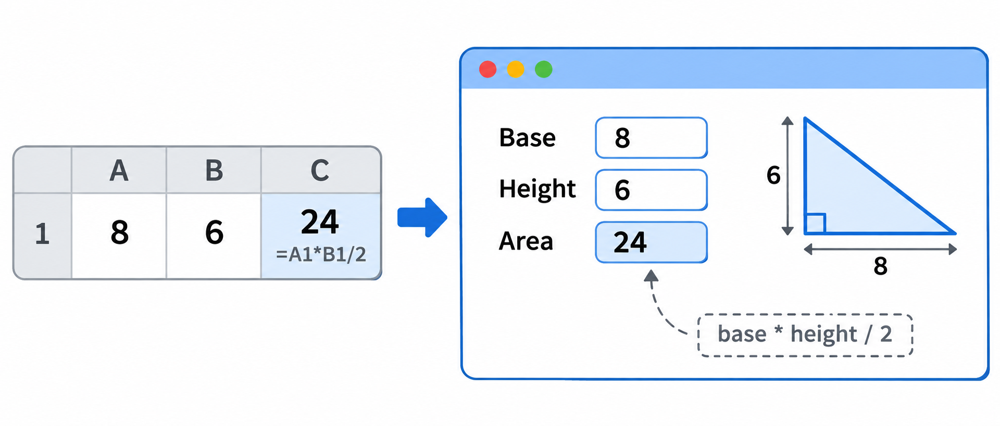
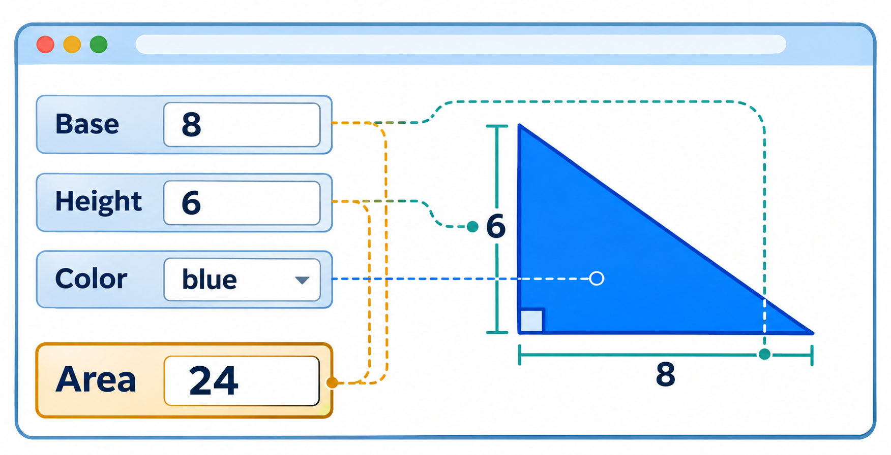
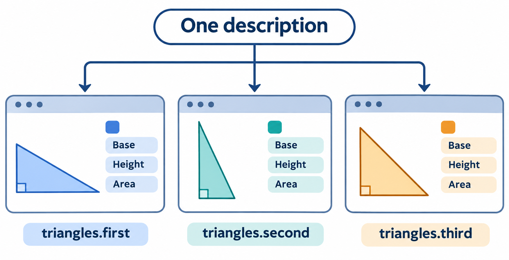

# Inside Gramlot

Document ID: **GC-017**.

<a id="gc-017-005"></a>

## 005 · Think of a page like a spreadsheet

In a spreadsheet, a cell can contain a formula. Change one of its inputs, and the result updates.

Gramlot brings a similar idea to web interfaces. You describe the interface, connect it to data and declare relationships between values.



In the spreadsheet, the result cell contains a formula. In Gramlot, a formula can be declared as part of the page. It is not a visible element, but its result can be displayed in the interface.

Let’s start with an even simpler relationship: two elements connected to the same value.

<a id="gc-017-010"></a>

## 010 · Connect an interface to Data

A Gramlot page has **Data**: the values the page works with.

Use `^` to connect an interface element to a Data value:

```python
root.input(value="^example.name", lbl="Name", lbl_position="L")
root.div("^example.name", lbl="Your name", lbl_variant="card",
         font_size="24px", text_align="center")
```

<iframe class="inside-example inside-name" src="https://gramlot-examples.readthedocs.io/en/latest/documentation/index.html" title="Try the name binding" loading="lazy"></iframe>

Both elements are connected to `example.name`.

The field lets the user enter a name. The card follows the same value and displays it. Change the name, and the card follows.

<a id="gc-017-015"></a>

## 015 · Calculate a value

A formula declares a value derived from other values. For example, the area of a triangle depends on its base and height:

```python
root.input(type="number", value="^triangle.base",
           lbl="Base", lbl_position="L", default=8)
root.input(type="number", value="^triangle.height",
           lbl="Height", lbl_position="L", default=6)

root.dataFormula(
    "triangle.area", "base * height / 2",
    base="^triangle.base", height="^triangle.height", _init=True,
)

root.div("^triangle.area", lbl="Area", lbl_variant="card",
         font_size="24px", text_align="center")
```

These inline formulas require a page Content Security Policy that permits inline expressions; see [Classes and hosts](090-classes-and-hosts.md#gc-090-035).

The formula calculates `triangle.area` from `triangle.base` and `triangle.height`. The card follows `triangle.area` and displays the result.

The fields start with 8 and 6, so the initial area is 24. The formula is declared once; Gramlot runs it initially and when an input changes.

<a id="gc-017-020"></a>

## 020 · Describe the interface

The calls to `root.input` and `root.div` create **Source**: the description of the page’s interface.

Source describes what the page contains. Data holds the values it works with. Bindings connect the two.

A page can contain HTML and SVG elements as well as Gramlot components. You describe how they fit together and connect them to the values they need.

<a id="gc-017-025"></a>

## 025 · Declare behavior

A **formula** calculates a value. A **controller** declares behavior to run in response to a change or an event.

Formulas and controllers are part of the page description, even though they are not visible elements.

If you know MVC, the separation is familiar: Data holds values, Source describes the interface, and formulas and controllers provide behavior. Bindings connect the interface to Data.

<a id="gc-017-030"></a>

## 030 · Draw the triangle

The same dimensions can also determine a drawing. Let’s add an SVG polygon.



First, add a field for the color:

```python
root.input(type="color", value="^triangle.color",
           lbl="Color", lbl_position="L", default="#3366cc")
```

Then describe the polygon. Here `panel` is the container used for the illustration:

```python
panel = root.div(class_="single-demo")
drawing = panel.svg(viewBox="-1 -1 12 12", role="img",
                    aria_label="Triangle", class_="single-svg")
drawing.polygon(
    points="^triangle.base:0,0 {},0 0,{height}",
    height="^triangle.height", fill="^triangle.color",
    transform="translate(0 10) scale(1 -1)",
)
```

<iframe class="inside-example inside-triangle" src="https://gramlot-examples.readthedocs.io/en/latest/documentation/triangle/index.html" title="Try one triangle" loading="lazy"></iframe>

The `points` template combines base and height into the three vertices required by SVG. The `fill` binding connects the color to Data too.

The same Data now controls both the **area** and the **appearance** of the triangle. A binding can connect an element’s visual attributes, not just the text it displays.

The fixed drawing area is suitable for dimensions between 0 and 10. The SVG transform places the right angle at the bottom left.

<a id="gc-017-035"></a>

## 035 · From one triangle to many

Suppose we want several triangles on the same page. Each needs its own dimensions, color, area and drawing.

Data is hierarchical, so we can give each triangle its own branch:

```text
triangles
├── first
│   ├── base
│   ├── height
│   ├── color
│   └── area
├── second
│   └── ...
└── third
    └── ...
```

We could repeat the interface for each branch. Instead, we can describe a triangle once and reuse it.

<a id="gc-017-040"></a>

## 040 · Give each triangle a context



A `datapath` establishes the Data context for a branch of the interface. Each call creates a triangle with its own dimensions and color:

```python
for name, base, height, color in examples:
    card = cards.section(class_="triangle-card")
    card.div(class_="window-bar").span("●  ●  ●")
    pane = card.div(
        datapath=f"triangles.{name}", class_="triangle-body"
    )
    triangle(pane, base, height, color)
    card.div(f"triangles.{name}", class_="path-label")
```

The page imports `triangle` from a separate Python module. Inside the function, paths beginning with `.` are relative to the context passed as `pane`. The complete files appear below.

For the first triangle, `^.base` refers to `triangles.first.base`. For the second, the same declaration refers to `triangles.second.base`.

<iframe class="inside-example inside-many" src="https://gramlot-examples.readthedocs.io/en/latest/documentation/many/index.html" title="Try three independent triangles" loading="lazy"></iframe>

The description is reused; the Data stays separate. Each triangle can have its own dimensions and color.

Source is hierarchical too: each triangle is a branch of the interface containing fields, a formula, a card and a drawing. Its `datapath` connects that branch to its own part of Data.

<a id="gc-017-045"></a>

## 045 · Reuse the triangle in another page

The example belongs to `gramlot-examples`. It has two Python files and a stylesheet. The Page imports the packaged function; the function receives the Source node whose `datapath` gives it a Data context.

### Page: `03-many.py`

```python
from gramlot import Page as BasePage
from gramlot_examples.documentation_gallery.triangle import triangle


class Page(BasePage):
    title = "Many triangles"

    def main(self, root):
        root.h2("One description", class_="demo-title")
        cards = root.div(class_="triangle-grid")

        examples = (
            ("first", 8, 4, "#417bda"),
            ("second", 4, 8, "#23a5a2"),
            ("third", 7, 7, "#ed9d2d"),
        )
        for name, base, height, color in examples:
            card = cards.section(class_="triangle-card")
            card.div(class_="window-bar").span("●  ●  ●")
            pane = card.div(
                datapath=f"triangles.{name}",
                class_="triangle-body",
            )
            triangle(pane, base, height, color)
            card.div(f"triangles.{name}", class_="path-label")
```

### Reusable block: `triangle.py`

```python
def triangle(pane, base, height, color):
    pane.input(type="number", value="^.base", lbl="Base", lbl_position="L",
               default=base, min=0, max=10, step=1)
    pane.input(type="number", value="^.height", lbl="Height", lbl_position="L",
               default=height, min=0, max=10, step=1)
    pane.input(type="color", value="^.color", lbl="Color", lbl_position="L", default=color)

    pane.dataFormula(
        ".area", "base * height / 2",
        base="^.base", height="^.height", _init=True,
    )
    pane.div("^.area", lbl="Area", lbl_variant="card", class_="result")

    drawing = pane.svg(viewBox="-1 -1 12 12", role="img",
                       aria_label="Triangle", class_="triangle-svg")
    drawing.polygon(
        points="^.base:0,0 {},0 0,{height}",
        height="^.height", fill="^.color",
        transform="translate(0 10) scale(1 -1)",
    )
```

A different page can import `triangle` and pass it a node in its own Data context. The function keeps the same relative bindings.

### Another page: `04-reuse.py`

```python
from gramlot import Page as BasePage
from gramlot_examples.documentation_gallery.triangle import triangle


class Page(BasePage):
    def main(self, root):
        pane = root.div(datapath="example", class_="triangle-body")
        triangle(pane, 8, 6, "#3366cc")
```

### Companion stylesheet

The example uses its [companion stylesheet](assets/inside/triangles.css), loaded alongside the Page.
