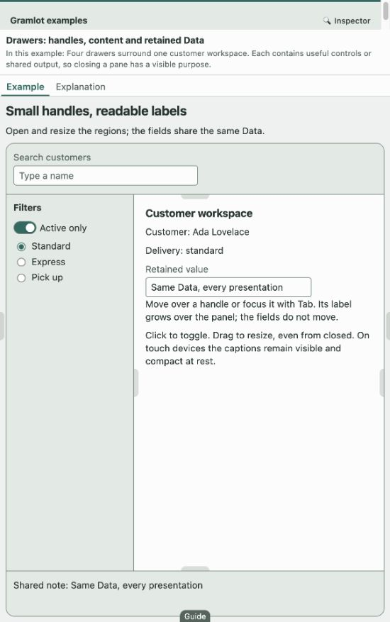
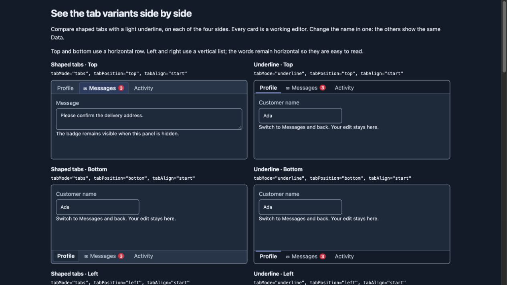
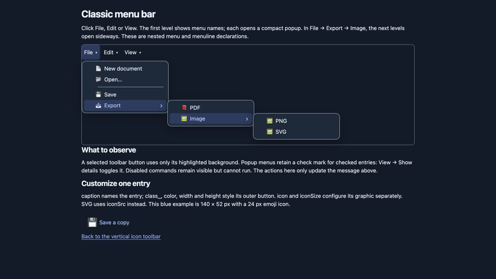
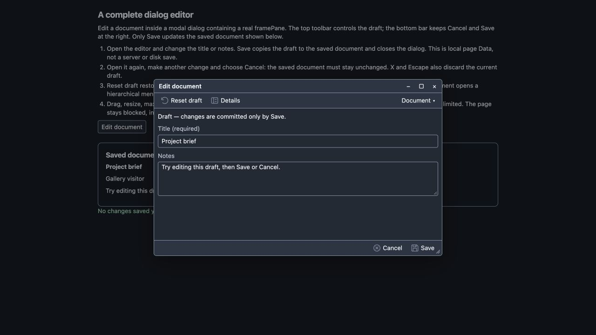
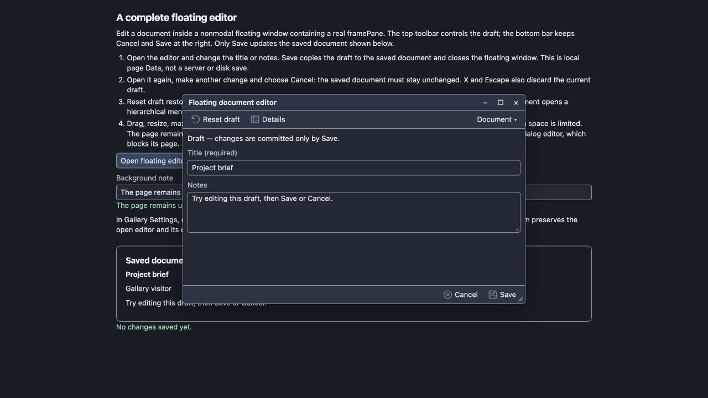
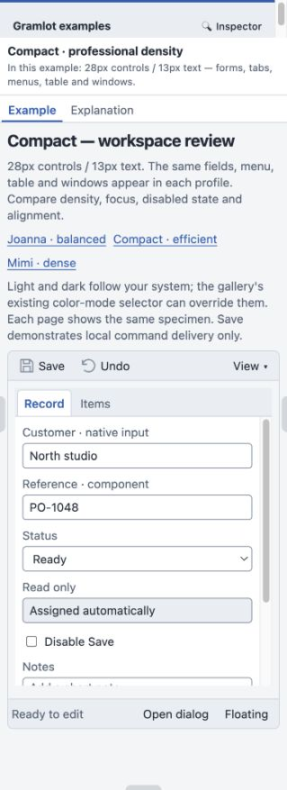
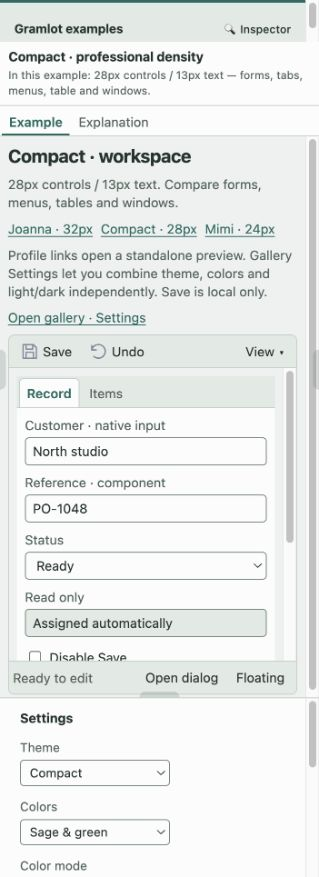
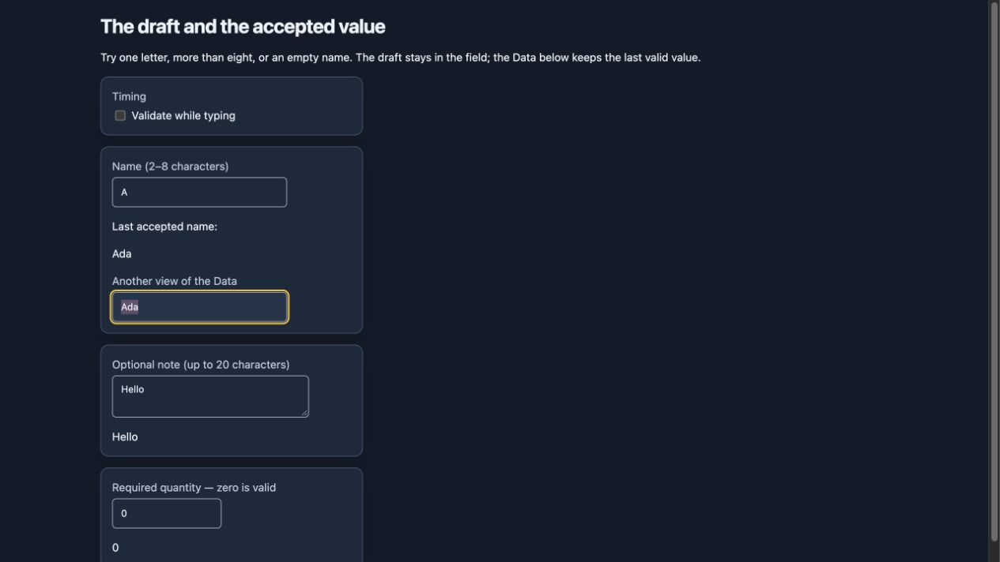
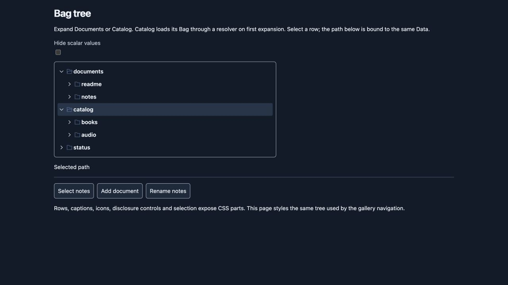
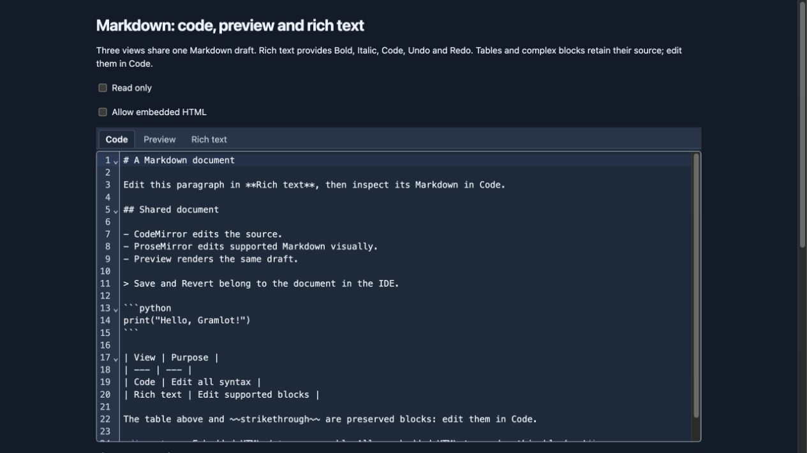

# Examples and visual tour

Document ID: **GC-355**.

## 005 · Read, run and inspect

The [example manual](https://gramlot-examples.readthedocs.io/en/latest/) contains
one page per catalogue lesson, complete Python/JavaScript source and an embedded
Gramlot playground. Open the playground in its own tab for more room. These are
real framework pages exported by the serverless package, not imitation HTML demos.
The embedded application is JavaScript; showing Python source does not mean the
Read the Docs host executes a Python server.

For Python endpoints, resolver round trips, filesystem tools and the development
menu/window chapters, use the Python gallery. The server adapter owns startup;
see [Try Gramlot](025-try.md). No public localhost URL is embedded in this manual.
The lesson catalogue below links to hosted pages; release availability can differ
from the development screenshots and trial chapters.

Use Gallery Settings to choose **Theme**, **Colors**, and **Color mode** separately.
Compact is a practical starting point; Mimi is denser and Joanna more spacious.
The Guide drawer is closed initially and can be opened from its visible handle.

## 010 · Forms, regions and panels

Try the four drawer handles, their labels and splitters. Enter a value, close its
region and reopen it: layout changes should preserve the Data. In nested layouts,
close or resize side regions when the central area becomes too narrow.

Tabs can be top, bottom, left or right. The label strip has independent start,
center and end alignment. A badge belongs to its tab even while the panel is hidden.

## 015 · Commands and editing windows

A toolbar exposes the first level of a menu. Submenus stay hierarchical, while
an overflow menu collects lower-priority units when the available space shrinks.

Both editors use a framePane. The dialog blocks the page; the floating editor
allows background interaction. The example commits only to local page Data;
it is not a database save tutorial.

## 020 · Density and color

Use [Themes and CSS](096-themes-and-css.md) for application CSS declarations,
semantic variables, field labels, touch sizing and accessibility considerations.
Screenshots show specific viewports and states; they complement the live examples.

An invalid draft stays local to its editor. Another view of the accepted Data
keeps its last valid value. This distinction matters when composing validation,
Save actions and shared fields.

The tree reads a Bag; disclosure, selection and lazy branches are separate from
application data editing. Its appearance follows the same theme variables.

Editors share the document value across views. Use the editing guide to distinguish
preserved Markdown blocks, rich-text editing, HTML sanitization and code options.

## 025 · Complete catalogue of hosted lessons

Each link opens its explanation, source and embedded playground in the example
manual. Follow the family order when learning; use the widget reference when
looking up a parameter.

### HTML / SVG

| Example | What to try |
| --- | --- |
| [Hello World](https://gramlot-examples.readthedocs.io/en/latest/lessons/html_svg/01-html_basics/01-hello_world.html) | A heading and a paragraph: the smallest Gramlot page. |
| [Text and links](https://gramlot-examples.readthedocs.io/en/latest/lessons/html_svg/01-html_basics/02-text_and_links.html) | Headings, inline text, quotations, code and links. |
| [Lists](https://gramlot-examples.readthedocs.io/en/latest/lessons/html_svg/01-html_basics/03-lists.html) | Ordered, unordered and nested lists, plus a glossary. |
| [Semantic page](https://gramlot-examples.readthedocs.io/en/latest/lessons/html_svg/01-html_basics/04-semantic_page.html) | A page composed from meaningful HTML landmarks. |
| [Tables](https://gramlot-examples.readthedocs.io/en/latest/lessons/html_svg/01-html_basics/05-tables.html) | A catalogue with headings, rows and totals. |
| [Forms](https://gramlot-examples.readthedocs.io/en/latest/lessons/html_svg/02-native_controls/01-forms.html) | Native fields, choices, buttons and a slider. |
| [Native disclosure](https://gramlot-examples.readthedocs.io/en/latest/lessons/html_svg/02-native_controls/02-native_disclosure.html) | Expandable questions and native progress indicators. |
| [SVG shapes](https://gramlot-examples.readthedocs.io/en/latest/lessons/html_svg/03-svg/01-svg_shapes.html) | The basic SVG vocabulary inside an HTML page. |
| [SVG composition](https://gramlot-examples.readthedocs.io/en/latest/lessons/html_svg/03-svg/02-svg_composition.html) | A scene assembled with groups, paths and repeated objects. |
| [Cards with icons](https://gramlot-examples.readthedocs.io/en/latest/lessons/html_svg/04-page_composition/01-cards_with_icons.html) | HTML cards with SVG icons and live Source removal. |
| [Static report](https://gramlot-examples.readthedocs.io/en/latest/lessons/html_svg/04-page_composition/02-static_report.html) | A summary, chart, legend and table from the same data. |
| [Complete page](https://gramlot-examples.readthedocs.io/en/latest/lessons/html_svg/04-page_composition/03-complete_page.html) | An event page with a programme, speakers, map and FAQ. |
| [Live Source playground](https://gramlot-examples.readthedocs.io/en/latest/lessons/html_svg/05-live_source.html) | Create, update and remove Source nodes, with a small SVG animation. |

### Binding

| Example | What to try |
| --- | --- |
| [Pointers](https://gramlot-examples.readthedocs.io/en/latest/lessons/binding/01-paths_and_updates/01-pointers.html) | Read Data with ^, =, relative, symbolic and ?attr pointers. |
| [Variable datapath](https://gramlot-examples.readthedocs.io/en/latest/lessons/binding/01-paths_and_updates/02-variable_datapath.html) | One card follows the record chosen in a select. |
| [Setters and defaults](https://gramlot-examples.readthedocs.io/en/latest/lessons/binding/01-paths_and_updates/03-setters_and_defaults.html) | dataSetter values and control defaults, all in place at the first render. |
| [Native editing](https://gramlot-examples.readthedocs.io/en/latest/lessons/binding/02-editing/01-native_editing.html) | Text, number, range, select, date and color fields bound both ways. |
| [Checkbox and radio](https://gramlot-examples.readthedocs.io/en/latest/lessons/binding/02-editing/02-checkbox_radio.html) | Booleans in the Data, one per checkbox and radio button. |
| [Style and visibility](https://gramlot-examples.readthedocs.io/en/latest/lessons/binding/03-presentation/01-style_and_visibility.html) | visible, class, style and reactive style shortcuts. |
| [Bound SVG](https://gramlot-examples.readthedocs.io/en/latest/lessons/binding/03-presentation/02-bound_svg.html) | SVG geometry and paint follow range and color fields. |
| [Freeze](https://gramlot-examples.readthedocs.io/en/latest/lessons/binding/01-paths_and_updates/04-freeze.html) | Freeze structural rendering while Data keeps updating; increment a counter, remove Source items, then thaw. |
| [Forms with binding](https://gramlot-examples.readthedocs.io/en/latest/lessons/binding/02-editing/03-forms.html) | The native form of example 06, bound to a record. |
| [SVG shapes with binding](https://gramlot-examples.readthedocs.io/en/latest/lessons/binding/03-presentation/03-svg_shapes.html) | The six shapes of example 08, resized and recolored by controls. |
| [Complete page with binding](https://gramlot-examples.readthedocs.io/en/latest/lessons/binding/04-complete_page.html) | The event page of example 12, with a bound heading, filter and map. |

### Controllers

| Example | What to try |
| --- | --- |
| [Formula](https://gramlot-examples.readthedocs.io/en/latest/lessons/controllers/01-logic/01-formula.html) | dataFormula computes a result path from its parameters. |
| [Controller](https://gramlot-examples.readthedocs.io/en/latest/lessons/controllers/01-logic/02-controller.html) | dataController reacts to Data, to a fired path and to time. |
| [Named logic](https://gramlot-examples.readthedocs.io/en/latest/lessons/controllers/01-logic/03-named_logic.html) | Formula and controller bodies in class Logic of 03_named_logic.js. |
| [Inline expressions](https://gramlot-examples.readthedocs.io/en/latest/lessons/controllers/01-logic/04-inline_expressions.html) | == expressions in text and attributes, and inline scripts. |
| [Node methods](https://gramlot-examples.readthedocs.io/en/latest/lessons/controllers/01-logic/05-node_methods.html) | SET, GET, PUT, FIRE and FIRE_AFTER from button actions. |
| [Button controller](https://gramlot-examples.readthedocs.io/en/latest/lessons/controllers/02-actions/01-button_controller.html) | A button with a nested controller, click counter, modifiers and fire. |
| [Events](https://gramlot-examples.readthedocs.io/en/latest/lessons/controllers/03-events/01-events.html) | connect_on<event> attributes for click, input, key and pointer events. |
| [End-to-end story](https://gramlot-examples.readthedocs.io/en/latest/lessons/controllers/04-complete_examples/01-end_to_end.html) | First the local 0.2.0 story; return after the endpoint lessons for a separate 0.2.14 quote, error and recovery step. |
| [Lifecycle](https://gramlot-examples.readthedocs.io/en/latest/lessons/controllers/03-events/02-lifecycle.html) | Core 0.2.0: observe hook order, freeze, removal and Source/DOM lookup. |
| [Attribute projection](https://gramlot-examples.readthedocs.io/en/latest/lessons/controllers/03-events/03-attribute_projection.html) | Core 0.2.0 templates/masks, then the 0.2.3 sandboxed Data preview. |
| [Data exchange](https://gramlot-examples.readthedocs.io/en/latest/lessons/controllers/05-data_exchange.html) | Core 0.2.5: save/restore typed Data and export JSON/XML; current utility path from 0.2.10. |
| [Endpoint](https://gramlot-examples.readthedocs.io/en/latest/lessons/controllers/06-server_calls/01-endpoint.html) | dataRpc calls an endpoint of the page and writes the value at its result path. |
| [Call on change](https://gramlot-examples.readthedocs.io/en/latest/lessons/controllers/06-server_calls/02-call_on_change.html) | dataRpc follows a ^ argument, with _delay, _onCalling and _onResult. |
| [Call on click](https://gramlot-examples.readthedocs.io/en/latest/lessons/controllers/06-server_calls/03-call_on_click.html) | A dataRpc nested in a button, with _onError for a failing and a protected endpoint. |
| [Remote](https://gramlot-examples.readthedocs.io/en/latest/lessons/controllers/07-remote_data/01-remote.html) | remote makes the content of an element a fragment built by the server. |
| [Cached remote](https://gramlot-examples.readthedocs.io/en/latest/lessons/controllers/07-remote_data/02-cached_remote.html) | Revisit remote with a last-result cache; distinguish mounted fragments from observed calls. |
| [Data remote](https://gramlot-examples.readthedocs.io/en/latest/lessons/controllers/07-remote_data/03-data_remote.html) | Revisit endpoint values with lazy Data; compare a bound read, an explicit snapshot and cache expiry. |
| [Publish and subscribe](https://gramlot-examples.readthedocs.io/en/latest/lessons/controllers/03-events/04-publish_subscribe.html) | Core 0.2.18: revisit button actions with page topics, self receivers, references and native ask. |
| [Parent and child messages](https://gramlot-examples.readthedocs.io/en/latest/lessons/controllers/03-events/05-frame_messages.html) | Core 0.2.18: local-first publish and direct parent/child postMessage exchange. |
| [Actions, confirmations and references](https://gramlot-examples.readthedocs.io/en/latest/lessons/controllers/02-actions/02-actions_ask_references.html) | Core 0.2.18: action, conditional ask and explicit Source/DOM references. |
| [Plain and delayed buttons](https://gramlot-examples.readthedocs.io/en/latest/lessons/controllers/02-actions/03-plain_and_delayed_buttons.html) | Core 0.2.19: native html_button and grouped clicks with _delay. |
| [Pointer templates and expressions](https://gramlot-examples.readthedocs.io/en/latest/lessons/controllers/01-logic/06-pointer_transforms.html) | Core 0.2.20: revisit CSS lengths, boolean state and formatted text with attribute pointer transforms. |
| [Plan your stay](https://gramlot-examples.readthedocs.io/en/latest/lessons/controllers/04-complete_examples/02-room_estimate.html) | Room, guests and nights drive seven chained formulas, validation and a click summary. |

### Input components

| Example | What to try |
| --- | --- |
| [Textbox and labelbox](https://gramlot-examples.readthedocs.io/en/latest/lessons/components/01-text/01-textbox.html) | Two textboxes share a customer name. Type in either one, switch live editing off and on, and move the label without rebuilding the field. |
| [Checkbox and labelbox](https://gramlot-examples.readthedocs.io/en/latest/lessons/components/02-checks_and_switches/01-checkbox.html) | Two checkboxes share one boolean preference. Click either caption, then disable both using the State checkbox. |
| [RadioButtonText and labelbox](https://gramlot-examples.readthedocs.io/en/latest/lessons/components/03-selection/01-radio_button_text.html) | Choose one delivery option in each group. Change the column count and label position, and try the arrow keys inside a group. |
| [Multiline text and labelbox](https://gramlot-examples.readthedocs.io/en/latest/lessons/components/01-text/02-text_box_area.html) | Two multiline fields share one note. Switch live editing and move the label while keeping the text and selection. |
| [Password and labelbox](https://gramlot-examples.readthedocs.io/en/latest/lessons/components/01-text/03-passwordbox.html) | Two password fields share a sample value. The browser masks the characters; changing either field updates the other. |
| [Single radio buttons](https://gramlot-examples.readthedocs.io/en/latest/lessons/components/03-selection/02-radio_button.html) | Each radio binds its own boolean. A shared group makes the choices exclusive; a separate group stays independent. |
| [Color and labelbox](https://gramlot-examples.readthedocs.io/en/latest/lessons/components/04-colorpicker.html) | Choose a color in either picker. Both controls and the swatch follow the same Data value. |
| [Horizontal slider](https://gramlot-examples.readthedocs.io/en/latest/lessons/components/05-numbers_and_sliders/01-horizontal_slider.html) | Two horizontal sliders share a numeric level. Drag or use the arrow keys; switch live editing to compare immediate and committed updates. |
| [Vertical slider](https://gramlot-examples.readthedocs.io/en/latest/lessons/components/05-numbers_and_sliders/02-vertical_slider.html) | Vertical and horizontal sliders share the same level. The vertical minimum is at the bottom and the maximum at the top. |
| [Number editing](https://gramlot-examples.readthedocs.io/en/latest/lessons/components/05-numbers_and_sliders/03-number_textbox.html) | Try a comma decimal, an integer and an exact Decimal. Invalid text stays in the field without changing Data. |
| [Date editing](https://gramlot-examples.readthedocs.io/en/latest/lessons/components/06-dates_and_times/01-date_textbox.html) | Enter a calendar date or a word such as oggi or domani. Two fields share one civil date. |
| [Time editing](https://gramlot-examples.readthedocs.io/en/latest/lessons/components/06-dates_and_times/02-time_textbox.html) | Edit a civil time with hours, minutes and optional seconds. The two fields keep the same typed value. |
| [Filtering select](https://gramlot-examples.readthedocs.io/en/latest/lessons/components/03-selection/03-filtering_select.html) | Search a caption, store its code. Two fields share the same choice and the same list. |
| [Callback select](https://gramlot-examples.readthedocs.io/en/latest/lessons/components/03-selection/04-callback_select.html) | Search 100 random samples generated once in this page. The callback reads a Data Bag, without a server request. |
| [Combo box](https://gramlot-examples.readthedocs.io/en/latest/lessons/components/03-selection/05-combo_box.html) | Choose a suggested city or enter a different one. Two fields share the same text; suggestions do not restrict what you can write. |
| [Checkbox group](https://gramlot-examples.readthedocs.io/en/latest/lessons/components/02-checks_and_switches/02-checkbox_text.html) | Choose several notification channels. Two groups share the same comma-separated codes; clearing all choices writes null. |
| [Date calendar](https://gramlot-examples.readthedocs.io/en/latest/lessons/components/06-dates_and_times/03-date_calendar.html) | Pick a day or type a date. The inline calendar, popup and text-only field share the same Data value. |
| [Required values and length](https://gramlot-examples.readthedocs.io/en/latest/lessons/components/07-forms_and_validation/01-validation.html) | Invalid drafts remain visible with a message while Data keeps the last accepted value. |
| [Formlet and shared labels](https://gramlot-examples.readthedocs.io/en/latest/lessons/components/07-forms_and_validation/02-formlet.html) | Arrange fields in columns and share label settings. Changing the layout preserves each field and its draft. |
| [GroupBox and typed copy](https://gramlot-examples.readthedocs.io/en/latest/lessons/components/07-forms_and_validation/03-group_box.html) | Group customer data under a heading. Copy TYTX with its types or choose plain JSON from the copy menu. |
| [Checkbox as a switch](https://gramlot-examples.readthedocs.io/en/latest/lessons/components/02-checks_and_switches/03-switch.html) | A switch and a checkbox share one boolean. Compare their appearance, captions and read-only state. |
| [Button commands](https://gramlot-examples.readthedocs.io/en/latest/lessons/components/08-buttons/01-button.html) | Compare the Gramlot command button with plain HTML. Try confirmation and a delayed command. |
| [Toggle button with LED](https://gramlot-examples.readthedocs.io/en/latest/lessons/components/08-buttons/02-toggle_button.html) | A command button and a checkbox share a boolean. The LED and aria-pressed follow Data. |
| [Dropdown commands and persistence](https://gramlot-examples.readthedocs.io/en/latest/lessons/components/08-buttons/03-dropdown_button.html) | The main surface executes; the arrow opens the menu. Shift-select a command to run it and make it the default. |
| [Validation rules and callbacks](https://gramlot-examples.readthedocs.io/en/latest/lessons/components/07-forms_and_validation/04-validation_engine.html) | Transformations, conditions, warnings, local callbacks and remote validation. |
| [Bag tree](https://gramlot-examples.readthedocs.io/en/latest/lessons/components/09-tree/01-basics.html) | A Bag-backed tree with icons, CSS parts, live captions, selection and a lazy Catalog branch. |
| [Tree labels and classes](https://gramlot-examples.readthedocs.io/en/latest/lessons/components/09-tree/02-labels_and_classes.html) | Use caption attributes and separate open, closed, selected and node classes. |
| [Tree callbacks, HTML and icons](https://gramlot-examples.readthedocs.io/en/latest/lessons/components/09-tree/03-callbacks_and_icons.html) | Use named Logic for computed labels, explicit sanitized HTML and custom icons. |
| [Internal tree drag and drop](https://gramlot-examples.readthedocs.io/en/latest/lessons/components/09-tree/04-internal_drag.html) | Copy documents between two Bag trees, reject locked folders and observe browser gesture completion. |
| [CodeMirror](https://gramlot-examples.readthedocs.io/en/latest/lessons/components/10-code_editors/01-base.html) | A live CodeMirror editor bound to Data. |
| [CodeMirror with options](https://gramlot-examples.readthedocs.io/en/latest/lessons/components/10-code_editors/02-options.html) | A live CodeMirror editor bound to Data. |
| [HTML: code, preview and Jodit](https://gramlot-examples.readthedocs.io/en/latest/lessons/components/10-code_editors/03-html.html) | Edit and preview one HTML document with CodeMirror and Jodit. |
| [Markdown: code, preview and rich text](https://gramlot-examples.readthedocs.io/en/latest/lessons/components/10-code_editors/04-markdown.html) | Edit and preview one Markdown document with CodeMirror and ProseMirror. |
| [Typst: editor, preview and PDF](https://gramlot-examples.readthedocs.io/en/latest/lessons/components/10-code_editors/05-typst.html) | Compile a Typst draft to SVG and PDF in the browser, also offline. |

### Containers

| Example | What to try |
| --- | --- |
| [Border regions and splitters](https://gramlot-examples.readthedocs.io/en/latest/lessons/layout/01-border/01-border.html) | A customer workspace divided into a header, filters, an editor and a live summary. The center uses the space left by the other regions. |
| [Nested borders and layout designs](https://gramlot-examples.readthedocs.io/en/latest/lessons/layout/01-border/02-nested.html) | An outer workspace contains another independent borderContainer. This separates application navigation from the editor and its output. |
| [Rounded borders and popups](https://gramlot-examples.readthedocs.io/en/latest/lessons/layout/01-border/03-rounded.html) | Two nested containers share a reactive corner radius, while date and choice popups open inside the editor. |
| [Drawers: handles, content and retained Data](https://gramlot-examples.readthedocs.io/en/latest/lessons/layout/01-border/04-drawer_handles.html) | Four drawers surround one customer workspace. Each contains useful controls or shared output, so closing a pane has a visible purpose. |
| [Nested regions playground](https://gramlot-examples.readthedocs.io/en/latest/lessons/layout/01-border/05-nested_lab.html) | A small application workspace built from five nested containers. Size controls let you inspect several levels of layout while real widgets keep working. |
| [Border events and controllers](https://gramlot-examples.readthedocs.io/en/latest/lessons/layout/01-border/06-border_events.html) | The example makes container notifications visible as counters and payloads, using ordinary dataController subscriptions. |
| [Tabs, selection and closing](https://gramlot-examples.readthedocs.io/en/latest/lessons/layout/02-tabs.html) | Compare fourteen working tab presentations: styles on four sides, horizontal and vertical alignment, then selection, icons, badges and closing. |
| [Demo carousel and live preview](https://gramlot-examples.readthedocs.io/en/latest/lessons/layout/03-stack.html) | The left drawer browses every other demo as a miniature; the center lets you try the chosen demo at its normal size. |

## 030 · Python development chapters

These chapters are in the development gallery's **Menus, toolbars and framePane**
section. They are Python-first trials, with browser Logic where necessary. They
are not silently advertised as already-exported hosted playgrounds. Open their
source and explanation in the gallery; read the common contract in
[Menus, toolbars, frames and windows](350-menus-toolbars-and-windows.md).

| Chapter | What to try |
| --- | --- |
| [One menu: popup, horizontal, vertical and contextual](https://github.com/gramlot-org/gramlot-examples/blob/develop/src/gramlot_examples/trials/menu/pages/menu/02_popup.py) | One hierarchy with icons, separators, checked and disabled, reused in four presentations plus exact opening modifiers. |
| [Toolbar: groups, priority and overflow](https://github.com/gramlot-org/gramlot-examples/blob/develop/src/gramlot_examples/trials/menu/pages/menu/03_toolbar.py) | Compact toolbar, retained search, indivisible groups, priority overflow and scrolling. |
| [Vertical icon toolbar](https://github.com/gramlot-org/gramlot-examples/blob/develop/src/gramlot_examples/trials/menu/pages/menu/07_vertical_toolbar.py) | Large icons, tooltip, selected state, separators and priority overflow in a narrow rail. |
| [Classic menu bar and hierarchy](https://github.com/gramlot-org/gramlot-examples/blob/develop/src/gramlot_examples/trials/menu/pages/menu/08_menu_bar.py) | Named top-level menus, nested side-opening submenus, checked and disabled entries. |
| [Reactive menu states](https://github.com/gramlot-org/gramlot-examples/blob/develop/src/gramlot_examples/trials/menu/pages/menu/04_live_states.py) | Shared checked, disabled and hidden bindings in popup and toolbar. |
| [FramePane: regions and recipient](https://github.com/gramlot-org/gramlot-examples/blob/develop/src/gramlot_examples/trials/menu/pages/menu/05_frame_pane.py) | Five regions, multiple bars, five-field messages and nested frame isolation. |
| [Resolver menus and nested Bags](https://github.com/gramlot-org/gramlot-examples/blob/develop/src/gramlot_examples/trials/menu/pages/menu/06_resolver.py) | Direct resolver, nested Bags, lazy submenus, live states, empty results and retry. |
| [Complete document workspace](https://github.com/gramlot-org/gramlot-examples/blob/develop/src/gramlot_examples/trials/menu/pages/menu/01_menu_trial.py) | Popup and toolbar together, central content, bindings, remote export, confirmation and delay. |
| [FramePane, dialog and floating](https://github.com/gramlot-org/gramlot-examples/blob/develop/src/gramlot_examples/trials/menu/pages/menu/09_windows.py) | Modal and nonmodal windows around a retained frame, with movement, resize and collapse. |
| [Complete dialog editor: Save and Cancel](https://github.com/gramlot-org/gramlot-examples/blob/develop/src/gramlot_examples/trials/menu/pages/menu/10_dialog_editor.py) | A modal framePane with a top toolbar, editable draft and bottom Save/Cancel actions. |
| [Joanna · professional density](https://github.com/gramlot-org/gramlot-examples/blob/develop/src/gramlot_examples/trials/menu/pages/menu/11_joanna.py) | 32px controls / 14px text — forms, tabs, menus, table and windows. |
| [Compact · professional density](https://github.com/gramlot-org/gramlot-examples/blob/develop/src/gramlot_examples/trials/menu/pages/menu/12_compact.py) | 28px controls / 13px text — forms, tabs, menus, table and windows. |
| [Mimi · professional density](https://github.com/gramlot-org/gramlot-examples/blob/develop/src/gramlot_examples/trials/menu/pages/menu/13_mimi.py) | 24px controls / 12.5px text — forms, tabs, menus, table and windows. |
| [Complete floating editor: Save and Cancel](https://github.com/gramlot-org/gramlot-examples/blob/develop/src/gramlot_examples/trials/menu/pages/menu/14_floating_editor.py) | The same editor in a nonmodal floating window, with top toolbar, fields and bottom Save/Cancel. |
